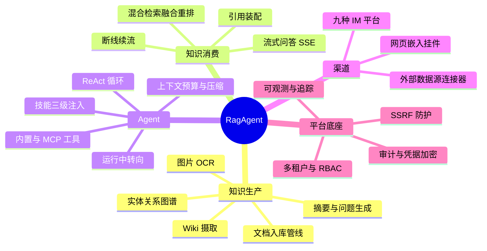

# 1. 项目总览

RagAgent 是一个把"企业级 RAG + Agent"工程化落地为**可自托管平台**的参考实现：文档摄取、知识库问答、Wiki 协作、Agent 工具编排、IM / 网页嵌入多渠道接入与 MCP 生态，后端是一套 Java 服务，前端是一套 Web 控制台。

贯穿全项目的三条工程理念：

> **边界在编译期强制**：七个 Maven 模块依赖单向，跨模块只认 `:contract` 里的纯 JDK 契约与端口——越界依赖无法编译，模块之间不"互相 import"。
>
> **文档与代码同频**：架构文档由脚本从代码生成（包索引 / Port 对照 / 管线事件表 / 路由权限表），README 里的可验证数字由守卫核对；改代码不改文档会直接红。
>
> **事实先于叙事**：AI 输出不确定，测试只保"工程正确性"；数量、类名、配置键一律以代码为准，历史过程记录与当前事实文档严格分离。

能力域一览：

---

[返回目录](详细技术文档.md) ｜ [下一章：2. 技术栈原理与优缺点](02-技术栈原理与优缺点.md)
