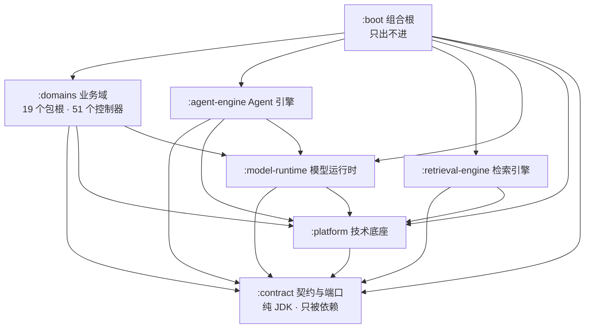
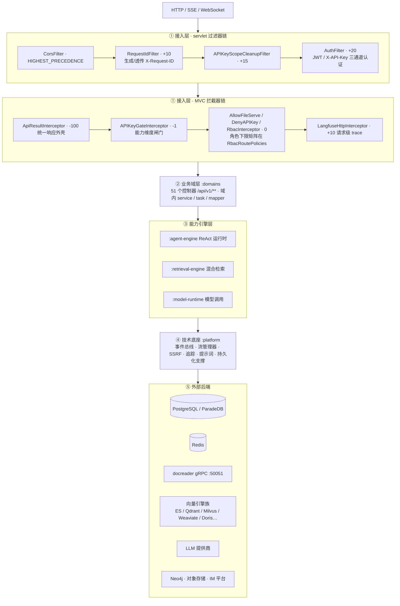

# 3. 整体架构

## 3.0 工程模块与交付物

仓库是一个 7 模块的 Maven 多模块工程（根 `ragagent-parent`，Java 21 / Spring Boot 3.3），模块按"契约 → 底座 → 引擎 → 域 → 组合根"单向分层：

| 模块 | 职责 | 主码包根 | 包数 | Java 文件 | 控制器 |
|---|---|---|---:|---:|---:|
| `:contract` | 契约与端口：跨模块接口、视图、事件、错误码。纯 JDK，零生产依赖 | `com.ragagent.contract` | 33 | 331 | 0 |
| `:platform` | 技术底座：事件总线、流管理器、SSRF、追踪、提示词、持久化支撑、Web 壳 | `com.ragagent.platform` | 26 | 202 | 1（`HealthController`，另有 3 个 `@RestControllerAdvice`） |
| `:model-runtime` | 模型运行时：LLM / Embedding / Rerank / ASR / 实体抽取的 provider 适配与并发闸门 | `embedding`、`llm`、`modelcontext`、`modelruntime`、`rerank`（5 个根） | 20 | 158 | 0 |
| `:retrieval-engine` | 检索引擎：混合检索、索引引擎注册表、各向量引擎实现、图（Neo4j） | `com.ragagent.retrieval` | 15 | 95 | 0 |
| `:agent-engine` | Agent 引擎：ReAct 运行时、工具注册表、技能目录、预算与压缩 | `com.ragagent.agent` | 9 | 72 | 0 |
| `:domains` | 业务域：19 个包根（会话、知识库、模型、存储、认证、IM、MCP、Wiki…），HTTP 面全在此 | 19 个业务域包根 | 252 | 1642 | 51 |
| `:boot` | 组合根：`RagAgentApplication` + 全局装配，跨模块 Bean 的唯一集中地 | `com.ragagent`（根包）+ `com.ragagent.config` | 2 | 19 | 0（仅 1 个 `@Controller`：`ScalarUi` 文档页） |

合计 357 个包 / 2519 个主码 Java 文件；每个包都有 `package-info.java` 说明职责。

编译期依赖方向（`scripts/check-module-graph.py` 的 `ALLOWED_MAIN` 矩阵，pom 以 compile scope 落实）：

> **只出不进**：`:boot` 依赖全部 6 个模块，没有任何模块反过来依赖它——所有跨模块 Bean 在 `com.ragagent.config` 装配（见 [§3.2](03-整体架构.md)）。`domains` 对 `:agent-engine` 只有 `test-jar` 作用域的测试依赖（复用录制夹具），主码边不存在；该矩阵由 `scripts/check-module-graph.py` 棘轮强制（新增边即红），另有 ArchUnit 测试 `ContractBoundaryRulesTest` 里的"模块 DAG 方向""platform / retrieval / modelruntime 面不得反向依赖业务域"三条零容忍规则兜底。

Maven 之外的交付物：

| 交付物 | 内容 |
|---|---|
| `frontend/` | Vue 3 + Vite 控制台（独立 nginx 容器交付，见 `frontend/Dockerfile`），经 HTTP/SSE 与后端通信 |
| `docreader/` | 仅 `docreader.proto`——文档解析的 gRPC 契约（`DocReader` 服务：`Read` / `ReadStream` / `ListEngines`）。解析服务本身不在本仓，以容器 `wechatopenai/weknora-docreader:latest` 运行（见 `docker-compose.yml`） |
| `otlp-proto/` | OpenTelemetry 的 4 份 proto（`resource` / `trace` / `common` / `trace_service`），供 `:platform` 追踪面做 OTLP 导出 |
| `mcp-server/` | 独立 Python 交付物：把 RagAgent 能力暴露为 MCP 服务的服务端，与 Java 主服务零编译依赖 |
| `migrations/` | Flyway 版本化 SQL（`migrations/versioned/`，`V1__baseline.sql` 起 3 个文件），由 `:boot` 启动时执行 |
| `deploy/` | 生产镜像与编排：`Dockerfile.app` / `Dockerfile.ui` / `Dockerfile.ocr`、`build-images.sh`、`docker-compose.prod.yml`、`env.prod.example`、`builtin_models.yaml.example`（见 [§28](28-部署基线.md)） |
| `scripts/` | dev 起服脚本（`dev-env.sh`、`java-server-up.sh`）、CI 冒烟（`ci-smoke.sh`）与 40+ 个"当前事实"守卫脚本（见 [§24](24-测试体系与质量门禁.md)） |

## 3.1 运行时分层

自上而下五层。接入层的真实顺序来自 `boot` 的 `WebConfig`（过滤器按 `FilterRegistrationBean` 的 order，拦截器按 `order()`，数字小者先执行）：

一次知识问答请求自上而下穿过五层：先经 CORS 与 `RequestIdFilter` 拿到请求 ID，`AuthFilter` 完成 JWT / API Key 认证并把租户上下文放进 `TenantContext`；随后拦截器链给 `@ApiResult` 路由打上统一响应外壳、按 API Key 作用域与 RBAC 角色矩阵做两级门禁、注册 Langfuse 追踪。进入 `:domains` 后由会话域控制器受理，域内服务把"检索"委托给 `:retrieval-engine` 的 `HybridSearchPort`、"模型调用"委托给 `:model-runtime`、"Agent 循环"委托给 `:agent-engine`；三者都只消费 `:contract` 端口与 `:platform` 底座（SSE 流管理器、事件总线、SSRF 出站防护、追踪），最终落到 PostgreSQL / Redis / docreader / 向量引擎 / LLM 提供商等外部后端。任何一层被门禁拒绝（401/403）都不会触达业务域，被拒请求不产生 Langfuse trace（拦截器排在认证下游）。

## 3.2 编译期边界与装配

**契约层纯 JDK。** `:contract` 的生产依赖为空（pom 无非 test 作用域依赖），只允许 `java.` / `javax.` / `com.ragagent.` 三种导入根，且不得出现 Spring/MyBatis 注解。这条线由两道守卫共同把守：脚本 `scripts/check-contract-purity.py`（导入根、构建依赖、框架形状三条硬判据，不做棘轮）与 ArchUnit 规则"`com.ragagent.contract` 只依赖 JDK 与自身"（`ContractBoundaryRulesTest`）。端口下沉的总量：`contract` 主码共 41 个以 `Port` 为后缀的接口，按 `scripts/gen-port-map.py` 生成的 `docs/architecture/port-map.md` 分类为域间（解耦）22、复合面（随复合端口）7、跨模块（必要）12；`ArchitectureRulesTest` 还有一条"每个契约端口恰有一个域侧实现"的装配规则（多实现即红）。

**组合根与装配点。** 跨模块 Bean 的装配权集中在 `:boot` 的 `com.ragagent.config`，但装配点一共 23 个 `@Configuration` 类，在 `scripts/wiring-points.baseline.json` 登记为三类，由 `scripts/check-wiring-points.py` 强制"新增即红"（每个 `@Configuration` 类必须登记并写明理由，文档侧 `docs/architecture/overview.md` 同步对齐）：

| 分类 | 数量 | 位置 | 代表 |
|---|---:|---|---|
| composition-root | 8 | `:boot` 的 `com.ragagent.config` | `WebConfig`、`RuntimeSnapshotWiring`、`RetrievalEngineWiringConfig`、`ImAdapterWiringConfig`、`MybatisPlusConfig` |
| domain-internal | 11 | `:domains` 域内 | `QaWiring`（问答管线 17 个插件类）、`McpWiring`、`KnowledgeProcessWiring`、各域 `*RedisWiring` |
| module-internal | 4 | 能力模块 | `StreamManagerConfig`、`LlmTransportWiring`、`LangfuseWiring`（`:platform`）、`Neo4jGraphConfig`（`:retrieval-engine`） |

**Bean 的发现靠根包组件扫描。** `RagAgentApplication` 位于根包 `com.ragagent`，Spring Boot 默认组件扫描覆盖 `com.ragagent.**`——这正好扫进 `:agent-engine` 的 `com.ragagent.agent`、`:retrieval-engine` 的 `com.ragagent.retrieval`、`:model-runtime` 的五个包根。也就是说，各能力模块的 `@Component` / `@Service`（如 `AgentEngineFactoryImpl`、`SkillCatalogService`、`HybridSearchService`）**没有任何显式 `@ComponentScan` 声明**，纯靠"模块不同、包名同根"被扫到；MyBatis Mapper 则由 `@MapperScan("com.ragagent.**.mapper")` 单独收口。

> **反直觉**：模块边界是 Maven 的，运行时 Bean 图却是按 Java 包名扫出来的。所以"新模块加 Bean"不需要在 `:boot` 注册扫描，但**包根一旦挪出 `com.ragagent` 之下，Bean 会静默消失**。

**`@ConfigurationPropertiesScan` 白名单。** 属性绑定不走根包全扫，而是白名单 10 个包（`com.ragagent.config`、`com.ragagent.platform.settings`、`platform.config`、`platform.security`、`platform.storage.config`、`platform.stream`、`platform.tracing.langfuse`、`storage.config`、`knowledge.config`、`auth.config`、`retrieval.graph`，以 `RagAgentApplication` 注解为准）。新增 `@ConfigurationProperties` 类若落在白名单之外的包，**不会报错、只会静默不生效**——`ArchitectureRulesTest` 用两条规则守住："属性类必须落在扫描名单覆盖的包内"与"属性类不得同时是 `@Component`（避免双装配）"。

**模块依赖矩阵的强制者。** 三层：① `scripts/check-module-graph.py`（按源集解析 import，主码边必须 ⊆ `ALLOWED_MAIN`，测试边必须 ⊆ 矩阵 ∪ `ALLOWED_TEST_EXTRA`，且禁止跨模块 split package 与同 FQN 重复类）；② ArchUnit 面级规则（`boot/src/test/java/com/ragagent/arch/ContractBoundaryRulesTest.java`：契约面纯 JDK、模块 DAG 方向、platform / retrieval / modelruntime 面不得反向依赖业务域与工具实现面）；③ `scripts/check-package-cycles.py` 等包级守卫。测试体系与质量门禁详见 [§24](24-测试体系与质量门禁.md)。

---

## 3.3 19 个业务域速览

`domains` 模块按目录划出 19 个业务域，每个域一个根包、一份 `package-info.java`。能力种类登记在
`scripts/capability-kinds.json`（新增/删除域必须同步该文件，`gen-domain-index.py --check` 校验），
"对外契约面"按 `gen-domain-index.py` 的口径统计：`contract` 模块中 `*Port` / `*Gateway` 接口里被本域
`implements` 的集合。控制器数按 `find domains -name "*Controller.java"` 逐域核实（合计 51 个）。

| 域 | 能力种类 | 控制器 | 职责一句话 | 关键入口类 | 对外契约面 |
|---|---|---:|---|---|---|
| `knowledge` | 产品能力 | 8 | 知识的存储、处理管线（分块→向量化→富化）与检索面，FAQ 独立子链路 | `KnowledgeBaseController`、`KnowledgeController`、`ChunkController` | 13（`KnowledgeCatalogPort`、`KnowledgeSpanPort`、`KnowledgeBaseGateway` 等） |
| `session` | 产品能力 | 8 | 会话与消息读写、两条问答入口、SSE 流桥、附件与会话侧管线 | `SessionController`、`KnowledgeQaController`、`SessionStreamController` | 3（`SessionQaPort`、`EmbedSessionPort`、`MessageTranscriptPort`） |
| `wiki` | 产品能力 | 1 | 知识库内联百科：页面/修订/文件夹树/链接图/摄取管线 | `WikiPageController` | 1（`WikiPageOpsPort`） |
| `memory` | 产品能力 | 1 | 长期记忆的抽取、去重合并、检索与生命周期（租约、墓碑、容量） | `MemoryController` | — |
| `agenttools` | 产品能力 | 0 | Agent 工具实现面：把工具调用翻译为业务域用例并格式化为模型可读输出 | 无 HTTP 面（实现 `contract.tool.AgentTool`） | — |
| `agentmanagement` | 产品能力 | 2 | 内建/自定义智能体注册表、技能目录与 agent config jsonb | `AgentController`、`SkillController` | — |
| `favorite` | 产品能力 | 1 | 用户对资源的收藏闭环（最小完整域） | `UserFavoriteController` | — |
| `datasource` | 集成适配 | 2 | 外部知识源（Notion/飞书/语雀/RSS/IMA/GitLab 等）抓取、游标推进与同步编排 | `DataSourceController`、`DataSourceCredentialsController` | — |
| `im` | 集成适配 | 2 | 九渠道 IM 适配（feishu/wechat/wecom/dingtalk/slack/mattermost/telegram/qqbot/yunzhijia）与运行时编排 | `ImChannelController`、`ImCallbackController` | — |
| `embedchannel` | 集成适配 | 1 | 对外嵌入问答渠道：渠道配置、令牌与鉴权过滤器 | `EmbedChannelController` | — |
| `mcp` | 集成适配 | 4 | MCP 协议仓内实现：服务注册、OAuth、工具审批与调用面 | `McpServiceController`、`McpOAuthController` | 2（`McpToolRegistrationPort`、`McpToolingGateway`） |
| `storage` | 集成适配 | 3 | 存储后端配置/凭据与文件服务（传输、解析、文件代理） | `StorageBackendController`、`FileProxyController` | 6（`StorageBackendPort`、`ProviderFileStorePort`、`FileUrlPort` 等） |
| `websearch` | 集成适配 | 3 | 联网搜索：provider 目录与凭据、搜索执行与抓取（见 [§11.6](11-工具技能与MCP.md)） | `WebSearchProviderController`、`WebSearchController` | 2（`WebSearchProviderPort`、`WebSearchTempStatePort`） |
| `auth` | 控制面 | 6 | 登录/OIDC/令牌、用户与租户目录、RBAC；子域 `apikey/` 管租户级 API Key | `AuthController`、`TenantMemberController`、`TenantCatalogController` | 2（`UserLookupPort`、`TenantStorageQuotaPort`） |
| `audit` | 控制面 | 1 | 审计条目写入、查询与保留期清理；审计行只追加不修改 | `AuditLogController` | 1（`AuditWritePort`） |
| `system` | 控制面 | 2 | 系统设置读写与管理员操作；设置键名是前后端共享契约 | `SystemController`、`SystemAdminController` | 1（`SystemSettingGateway`） |
| `model` | 能力配置 | 4 | 模型条目 CRUD、凭据子资源、Ollama 管理与调试面；运行时在 model-runtime | `ModelController`、`ModelCredentialsController`、`ModelDebugController` | 2（`ModelCatalogPort`、`ModelFactsPort`） |
| `vectorstore` | 能力配置 | 1 | 向量库类型目录与配置校验/持久化；检索实现在 retrieval-engine | `VectorStoreController` | — |
| `initialization` | 初始化向导 | 1 | 首次配置编排：未保存模型的连通性预检、文本抽取试验、ASR 自检 | `InitializationController` | — |

5 类能力的含义与边界规则：**产品能力**（product）直接产生用户价值、按产品需求演进；**集成适配**（integration）
对接外部系统/渠道，变更由第三方 API 与协议驱动；**控制面**（control）覆盖租户、身份、系统设置与审计，由安全
合规驱动；**能力配置**（capability-config）是模型/检索等运行时能力的配置面，本身不实现运行时；**初始化向导**
（setup）只做首次配置编排、只调契约端口、不承载业务规则。守卫 `scripts/check-capability-kinds.py` 强制
**跨种类禁止直连**：域对域的直接 import 必须同种类，跨种类一律经 `contract` 端口（如产品能力域不得直接
import 控制面的 `com.ragagent.auth.*`），同种类内的族关系（`knowledge`⇄`wiki`、`session`⇄`memory`）由
`check-domain-contracts.py` 的「域间只经契约」棘轮继续管。

---

[上一章：2. 技术栈原理与优缺点](02-技术栈原理与优缺点.md) ｜ [返回目录](详细技术文档.md) ｜ [下一章：4. 模块 UML 类图](04-模块UML类图.md)
