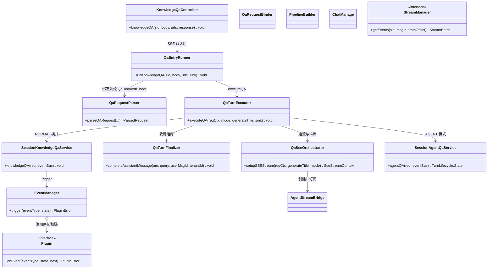
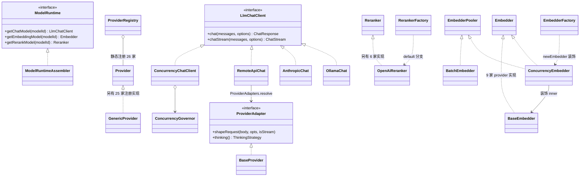
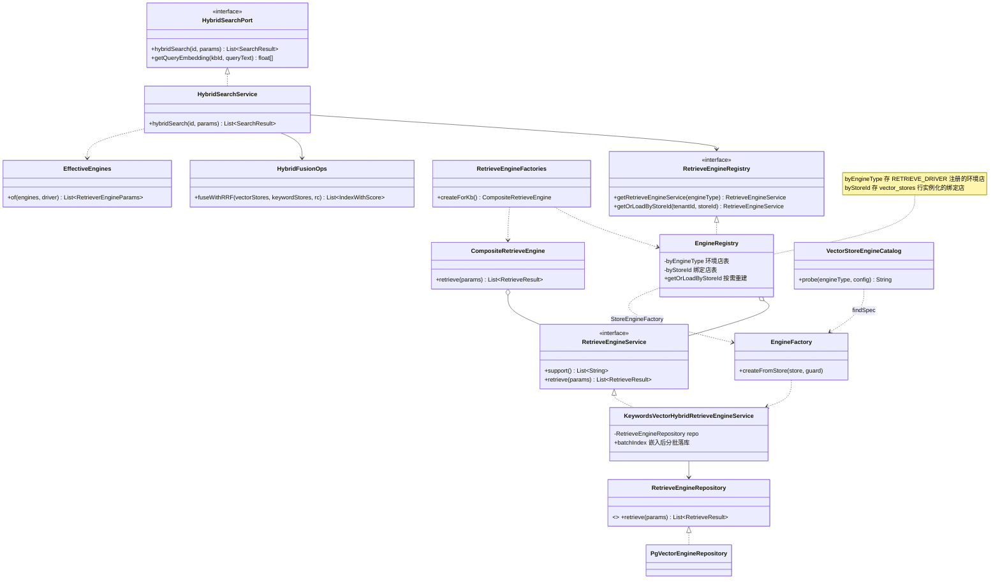
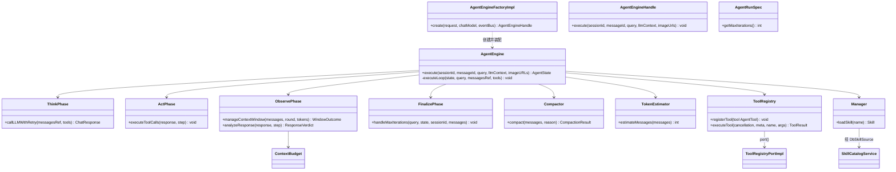
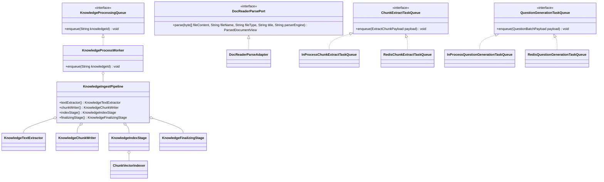

# 4. 模块 UML 类图

模块 UML 只画**跨模块边界与装配关系**上最关键的那批类；每个类的完整职责见对应章节。
约定：`«P»` 标注实现该端口的适配器；箭头方向 = 依赖方向。
## 4.1 契约层与端口

跨模块调用的统一形状是"`:contract` 端口 + 各侧适配器"：调用方只 import 端口，实现由组合根或模块内 `@Component` 提供。挑 8 个最关键的端口（签名已按源码简写）：

```mermaid
classDiagram
    class HybridSearchPort {
        <<interface>>
        +hybridSearch(String id, SearchParams params) List~SearchResult~
        +getQueryEmbedding(String kbId, String queryText) float[]
        +resolveEmbeddingModelKeys(List~String~ kbIds) Map
    }
    class EmbeddingPort {
        <<interface>>
        +embed(ModelFacts model, List~String~ texts) List
    }
    class ModelCatalogPort {
        <<interface>>
        +listModels() List~ModelRowView~
        +findModelVisible(long tenantId, String modelId) ModelRowView
        +createModel(ModelView model) ModelView
    }
    class ToolRegistryPort {
        <<interface>>
        +get(String name) AgentTool
        +tools() List~AgentTool~
        +executeInternal(ToolCancellation c, ToolExecContext m, AgentTool t, Object args) ToolResult
    }
    class McpToolRegistrationPort {
        <<interface>>
        +createTooling(ToolRegistryPort registry) McpToolingGateway
        +registerOnDemandTools(long tenantId, String mode, List~String~ ids, ToolRegistryPort r, McpToolingGateway g, int timeout)
    }
    class SessionQaPort {
        <<interface>>
        +knowledgeQa(QaRequestPayload p, EventBusInterface bus)
        +agentQa(QaRequestPayload p, EventBusInterface bus)
        +getSession(String sessionId) SessionView
    }
    class KnowledgeCatalogPort {
        <<interface>>
    }
    class AuditWritePort {
        <<interface>>
        +logBestEffort(AuditRecord record)
    }
    class HybridSearchService["HybridSearchService（:retrieval-engine）"]
    class ModelRuntimeEmbeddingAdapter["ModelRuntimeEmbeddingAdapter（:model-runtime）"]
    class ModelCatalogAdapter["ModelCatalogAdapter（:domains/model）"]
    class ToolRegistryPortImpl["ToolRegistryPortImpl（:agent-engine）"]
    class McpToolRegistrationAdapter["McpToolRegistrationAdapter（:domains/mcp）"]
    class SessionQaAdapter["SessionQaAdapter（:domains/session）"]
    class KnowledgeCatalogAdapter["KnowledgeCatalogAdapter（:domains/knowledge）"]
    class AuditWriteAdapter["AuditWriteAdapter（:domains/audit）"]
    HybridSearchPort <|.. HybridSearchService
    EmbeddingPort <|.. ModelRuntimeEmbeddingAdapter
    ModelCatalogPort <|.. ModelCatalogAdapter
    ToolRegistryPort <|.. ToolRegistryPortImpl
    McpToolRegistrationPort <|.. McpToolRegistrationAdapter
    SessionQaPort <|.. SessionQaAdapter
    KnowledgeCatalogPort <|.. KnowledgeCatalogAdapter
    AuditWritePort <|.. AuditWriteAdapter
    note for KnowledgeCatalogPort "复合端口：聚合 7 个子端口<br/>KnowledgeEntryReadPort / ChunkFaqReadPort / KnowledgeBaseReadPort<br/>KnowledgeBaseWritePort / KnowledgeIngestLookupPort<br/>KnowledgeContentWritePort / KnowledgeDeletePort"
    note for AuditWritePort "AuditRecord：tenantId / actorUserId / action<br/>targetType / targetId / scopeType / outcome / detailsJson"
```

端口 → 实现 → 调用方对照（摘自 `docs/architecture/port-map.md`，实现类位置已对代码核实）：

| 端口 | 实现（模块） | 调用方域 |
|---|---|---|
| `HybridSearchPort` | `HybridSearchService`（retrieval-engine） | knowledge、session |
| `EmbeddingPort` | `ModelRuntimeEmbeddingAdapter`（model-runtime） | knowledge、memory、retrieval-engine |
| `ModelCatalogPort` | `ModelCatalogAdapter`（domains/model） | initialization、knowledge、mcp、memory、model-runtime、session、wiki |
| `ToolRegistryPort` | `ToolRegistryPortImpl`（agent-engine） | agent-engine、mcp |
| `McpToolRegistrationPort` | `McpToolRegistrationAdapter`（domains/mcp） | agent-engine |
| `SessionQaPort` | `SessionQaAdapter`（domains/session） | im |
| `KnowledgeCatalogPort` | `KnowledgeCatalogAdapter`（domains/knowledge） | datasource、embedchannel、im、initialization、knowledge、session |
| `AuditWritePort` | `AuditWriteAdapter`（domains/audit） | 多域审计写入 |
| `DocReaderParsePort` | `DocReaderParseAdapter`（domains/knowledge） | im、initialization、session |
| `StorageBackendPort` | `StorageBackendPortAdapter`（domains/storage） | initialization、knowledge、storage |

> **原理要点**：域间不直接 import 对方 service，一律走端口——`:domains` 内 51 个控制器、19 个域通过 22 个"域间端口"解耦；跨模块边（domains ↔ 引擎层）只保留 12 个"必要端口"（如 `EmbeddingPort`、`ModelCatalogPort`、`ToolRegistryPort`）。**边界**：7 个"复合面"端口（`KnowledgeEntryReadPort` 等）没有独立实现，只作为 `KnowledgeCatalogPort` 的聚合面存在，由同一个 `KnowledgeCatalogAdapter` 落地。

---

## 4.2 问答编排

问答编排类群分布在 `session` 域的 `controller/`、`qa/`、`service/`、`conversation/`、`rag/` 包与 `platform` 的 `stream/` 包。三个 HTTP 入口（`knowledge-chat` / `agent-chat` / `knowledge-search`）收敛在同一个 `KnowledgeQaController`，两个 SSE 入口经 `QaEntryRunner` 走同一条"绑定 → 解析 → 执行"路径（embed 面也复用它）。

> **其余签名**（图外补充）：`KnowledgeQaController.agentQA` / `.searchKnowledge(rawBody)`；`QaEntryRunner.runAgentQA`（agent 模式判定：`customAgent.agent_mode > request.agent_enabled`）；`QaRequestBinder.bindSearchRequest`；`QaSseOrchestrator.handleAgentEventsForSSE` / `.startHeadlessPump`；`QaTurnFinalizer.runWithTenant`；`SessionKnowledgeQaService.knowledgeQAByEvent / .searchKnowledge`；`EventManager.register`；`Plugin.activationEvents`；`PipelineBuilder.presets()`；`ChatManage.fork()` / `.needsRetrieval()`；`StreamManager` 的 `appendEvent` / `appendSteerEvents` / `setLiveRun` / `clearLiveRun`。
> **边界**：`EventManager`、`Plugin`、`PipelineBuilder`、`ChatManage` 只有 `SessionKnowledgeQaService` 这条 RAG/纯聊天路径使用；`SessionAgentQaService` 走 agent 引擎并返回 `TurnLifecycle.State`（`DONE/FAILED/CANCELLED`）。`StreamManager` 是 `platform` 层接口，内存/Redis 双实现见 [§12](12-会话流式输出与SSE.md)。

---

## 4.3 模型层

`model-runtime` 的核心契约全部在 `contract` 的 `contract.model` 包：对话走 `LlmChatClient`（非流式 `chat` / 流式 `chatStream` 返回 `ChatStream` 句柄），向量走 `Embedder`，重排走 `Reranker`，五类能力的"按模型 id 装配"归口 `ModelRuntime` 端口，由 `ModelRuntimeAssembler` 实现。选择逻辑两级：先按模型行的 `source`（`local` → Ollama 通道 / `remote` → 远端厂商），远端再按 `ProviderName`（为空则按 BaseURL 子串 `ProviderRegistry.detectProvider`）分流到 `AnthropicChat`（Anthropic Messages 协议）或 `RemoteApiChat`（OpenAI 兼容协议，厂商差异由 12 个 `ProviderAdapter` 吸收）。

装饰与选择的归属：**谁装饰谁**——chat 链自内向外是"真实实现（`RemoteApiChat` / `AnthropicChat` / `OllamaChat`）→ `ConcurrencyChatClient`（后台并发闸门，`LlmChatClients.create` 包最外）→ `LangfuseChatClient`（`ModelRuntimeAssembler.getChatModel` 再包）"；embedding 链同构："真实 `BaseEmbedder` 子类 → 维度覆盖 → `ConcurrencyEmbedder` → `LangfuseEmbedder`"；rerank 是唯一没有装饰器的家族（工厂直出）。**谁按什么选择谁**——`source` 决定本地/远端通道，`ProviderName`（或 BaseURL 探测）决定远端协议实现；`ProviderRegistry` 里的 26 家 `Provider` 只做元数据与保存期配置校验，不承担传输。

---

## 4.4 检索引擎

依赖方向：业务域（`session`、`knowledge`）只认契约面 `HybridSearchPort` / `IndexEngineResolver`，注入的实现都在 `retrieval-engine`；检索域**不 import 任何业务域**，回查 chunk/文档元数据走 `ChunkSearchGateway` / `KnowledgeDocumentGateway` 等契约端口，查询向量经 `EmbeddingPort`（实现见 model-runtime，见 [§6](06-模型层.md)）。域内再分层：编排层（`HybridSearchService` + 三个 Ops 簇）→ 注册表/工厂（`EngineRegistry`、`RetrieveEngineFactories`、`EngineFactory`）→ 引擎服务（`KeywordsVectorHybridRetrieveEngineService`，负责嵌入与分批）→ 各厂商仓储（`engine/<vendor>/`）。控制面探测（`VectorStoreEngineCatalog`）与运行时工厂共用 `EngineFactory` 的同一张引擎规格表，规则不可能两边漂移。

---

## 4.5 Agent 引擎

`agent-engine` 的门面 `AgentEngine`（入口 `execute`）驱动 `executeLoop`，单轮编排在 `ReActIteration`；八个段协作者——think/act/observe/finalize/`SteerIntake`/`ConversationAssembler`/`ReActIteration`/`ContextDebugEmitter`——与引擎共享包内可见状态。预算与压缩在 `budget/`（`TokenEstimator`）与 `compaction/`（`Compactor`），工具框架在 `tool/`（含运行时修正子包 `tool/runtime/`），技能装载在 `skills/`。契约面 `contract.agent`：`AgentEngineFactory`（装配下沉到引擎侧）→ 实现 `AgentEngineFactoryImpl`，域侧只拿 `AgentEngineHandle` 4 方法句柄；`AgentRunSpec` 是 agent 配置 jsonb 的引擎只读面（`UNLIMITED_MAX_ITERATIONS=-1`）。

> **原理要点**：引擎**跨轮无状态**——会话历史每轮由会话域从 DB 重建后经 `llmContext` 传入；所有对外输出走 `EventBusInterface`，emit 顺序即 SSE 帧序。
> **边界**：`AgentRunSpec` 是接口而非 record（契约面零 Jackson，两侧各持可变实现 `AgentConfig`/`QaAgentConfig`）；`Manager` 为 null = 本轮技能未启用或目录读取失败降级，不阻断对话。

---

## 4.6 入库管线

入库主链路是一个**单 worker + 阶段对象**的编排：`KnowledgeProcessWorker` 只负责"接管、租户作用域、阶段排序、异常转发"，四个阶段类由 `KnowledgeProcessWiring` 装配进 `KnowledgeIngestPipeline` record 传入。对外只暴露一个入队口 `KnowledgeProcessingQueue.enqueue(String knowledgeId)`，生产方（controller/service、`contract.knowledge.KnowledgeIngest` 端口、datasource 桥）都不反向依赖 worker 实现。

> **原理要点**：名字易误解——`KnowledgeProcessWorker` 实现了 `KnowledgeProcessingQueue`，但**主链路没有跨实例队列**：`enqueue` 在提交线程捕获 `traceparent`（`LangfuseTracing.inject()`）与租户 id（`TenantContext.currentTenantId()`）后，直接提交给进程内虚拟线程执行器（`newVirtualThreadPerTaskExecutor`）。多副本部署时上传落在哪个副本就由哪个副本处理；进程重启丢掉的在飞任务由启动恢复扫 pending 补投。**跨实例队列只覆盖富化子任务**（见 [§8.6](08-知识生产-文档入库管线.md)）。

- 队列双实现由 `KnowledgeRedisWiring` 按 `knowledge.redis-enabled` 切换：true 时 Redis 面以 `@Primary` 胜出无条件注册的 InProcess 实现，且启动即 ping、连不上**启动失败**（不静默退化）；`AbstractRedisKnowledgeTaskQueue` 统一重试语义（`MAX_RETRY = 3`，退避 `n^4 + 15 + rand(30)*(n+1)` 秒，租约/续期/重投由 `RedisRetryingTaskQueue` 承载）。
- `ChunkVectorIndexer` 是 chunk 向量行重建的唯一执行体（见 [§8.5](08-知识生产-文档入库管线.md)）；`DocReaderParsePort` 是解析面端口，`DocReaderParseAdapter` 逐字转发 `DocReaderClient` 供跨域方消费，管理面另有 `DocReaderAdminPort` 分列。

---

[上一章：3. 整体架构](03-整体架构.md) ｜ [返回目录](详细技术文档.md) ｜ [下一章：5. 一次请求的全流程时序](05-一次请求的全流程时序.md)
