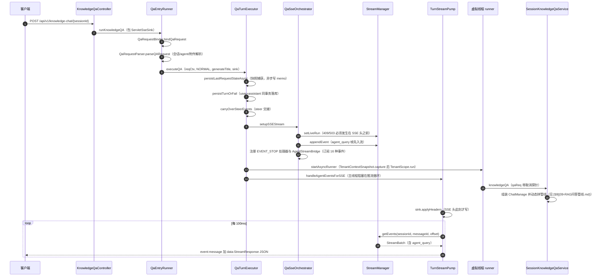
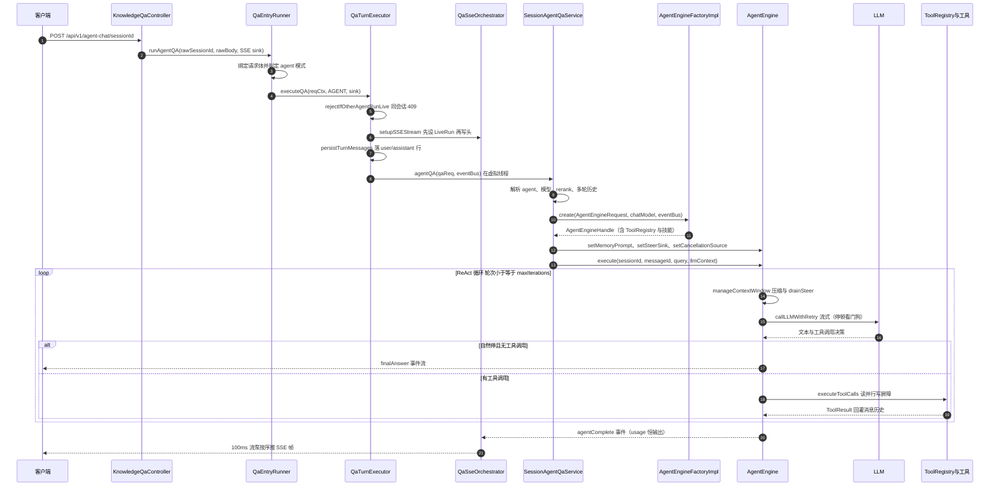
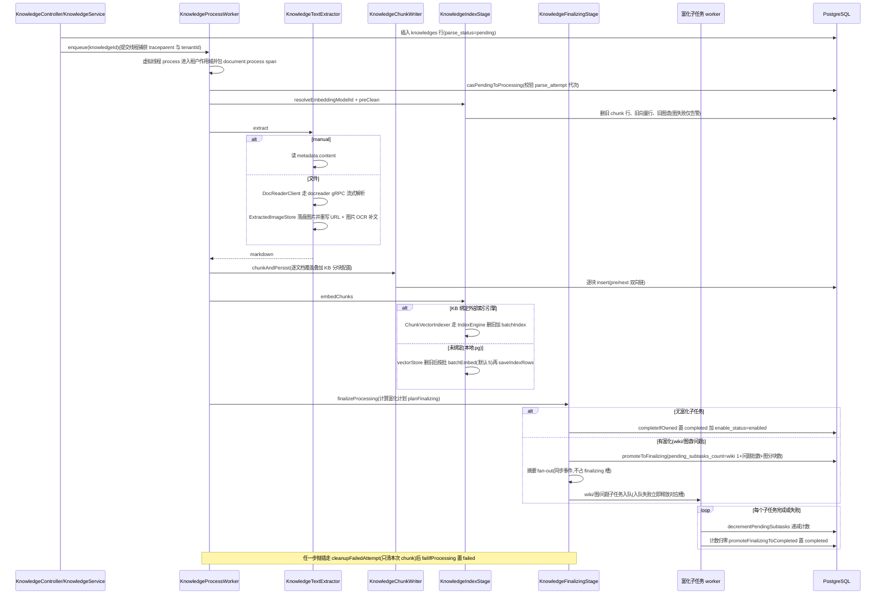

# 5. 一次请求的全流程时序

四条主线各配一张时序图：知识问答与 Agent 问答共用同一套入口解析/执行簇（[§4.2](04-模块UML类图.md)），入库是异步状态机（[§8](08-知识生产-文档入库管线.md)），续流/转向/停止是同一轮生成在不同通道上的操作（[§5.4](05-一次请求的全流程时序.md)）。
## 5.1 知识问答（SSE）

`POST /api/v1/knowledge-chat/{sessionId}` 从控制器到第一个 SSE 帧的完整链路：

> **顺序契约**：租户快照（`TenantContextSnapshot.capture()` + `TenantScope.run()`）先于虚拟线程启动；`setLiveRun` 先于 SSE 头；`agent_query` 帧先入流，所以客户端收到的第一帧是它。主线程不参与执行，只做"读流写帧"的泵（`TurnStreamPump`），执行在独立虚拟线程上推进。

`QaTurnExecutor.executeQA` 的 7 个具名步骤（顺序不可调换）：

| 步骤 | 方法 | 关键约束 |
|---|---|---|
| 1 | `persistLastRequestStateAsync` | 派生线程无 ThreadLocal，必须 capture/replay 租户 |
| 2 | `rejectIfOtherAgentRunLive`（仅 AGENT 模式） | 另一轮在跑则 409 |
| 3 | `persistTurnOrFail` | user/assistant 两行同事务；失败落 500（流尚未建立） |
| 4 | `carryOverSteerEvents` | 必须在公布 live run 之前接上 |
| 5 | `setupSseOrRollback` | 建流失败先回滚消息再抛 409/503 |
| 6 | `registerQuickAnswerHandlers`（仅 NORMAL 模式） | thought 累积 + 完成事件收尾 |
| 7 | `startAsyncRunner` | 租户快照、引擎调用、错误事件、终态收尾 |

---

## 5.2 Agent 问答（ReAct + 工具）

入口 `POST /api/v1/agent-chat/{sessionId}`（`KnowledgeQaController.agentQA`，与 knowledge-chat 共用 `QaEntryRunner` 装配路径）。会话域 `SessionAgentQaService.agentQA` 完成七步：解析 agent → 模型面 → 历史 → 建引擎 → 记忆/转向接缝 → 查询组装 → 执行；引擎装配经 `AgentEngineFactoryImpl`（工具、内置工具、MCP、技能都在这里挂上）。

> **要点**：SSE 头之前先 `SetLiveRun`——409/503 必须还能改状态码；执行段跑在虚拟线程上，租户身份用快照显式 replay（不跨线程带 ThreadLocal）；用户停止经 `cancellationProbe`（读 `streamCtx.cancelled`）贯穿 think/act/审批等待三条路。收尾由 `QaTurnFinalizer` 写回 assistant 消息并清 LiveRun（会话/流细节见 [§12](12-会话流式输出与SSE.md)）。

---

## 5.3 文档入库

从一次上传到终态的全链路（以 `POST /api/v1/knowledge-bases/{id}/knowledge/file` 为例，URL/手工/数据源在"落行并入队"之后完全同形）：

> **反直觉**：①"队列"是进程内虚拟线程，`enqueue` 即提交执行；②取消不是信号中断——worker 只在检查点读 `isAborted()`（`deleting`/`cancelled`），被抢行后各步 CAS 写 0 行自然退出；③失败清场只删**本次尝试**登记的 chunk id 清单，代次已变（被重解析接管）时连知识级向量都不动，避免误删新尝试的产物。

---

## 5.4 断线续流、运行中转向与停止

```mermaid
flowchart TB
    subgraph Resume["continue-stream 续流"]
        A["GET /api/v1/sessions/continue-stream/{sessionId}<br/>参数 messageId"] --> B["先解析 resource_urls<br/>非法值落 400 JSON"]
        B --> C["校验会话与消息存在<br/>消息不存在 404"]
        C --> D["getEvents 取 offset 0<br/>空流 404"]
        D --> E["SseContract.setSSEHeaders<br/>SSE 头此刻才写"]
        E --> F["回放全部事件<br/>已含 complete 则收尾"]
        F --> G["100ms 轮询增量<br/>上限 2 小时"]
    end
    subgraph Steer["运行中转向 steer"]
        H["POST /api/v1/sessions/{sessionId}/steer<br/>delivery 缺省 after"] --> I["查 live run<br/>查询失败 503 无轮次返回 new_run"]
        I --> J["appendSteerEvents<br/>独立子列表 队列深度上限 10"]
        J --> K["SteerSinkBridge.pollSteer<br/>引擎排空点取走并落库"]
        K --> L["inject 当轮注入<br/>after 存入 backlog 由 follow-up 新轮消化"]
    end
    subgraph StopStop["停止 stop"]
        M["POST /api/v1/sessions/{sessionId}/stop<br/>SessionStopService"] --> N["校验消息可见性 owner 租户<br/>消息已结束则幂等成功"]
        N --> O["appendEvent 写 stop 事件"]
        O --> P{"流管理器实现"}
        P -->|redis| Q["RedisStreamManager<br/>任意副本的泵读到 stop 即取消"]
        P -->|memory| R["MemoryStreamManager<br/>仅本副本可见 跨实例 stop 失效"]
    end
```

- **续流**：`SessionStreamController.continueStream` 从 offset 0 回放全部已入流事件，再进入 100ms 轮询（`POLL_INTERVAL_MILLIS=100`，单连接上限 2 小时）。客户端断开用"写失败检测"（`SseFrameWriter.write` 抛 `IOException`），阻塞式 Servlet 拿不到即时断连通知，代价是延迟发现而非错误。
- **steer**：`SteerController` 的排队/列表/删除/提升四个端点只操作 `StreamManager` 的 steer 子列表（用户可见 SSE 流里永不出现）；引擎侧消费在 `SteerSinkBridge.pollSteer`（当轮 drain）与 `SteerRunCoordinator`（`after` 语义的 follow-up 新轮交接）。队列深度按未消费条数计，上限 10（`MAX_STEER_QUEUE_DEPTH`），query 上限 10000 码点。
- **stop/取消**：`SessionController` 的 `POST /api/v1/sessions/{sessionId}/stop` 经 `SessionStopService` 向主流列表追加 `stop` 事件；持有 SSE 连接的那个实例的 `TurnStreamPump` 轮询读到 `stop` 后发出 `EVENT_STOP`（置位 `cancelled` + interrupt 执行线程），终态由唯一 finalizer 提交。**跨实例语义**：stop 事件经 `StreamManager` 落存储——只有选了 Redis 实现（`STREAM_MANAGER_TYPE=redis`）事件才跨副本可见；内存实现下 stop 请求若落到另一个副本，`stop` 事件本副本读不到，跨实例 stop 失效。IM 面另有 `StreamStopWatcher`（500ms 轮询）做同件事。

---

[上一章：4. 模块 UML 类图](04-模块UML类图.md) ｜ [返回目录](详细技术文档.md) ｜ [下一章：6. 模型层（model-runtime）](06-模型层.md)
