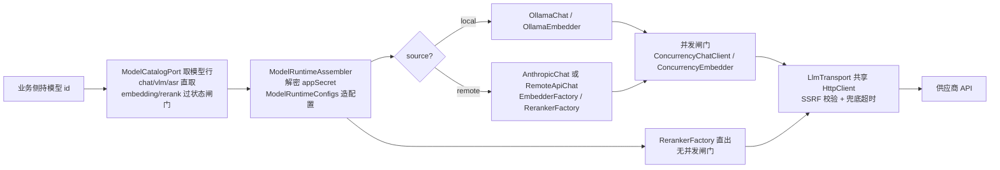

# 6. 模型层（model-runtime）

## 6.1 职责与包结构

| 码包 | 职责（据各 `package-info.java`） |
|---|---|
| `embedding` | 嵌入客户端族（库式域，无 HTTP 面）：`EmbedderFactory` 选择器、传输与编码、池化与失败降级；只做"文本 → 向量"。各家实现在 `embedding.provider` |
| `llm` | LLM 客户端族：`llm.provider`（元数据与校验）、`llm.limiter`（并发闸门）、`llm.ollama`（本地通道）、`llm.extract`（实体抽取）、`llm.domain`（元数据映射） |
| `modelcontext` | 模型上下文装配（库式域）：来源/资源句柄注册表、工具结果的模型面渲染、流式句柄解码 |
| `modelruntime` | 模型运行时：`modelruntime.application`（`ModelRuntime` 装配器与配置映射）、`modelruntime.adapter.provider`（按协议家族归类的 chat / ASR / VLM 实现） |
| `rerank` | 重排客户端族：`RerankerFactory` 选择器、`RankResult` 形态；各家实现在 `rerank.provider` |

`modelcontext` 管的是"这次对话能看到什么"：`SourceRegistry` 为 chunk/document/知识库/网页分配请求局部句柄（`cN`/`dN`/`bN`/`wN`），`ResourceRegistry` 为持久资源分配 `res://NNNN` 句柄，`SourceToolCodec` 做工具参数的句柄编解码，`ModelOutput` 把 `ToolResult` 渲染成给 LLM 的紧凑文本，`StreamDecoder`/`CitationStreamExpander` 在流式输出上安全还原句柄、防止私有 `<ref/>` 片段漏进 SSE。它与 MCP 协议无关——MCP 的连接与协议实现见 [§11](11-工具技能与MCP.md)，这里的 `mcpServers`/`mcpTools` 只是两类句柄表的名字。

## 6.2 LLM 提供商

`ProviderRegistry` 的静态块显式注册 **26 家** provider；`Provider` 接口只有 `info()`（`ProviderInfo`：展示名/描述/各模型类型默认 URL/支持的模型类型/是否必须鉴权/额外字段）和 `validateConfig()`（保存模型时由 `ModelConfigValidator` 统一调用，只做结构校验、不联网）。**传输不在这 26 家对象里**：chat 的协议分叉在 `LlmChatClients.create` 完成。

26 个 `ProviderName` 标识（`ProviderRegistry.allProviders()` 顺序）：

```
generic aliyun zhipu volcengine hunyuan siliconflow deepseek minimax moonshot modelscope
qianfan qiniu openai anthropic gemini openrouter litellm requesty jina mimo longcat
lkeap gpustack nvidia novita azure_openai
```

| 协议通路 | 适用的 provider | 客户端实现 |
|---|---|---|
| OpenAI 兼容 | 除 `anthropic` 外全部 25 家（含 `openrouter`/`litellm`/`requesty`/`gpustack` 等聚合网关；`generic` 为兜底） | `RemoteApiChat` |
| Anthropic Messages | `anthropic` | `AnthropicChat`（`adapter/provider/chat/anthropic/` 全套请求/响应/工具流类） |
| 本地 Ollama | 不占 26 家注册，按模型行 `source=local` 进入 | `OllamaChat`（走 `OllamaService` 的 NDJSON 接口） |

`RemoteApiChat` 把厂商差异收敛到 `ProviderAdapter`：`adapter/provider/chat/common/ProviderAdapters` 的有序注册表共 **12 个**具名适配器（`QwenThinking`、`Lkeap`、`Deepseek`、`Generic`、`LiteLlm`、`Gemini`、`Volcengine`、`Nvidia`、`AzureReasoning`、`Azure`、`OpenAiReasoning`、`Moonshot`，带 `matches()` 谓词的专有适配器排在同 provider 兜底之前），无命中时回落 `BaseProvider`（Bearer 鉴权、标准 `<baseURL>/chat/completions`、不发 thinking 字段）。出站请求体统一由 Jackson `ObjectNode` 组装，流水线固定为：消息转换与 `transformMessages` 改写 → 组装标准请求体 → `shapeRequest` 厂商整形 → thinking 字段注入（`extra_config.thinking_control` 覆盖优先于 `adapter.thinking()`）→ `PromptCache` 注入缓存字段 → `endpoint` 覆写 URL → `auth` 设鉴权头并发送。流式解析在 `SseReader` + `RemoteApiStreamOps` + `OpenAiStreamState`（SSE 逐事件、delta 产出、`tool_calls` 增量累积、`data: [DONE]` 收尾）；思考块经 `ThinkingEmitter` 保证"分片随到随转、恰好一个 thinking-done 标记"，流内只产出 `ANSWER` / `THINKING` / `TOOL_CALL` / `ERROR` 四类 `StreamResponse`。thinking 编码策略有四个实现（`ThinkingStrategies.None` / `EnableThinking` / `ThinkingTypeField` / `ChatTemplateKwargs`），由前端 `parameters.extra_config.thinking_control` 选 `none` / `enable_thinking` / `thinking_type` / `chat_template_kwargs`。

## 6.3 模型从配置到调用

模型类型是 `ModelType` 枚举的五个值：`Embedding`、`Rerank`、`KnowledgeQA`（亦称 Chat）、`VLLM`、`ASR`。业务侧只持模型 id，取行经契约端口 `ModelCatalogPort`（domains 侧由 `model/api/ModelCatalogAdapter` 实现），装配归口 `ModelRuntimeAssembler`：



两类取数口径不同：embedding/rerank 走 `findModelOrEmpty`（带状态闸门，`downloading` 状态报 "model is currently downloading" 等），chat/vlm/asr 走 `findModelVisible` 直取。模型级凭据存在模型行 `ModelParameters.appSecret`（加密存储），装配时经 `CryptoService.decryptStoredSecretLenient` 宽容解密（失败原样返回密文）；出站基址过 `SsrfGuard.validateURLForSSRF`（VLM 走 `vlmConfigFor`，ollama 不校验基址）。VLM 预测器按"配置 + SSRF 校验 → 观测装饰 → 命名并发闸门"装配，无批级超时，HTTP 层由 `VLM_HTTP_TIMEOUT_SECONDS`（缺省 180s）兜底。

模型域的管理面（domains 的 model 域）：

| 入口 | 作用 |
|---|---|
| `ModelController`（`/api/v1/models`） | 模型 CRUD + `GET /providers`；写操作 Admin+、读 Viewer+；SSRF 拒绝走统一错误信封 |
| `ModelCredentialsController` | `PUT /{id}/credentials` 写凭据、`DELETE /{id}/credentials/{field}` 删字段 |
| `ModelDebugController` | `POST /{id}/debug`：五类模型联调（multipart）；运行时错误不报 HTTP 错误，落在结果对象 `ok=false + error`（HTTP 恒 200）；请求体上限 64KB、`documents` ≤ 100 条 |
| `ModelOllamaController`（`/api/v1/models/ollama`） | `status` / `models` / `models/check` / `models/download` / 下载进度与任务列表 |

## 6.4 并发与稳定性

**后台并发闸门**：`ConcurrencyGovernor` 是进程级单例，chat（`ConcurrencyChatClient`）、embedding（`ConcurrencyEmbedder`）、VLM（命名闸门）共用同一限流器。启动由 boot 的 `ModelConcurrencyGovernorWiring` 装配：上限取 `model.max_concurrency`（DB 系统设置 → `RAGAGENT_MODEL_MAX_CONCURRENCY` env → 缺省 32）；后端缺省 `LocalLimiter`（进程内信号量），`llm.limiter.redis-enabled=true` 时装 `RedisLimiter`（跨实例分布式信号量，启动即 ping、连不上**启动失败**不静默退化）；`limit ≤ 0` 关闭治理。闸门**只节流后台任务**：`BackgroundTaskContext`（ThreadLocal）标记的摄入/摘要/图谱等流量才取并发槽，交互式 HTTP 路径直接放行；限流器任何故障 fail open（返回 `Release.NOOP`，绝不阻断模型流量）。`ModelConcurrencyLimiter` 契约规定 `acquire` 永不抛异常：`LocalLimiter` 用 50ms 轮询实现可取消等待；`RedisLimiter` 是"自愈租约 ZSET"（租约默认 30s 过期回收、心跳每 ttl/3 ≈ 10s 续租、等待 200ms 轮询）。

**超时与重试**：出站统一走 platform 的 `LlmTransport` 共享 `HttpClient`（SSRF 校验在发送前与每次重定向前）；兜底超时非流式 300s（`RAGAGENT_LLM_CHAT_TIMEOUT_SECONDS`）、流式 600s（`RAGAGENT_LLM_STREAM_TIMEOUT_SECONDS`），只在调用方未给 deadline 时生效，且施加在请求头阶段——流式响应体读取不会因 deadline 中断，长流依赖上游收尾。**chat 没有内置重试装饰器**，失败直接冒泡、降级由调用方做（例如 `PluginRerank` 的 API 失败回退原检索结果）；唯一内建重试是 `BaseEmbedder.embed` 的"3 次尝试取首个非空批"。消费者提前离开时必须 `ChatStream.close()`（终止上游、释放并发 permit、解阻塞、幂等），不关则 permit 要等 120s 放弃阈值才释放。Token 计数不在本模块：用量来自供应商响应的 `TokenUsage`；上下文预算的本地估算在 agent-engine 的 `TokenEstimator`（jtokkit `CL100K_BASE`，`encodeOrdinary`，思考内容 `reasoning_content` 一并计数），属 [§10](10-Agent引擎.md) 议题。

## 6.5 Embedding 与 Rerank

Embedding 的统一出口是 `EmbeddingVectors`：条数、空向量、批内维度一致性在这里把关，OpenAI 族响应的 `data[].index` 按 index 归位——因为 pg 写库与索引写入都是 `rows[i] ↔ vectors[i]` 按位置配行，顺序错或混维会静默写错向量。批处理上 `Embedder.batchEmbed` 要求返回顺序与输入一致；池化能力 `EmbedderPooler` 的实现 `BatchEmbedder` 按 `BATCH_EMBED_SIZE`（缺省 5）切子批并发（虚拟线程 + 容量信号量，首错短路），但当前 `ModelRuntimeAssembler` 装配时传 `pooler=null`，池化是备而未接的能力。`NvidiaEmbedder` 读 `EmbedQueryContext`（ThreadLocal）切 `input_type=query/passage`，未标记时按 `passage`。取径上：索引/会话侧走契约 `EmbeddingPort`（实现 `ModelRuntimeEmbeddingAdapter`，与问答同一条客户端路径），wiki 侧走 `EmbeddingModelPort`（knowledge 域适配，非 embedding 类型抛 `IllegalStateException` 降级），细节见 [§7](07-检索引擎.md)/[§8](08-知识生产-文档入库管线.md)。Rerank 的 `RerankerFactory` 按 provider 路由 7 家实现（`aliyun`/`zhipu`/`jina`/`nvidia`/`lkeap`/`volcengine`，缺省 `OpenAiReranker`），并在工厂层注入 `customHeaders`；问答管线在 `CHUNK_RERANK` 阶段经 `PipelinePorts.ModelService.getRerankModel` 取客户端（`QaWiring` 装配），`PluginRerank` 编排重试与兜底：API 失败回退原检索结果、无结果且阈值 >0.3 降 ×0.7 重试、全低于阈值时 top1 兜底，合成评分 `0.6×model + 0.3×base + 0.1×sourceWeight`，再按 MMR（lambda 0.7）做多样性选择。

## 6.6 内置模型声明（builtin_models.yaml）

对账类是 domains model 域的 `BuiltinModelsReconciler`（`ApplicationRunner`，启动时执行一次）：

- 路径 `./config/builtin_models.yaml`，环境变量 `BUILTIN_MODELS_CONFIG` 可覆盖；**文件不存在即 no-op**（默认不捆绑，不写任何行、也不清扫）。
- 只写 `managed_by='yaml'` 的行，按 id 幂等 UPSERT（`deleted_at` 强制复位 NULL，重复启动不重复插入）；`is_default` 维持 `(tenant_id, type)` 桶内唯一（`clearDefaultForBucket`）。
- 同名但 `managed_by` 非 `yaml` 的行视为运行时覆盖，**保留不动**——系统管理员在页面编辑内置模型时 `ModelService.updateModel` 会清空 `managed_by`，即"页面编辑解除托管"，此后该行不再受 YAML 管辖。
- 漂移清扫：文件里消失且仍为 `managed_by='yaml'` 的行**软删除**；文件缺失或解析失败则清扫也不跑。
- `${VAR}` 用环境变量插值，**未设置的变量原样保留**（字面量进库，便于首次启动后再补 env 重启生效）。
- 校验：id 非空且 ≤64 字符；`type` 必须是 `KnowledgeQA` / `Embedding` / `Rerank` / `VLLM` / `ASR` 之一，否则跳过该条；`tenant_id` 缺省 10000（系统租户）。

## 6.7 本地模型（Ollama）与抽取

Ollama 本地模型管理在 `llm/ollama/OllamaService`，实现契约端口 `OllamaAdminPort`：探活（`HEAD /`）、`/api/tags` 列模型、`/api/pull` 拉取（逐次回报 `OllamaPullProgress`）、`/api/show`、`/api/create`、`/api/delete`、`/api/version`。线格式与官方客户端一致：流式接口是 **NDJSON**（`Accept: application/x-ndjson`）而非 SSE。domains 侧 `OllamaManageService` 经端口驱动下载任务（`OllamaDownloadTaskStore` 存进度），HTTP 面在 `ModelOllamaController`；`source=local` 的 chat/embedding 模型行分别由 `OllamaChat` / `OllamaEmbedder` 消费同一 `OllamaService`。实体抽取的契约是 `EntityExtractionPort`（入参 `LlmChatClient` + 不透明模板 + 文本），实现在 model-runtime 的 `llm/extract/EntityExtractionAdapter`：把模板还原为平台 `PromptTemplateStructured` 后交给 `EntityExtraction.Extractor`，再把内部图形状搬成契约 `EntityExtractionResult`（消费方为知识图谱抽取等，见 [§14](14-Wiki与知识图谱.md)）；模型调用或解析失败以运行时异常表达。

> **原理要点**：全部模型能力的构造归口 `ModelRuntimeAssembler` 一个 bean——消费域（知识、会话、wiki、记忆、mcp）只 import 契约面；厂商差异被压进两处：协议级分叉（Anthropic 独立实现）与参数级适配（`ProviderAdapter`），新增厂商 = `ProviderName` 加枚举 + `Provider` 实现 + 注册两行，传输层零改动。装饰次序固定为"真实实现 → 并发闸门 → langfuse 观测"，闸门只包住真实 provider 往返，等待时间不计入观测计时。
> **优点**：统一抽象屏蔽厂商差异；并发治理集中在客户端层（唯一能看到全部任务类型的地方），且后台/交互分离——摄入风暴不拖慢用户请求；限流器故障 fail open，观测组件缺失零成本。
> **边界**：chat 无内置重试，供应商抖动要靠调用方降级；思考块与工具调用格式的厂商差异只覆盖到 12 个适配器，未列厂商走 `BaseProvider` 兜底（不发 thinking 字段），换用小众模型前需用调试端点实测；rerank 工厂无并发闸门、池化 embedding 备而未接；本地 token 计数在 agent-engine 而非本模块，模型层只透传供应商 `TokenUsage`。


---

[上一章：5. 一次请求的全流程时序](05-一次请求的全流程时序.md) ｜ [返回目录](详细技术文档.md) ｜ [下一章：7. 检索引擎（retrieval-engine）](07-检索引擎.md)
