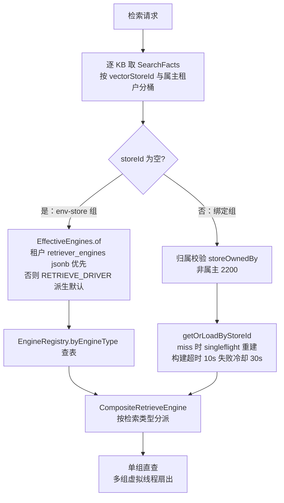
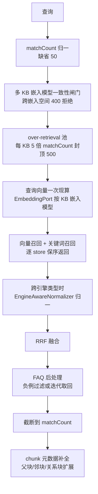

# 7. 检索引擎（retrieval-engine）

## 7.1 职责与包结构

`retrieval-engine` 是**库式域，无 HTTP 面**：把统一检索参数翻译成各厂商协议（纯技术），并在其上做带业务语义的检索编排（多 KB 路由、RRF 融合、FAQ 后处理）。

| 包 | 职责 |
|---|---|
| `retrieval/`（顶层） | `HybridSearchService`（`HybridSearchPort` 实现）+ 三个编排簇：`HybridStoreGroupOps`（KB 分桶与引擎解析）、`HybridFusionOps`（RRF 融合与 FAQ 后处理）、`HybridResultOps`（结果装配） |
| `retrieval/engine/` | 注册表（`EngineRegistry`）、工厂（`EngineFactory` / `RetrieveEngineFactories`）、复合引擎、pg 适配（`PgVectorEngineRepository`）、共享类型（`EngineTypes`）、有效引擎映射（`EffectiveEngines`）、控制面目录（`VectorStoreEngineCatalog`） |
| `retrieval/engine/<vendor>/` | 8 家引擎驱动子包：`doris` / `elasticsearch` / `milvus` / `opensearch` / `qdrant` / `sqlite` / `tencentvectordb` / `weaviate` |
| `retrieval/artifact/` | `ArtifactReferenceRewriter`：把答案里指向沙箱产物的链接改写成 `resource://` 或 `sandbox:<name>` 形态 |
| `retrieval/config/` | `RetrievalEnvLookup`：域内读环境变量的唯一入口（由 `boot` 的装配类在构造器里安装，保证早于任何引擎构造） |
| `retrieval/graph/` | Neo4j 图检索（见 [§7.5](07-检索引擎.md)） |
| `retrieval/support/` | 无状态算法支撑（如 `KeywordScoreNormalizer`） |
| `retrieval/telemetry/` | `RetrievalObs`：把引擎内部形状的命中汇总成检索 span 的输出 |

## 7.2 九种检索后端

引擎类型字面量的唯一来源是契约 `VectorEngineTypes`（9 个常量）；其中 postgres / sqlite 是"环境引擎"——只能经 `RETRIEVE_DRIVER` 的 env-store 出现，不能注册为数据库里的向量库行（`VectorEngineTypes.CONFIGURABLE` 只含其余 7 家）。`RETRIEVE_DRIVER` 每一段对应一个驱动名，逐段映射到"支持的检索类型"由 `EffectiveEngines` 的映射表给出：

| `RETRIEVE_DRIVER` 段 | 引擎类型 | 实现类 | 向量 | 关键词 | 注意事项 |
|---|---|---|---|---|---|
| `postgres` | `postgres` | `PgVectorEngineRepository`（读委托 `PgVectorRetrieveRepository`，写委托 `VectorStoreService`） | ✓ | ✓ | 默认 PG 连接；`halfvec` 多维度列 + ParadeDB pg_search BM25 索引；`ef_search`/`iterative_scan` 走事务内 `SET LOCAL` |
| `elasticsearch_v7` | `elasticsearch` | `ElasticsearchV7RetrieveRepository` | — | ✓ | 裸 HTTP 自持；v7 只有关键词面 |
| `elasticsearch_v8` | `elasticsearch` | `ElasticsearchV8RetrieveRepository` | ✓ | ✓ | DB 店按 `connection_config.version` 前缀选 v7/v8（空 → v8） |
| `opensearch` | `opensearch` | `OpenSearchRetrieveRepository` | ✓ | ✓ | 要求版本 ≥2.4 且装 k-NN 插件（构造期探针显形）；`knn_vector` 维度上限 16000；关键词/向量分索引 |
| `doris` | `doris` | `DorisRetrieveRepository` | ✓ | ✓ | MySQL 协议走 FE（addr，缺省 `doris-fe:9030`）+ Stream Load HTTP（`DORIS_HTTP_PORT` 缺省 8030）；建表后后台轮询 ANN 索引就绪 |
| `qdrant` | `qdrant` | `QdrantRetrieveRepository` | ✓ | ✓ | REST 自持；关键词路为跨集合 `/points/scroll` 合并（单集合失败跳过继续）；端口缺省 6334 |
| `weaviate` | `weaviate` | `WeaviateRetrieveRepository` | ✓（GraphQL `nearVector`，`certainty` 为分） | ✓（跨集合 BM25） | 中文分词依赖服务端 GSE 模块（CI 显式开启）；单集合 BM25 失败**直接报错**（与 Qdrant 的跳过相反） |
| `milvus` | `milvus` | `MilvusRetrieveRepository` | ✓ | ✓ | REST v2 自持；集合含服务端 BM25 函数 + `SparseFloatVector` 稀疏列（`content_sparse`）；已对 `milvusdb/milvus:v2.6.11` 实测 |
| `tencent_vectordb` | `tencent_vectordb` | `TencentVectorDbRetrieveRepository` | ✓ | ✓ | BM25 稀疏向量在**客户端**编码（`TencentVectorDbBm25` + `JiebaTokenizer`，对齐官方 SDK v1.8.4）；addr/username/api_key 缺一即拒 |
| `sqlite` | `sqlite` | `SqliteRetrieveRepository` | ✓ | ✓ | 单文件引擎（`SQLITE_PATH`，缺省 `./data/weknora-retrieval.sqlite`）；关键词面为 FTS5 + CJK 二元切分（`SqliteCjkBigram`）；地址免 SSRF |

稠密向量不在引擎内算：写入侧由 `KeywordsVectorHybridRetrieveEngineService.index/batchIndex` 用统一 `Embedder` 嵌入（内容先净化——含 `base64,` 才跑内联图片正则替换为 `[image]`，再按码点截断到 20000），查询侧走 `EmbeddingPort`（见 [§7.4](07-检索引擎.md)）。只有稀疏向量在各引擎内部产生：Milvus 由服务端 BM25 函数从文本生成，腾讯 VectorDB 由客户端编码。

## 7.3 引擎注册与选择

**环境级注册**：`RETRIEVE_DRIVER`（env，经 Spring 松散绑定进 `RetrievalDriverProperties`，即 `retrieve.driver`）按逗号分段，`RetrievalEngineWiringConfig.registerEnvStores` 逐段构造引擎并注册进 `EngineRegistry.byEngineType`——postgres 由既有 JDBC 件的引擎口适配承担，其余 8 家从各自的 `*_ADDR/HOST/USERNAME/PASSWORD/API_KEY` 等 env 现场建驱动；**串为空（或缺省段没匹配上）= 注册表空 = 检索全关**（问答日志出现 "No retrievable indexing pipelines"），`.env.example` 的缺省值是 `RETRIEVE_DRIVER=postgres`。单个引擎注册失败只记 error 继续，不阻塞启动（`StartupCapabilityReport` 会在启动时告警两种异常形态）。env-store 的虚拟向量库 id 以 `__env_` 为前缀（如 `__env_postgres__`）。

**知识库级绑定**：`vectorstore` 域维护 `vector_stores` 表（白名单 = `VectorEngineTypes.CONFIGURABLE` 的 7 家），KB 的 `vector_store_id` 指向哪一行，检索/写入就解析哪一行的引擎实例（存 `EngineRegistry.byStoreId`）。绑定店的解析必须过两道关：`TenantStoreOwnership.storeOwnedBy` 归属校验（跨租户 → `RetrieveEngineException.VECTOR_STORE_FORBIDDEN`，用户侧映射 2200），注册表取不到（DB 有行但启动期建失败）→ `VECTOR_STORE_NOT_FOUND`/`UNAVAILABLE`（映射 2201）。注册表是**进程内的**：别的实例注册的引擎本实例没有——`getOrLoadByStoreId` 按需重建（singleflight 折叠并发构建、构建超时 10s、失败冷却 30s、代数复核防过期发布）让两种缺口自愈。**租户级覆盖**：`tenants.retriever_engines` jsonb 非空时优先生效，否则按 `RETRIEVE_DRIVER` 派生默认（`EffectiveEngines.of`）。

**连通性探测**在检索域的控制面目录 `VectorStoreEngineCatalog.probe`（9 个分支：ES 裸 HTTP GET 解析 `version.number`、postgres JDBC `SHOW server_version`、Qdrant 驱动健康探针、Milvus REST `collections/list`、腾讯 `ListDatabase`、Weaviate `/v1/.well-known/ready` + `/v1/meta`、Doris MySQL 协议 `SELECT @@version`、OpenSearch 版本 + k-NN 插件探针、sqlite 恒空串），由 `vectorstore` 域的 `VectorStoreConfigService.testConnection` 经契约端口调用，暴露在 `POST /api/v1/vector-stores/test` 与 `POST /api/v1/vector-stores/{id}/test`。



## 7.4 混合检索与融合

`HybridSearchService.hybridSearch` 是唯一的检索读面入口（`HybridSearchPort`，消费方为 session 的 QA 管线、知识控制器、agent 工具）。流程：



**融合算法是 RRF（Reciprocal Rank Fusion）+ 加权**，公式在 `HybridFusionOps.fuseWithRRF`：

```text
score = vectorWeight / (rrfK + vRank) + keywordWeight / (rrfK + kRank)
```

`rank` 是**店内名次**（1-indexed，各 store 各自算名次，同一 chunk 命中多个 store 取最好名次）；同分再按 `chunkId` 升序决序，保证交换 KB/store 顺序结果稳定。参数取自租户配置 `tenants.retrieval_config`（`HybridSearchService.currentRetrievalConfig` 读 `rrfK` / `rrfVectorWeight` / `rrfKeywordWeight`），0 值回落缺省 **rrfK=60、vectorWeight=0.7、keywordWeight=0.3**。归一化只作用于向量分：Milvus 是唯一暴露带符号余弦 [-1,1] 的引擎，按 `(score+1)/2` 再 `clamp01`；BM25 正数无界，原样透传（RRF 按秩融合对刻度免疫）。单一来源（只有向量或只有关键词命中）跳过 RRF，直接按分去重。

**阈值与 TopK 的配置落点分两层**：会话侧缺省在 `application.yml` 的 `conversation:` 段（`embedding-top-k: 30`、`vector-threshold: 0.2`、`keyword-threshold: 0.3`、`rerank-threshold: 0.3`、`rerank-top-k: 30`、`max-rounds: 5`），租户可用 `tenants.retrieval_config` 覆盖（同名字段 + `rerankModelId`）；这些值由 session 管线装进 `SearchParams`（`queryEmbedding`/`vectorThreshold`/`keywordThreshold`/`matchCount`…）传给引擎。融合后的**重排（rerank）在 session 的 RAG 插件链里做**（见 [§9](09-RAG问答管线.md)），检索引擎只负责按阈值/TopK 召回与融合；FAQ KB 触发迭代取回时最多 5 轮、TopK 从 `min(matchCount*3, 500)` 起每轮翻倍（封顶 500），只涨 TopK、引擎分组复用。

**扇出语义**：KB 按 `(vectorStoreId, 属主租户)` 分桶；单组快速路径直接 `engine.retrieve`（零扇出开销，现行主形态）；多组用虚拟线程扇出，并发上限 4（`MULTI_STORE_FANOUT_LIMIT`）、单组超时读 `MULTI_STORE_RETRIEVE_TIMEOUT_SEC`（缺省 30s），**all-or-nothing**——任一组失败整条检索报 2201。

## 7.5 图检索

`retrieval/graph/` 三件：`Neo4jProperties`（`NEO4J_ENABLE`/`NEO4J_URI`/`NEO4J_USERNAME`/`NEO4J_PASSWORD`，env 名松散绑定 `neo4j.*`）、`Neo4jGraphConfig`（装配）、`Neo4jGraphRepository`（实现契约 `RetrieveGraphRepository` 的 `addGraph`/`delGraph`/`searchNode` 三口）。门控语义：`NEO4J_ENABLE`（忽略大小写）不等于 `true` → **不建驱动**，仓储退化为 no-op（三个操作都告警 `NOT SUPPORT RETRIEVE GRAPH` 后静默，调用方无需判空）；启用时连接纪律是 30 次 × 2s 重试，全部失败**抛出让启动失败**（不带半个图库继续跑）。检索侧的消费点是 session RAG 插件链的 `PluginSearchEntity`：实体抽取命中后按节点名 `CONTAINS` 匹配取回一跳子图，注入问答上下文（流水线全貌见 [§9](09-RAG问答管线.md)；图谱抽取与运维见 [§14](14-Wiki与知识图谱.md)）。

## 7.6 可观测与异常语义

- **telemetry**：`RetrievalObs.summarizeRetrieveOutput` 把一次多 store 检索折成 span 输出——`total_hits`/`vector_hits`/`keyword_hits`/`group_count`/`by_retriever`（逐组引擎×检索类型×计数）+ `top_hits`（分数降序前 25 条，每条含 rank/chunk_id/score/match_type/160 码点内容预览）。span 输入 11 键（query_text、kb_ids、阈值、组数等）由 `HybridSearchService` 组装；产出只进 Langfuse span（见 [§21](21-可观测性与运维.md)），不进契约。
- **异常语义守卫**：`scripts/check-exception-semantics.py` 规则一（针对 `retrieval-engine/.../engine/`）：**检索引擎层不得在 catch 块里把条件/过滤重置为空**（判据是 catch 内出现 `createObjectNode(`）——解析失败把 filter 置空等于"匹配全库"，会把本该被租户/KB/启用状态挡掉的内容捞出来；条件坏了必须抛，不是放宽。同脚本规则二要求非边界层的 catch 块要么有语句、要么写明理由注释。
- **失败分类即重试语义**：`RetrieveEngineException` 的三种 store 哨兵（`FORBIDDEN`/`NOT_FOUND`/`UNAVAILABLE`）决定异步任务是**永久跳过还是重试**——跨租户/不存在跳过，连接抖动与解析超时按可重试处理，"未知失败一律当可重试"；取消/超时原样透传，绝不能被报成 not-found（那等于把一次性故障变成永久丢单）。store UUID 只进结构化日志，用户可见文案收敛为 2200/2201。

> **原理要点**：九种后端共享同一套抽象（`RetrieveEngineService` → `RetrieveEngineRepository`），差异被压缩在 `engine/<vendor>/` 的驱动子包里；编排层看到的永远是"向量召回 + 关键词召回 + RRF"这一个形状。
> **优点**：知识库之间可混用不同引擎（多 KB 检索按 store 分组扇出）；引擎可热插拔（DB 店按需重建自愈，无需重新发布）；RRF 按秩融合天然免疫各引擎分数量纲差异；回归有契约测试与 golden 钉住。
> **边界**：多 KB 混用要求所有 KB 共用同一嵌入模型（一致性闸门 400），跨引擎混用才做分数归一、同引擎保持原刻度；各引擎的关键词能力不等价——分词在谁那边（SQLite/腾讯客户端切分、Milvus 服务端函数、Weaviate 依赖 GSE、Qdrant 全文 OR）、向量面是否支持（ES v7 只有关键词）都由引擎自决；批量嵌入的重试（5 次 × 200ms 起指数退避）与分批（向量 40/其余 10、并发上限 5）由引擎服务层统一决定，外部引擎的建表方式与索引就绪等待也各不相同（Doris 建表后轮询 ANN、OpenSearch 构造期探针、SQLite 构造期建 FTS）；集成测试覆盖面不对称——Milvus/Weaviate 有 CI 常驻 job 起真实容器跑 `*IT`（`RAGAGENT_MILVUS_IT`/`RAGAGENT_WEAVIATE_IT` 门控），pg 引擎由 CI 真 ParadeDB 灌库 + 契约测试锁定 SQL，其余引擎（ES/OpenSearch/Doris/Qdrant/腾讯）只有单测与 mock/契约 fixture，无真实容器 IT。


---

[上一章：6. 模型层（model-runtime）](06-模型层.md) ｜ [返回目录](详细技术文档.md) ｜ [下一章：8. 知识生产：文档入库管线](08-知识生产-文档入库管线.md)
