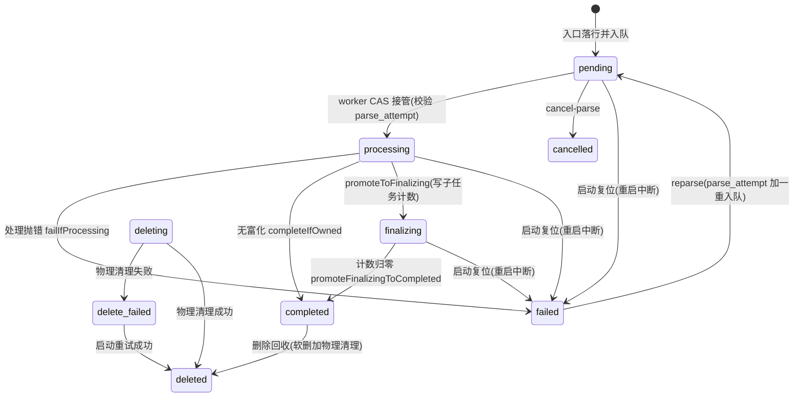

# 8. 知识生产：文档入库管线

本章覆盖"一份文档从入口到可检索"的完整生产线。一页纸版见 [ingest-flow.md](architecture/ingest-flow.md)；解析产物的消费方（检索）见 [§7](07-检索引擎.md)/[§9](09-RAG问答管线.md)。

## 8.1 知识形态与入口

所有入口最终收敛为同一件事：**插一行 `knowledges`（`parse_status=pending`）并调用 `KnowledgeProcessingQueue.enqueue`**。

| 形态 | 端点 / 入口 | 说明 |
|---|---|---|
| 文件上传 | `POST /api/v1/knowledge-bases/{id}/knowledge/file` | 201 返回文档视图；`processConfig` 整体写入 `metadata.processOverrides` |
| URL | `POST /api/v1/knowledge-bases/{id}/knowledge/url` | `SsrfGuard` 校验先行；同步抓取后与文件同形落行（worker 对非 manual 只读 `file_path`） |
| 手工 | `POST /api/v1/knowledge-bases/{id}/knowledge/manual` | 正文存 `metadata.content`；更新走 `PUT /api/v1/knowledge/manual/{id}` |
| FAQ | `POST /api/v1/knowledge-bases/{id}/faq/entries`（批量，异步）、`POST .../faq/entry`（单条） | 产出 `faq` 型 chunk；导入进度 `GET /api/v1/faq/import/progress/{taskId}` |
| 图片信息补全 | `PUT /api/v1/knowledge/image/{id}/{chunkId}` | 写 `imageInfo` 并维护 `image_caption` / `image_ocr` 子块，事务提交后重建向量 |
| 重解析 | `POST /api/v1/knowledge/{id}/reparse`、`POST /api/v1/knowledge/batch-reparse` | `parse_attempt` 自增后重新入队，可带新的 `processConfig` 整体替换旧覆盖 |
| 数据源同步 | `MapperKnowledgeBridge` → `KnowledgeIngest.enqueueProcessing` | 连接器只取回，落行后进本链路（见 [§16](16-外部数据源连接器.md)） |
| 分块预览 | `POST /api/v1/chunker/preview` | 不落库，调试用（见 [§8.4](08-知识生产-文档入库管线.md)） |

上传/URL 落行前做**同库同哈希同类型重复检测**（`contentHash` = md5），命中抛 `DuplicateKnowledgeException`（错误码 `KNOWLEDGE_DUPLICATE_FILE`）。取消解析入口是 `POST /api/v1/knowledge/{id}/cancel-parse`（见 [§8.7](08-知识生产-文档入库管线.md)）。

## 8.2 状态机

状态列是 `knowledges.parse_status`，词汇集中在 `contract.knowledge.KnowledgeParseStatus`；所有状态写都收口在 `IngestStateRepository`（条件 UPDATE，返回 0 行 = "这行已不归本次尝试"）。

| 状态 | 含义 | 谁推进 |
|---|---|---|
| `pending` | 已落行、等待 worker | 各入口 enqueue；取消端点可直接翻 `cancelled` |
| `processing` | 解析/分块/向量化中 | `casPendingToProcessing`（worker 唯一接管口） |
| `finalizing` | 富化子任务进行中 | `promoteToFinalizing`，同时写 `pending_subtasks_count` |
| `completed` | 全部完成 | `completeIfOwned`（无富化）或 `promoteFinalizingToCompleted`（计数归零守卫） |
| `failed` | 失败终止，`error_message` 截 2000 字符 | `failIfProcessing`；仅 `processing` 且代次未变可翻 |
| `cancelled` | 用户取消 | `cancel-parse`（幂等；`completed`/`failed`/`deleting` 拒绝取消） |
| `deleting` | 删除过渡标记（清空知识库时批量打上） | `KnowledgeRecycleService` |
| `deleted` | 软删完成且物理资源已回收 | 回收清理成功后落终态 |
| `delete_failed` | 行已软删但物理清理失败，待启动重试 | `markCleanupFailed` |

> **原理要点**：全部迁移是**代次化 CAS**——每条 WHERE 都带 `parse_attempt`（重解析时 `KnowledgeParseService` 自增该列），旧尝试的迟到写因代次不匹配而 0 行退出。两个旁路状态列与状态机并行：`enable_status`（索引完成 `markIndexedEnabledIfOwned` 置 `enabled` + `processed_at`）与 `summary_status`（`none/pending/processing/completed/failed`，见 [§8.6](08-知识生产-文档入库管线.md)）。`isAborted()` 的判定口径是 `parse_status` 为 `deleting` 或 `cancelled`——worker 在阶段间检查点静默退出。

## 8.3 解析：docreader 与 OCR

**docreader** 是独立 gRPC 服务（proto 在 `docreader/docreader.proto`，`service DocReader` 提供 `Read` / `ReadStream` / `ListEngines`）。地址经环境变量 `DOCREADER_ADDR` 注入 `grpc.client.docreader.address`，缺省 `static://localhost:50051`（`DocReaderProperties` 兜底 `localhost:50051`，`docreader.transport` 缺省 `grpc`）。Java 侧 `DocReaderClient` 走 `ReadStream` 流式：先到一帧 meta（markdown + 元数据 + 错误），再每图一帧——大扫描件不触 gRPC 单消息上限；超时/协议错误统一映射为 `IllegalStateException`。

- **解析引擎路由**：`KnowledgeTextExtractor.resolveParserEngine` 是 KB 级 `chunkingConfig.parserEngineRules`（`fileTypes` → `engine`）的**唯一消费点**，逐文档 `processOverrides.parserEngineRules` 优先，未命中回落 KB 规则，再回落 docreader 默认路由。引擎目录（本地静态注册表 + 远端 `ListEngines` 合并）由 `ParserEngineCatalog` 实现，管理面经 `contract.doc.ParserEngineCatalogPort` 消费（`/system/parser-engines*`）。
- **图片抽取与 URL 重写**：docreader 返回的 `imageRefs`（文件名/原始引用/MIME/内联字节）交给 `ExtractedImageStore.storeAndRewrite`——图片落租户存储 `exports` 区、登记资源并绑定属主，正文重写为 provider 形引用（`local://` 等）；图片类文档正文最前补 `# {标题}`；引用同步记进 `metadata.mediaRefs` 供检索侧使用。
- **图片 OCR**：`KnowledgeImageOcr` 把正文里已落盘的 `exports` 引用送外部 OCR 服务，识别文字插回引用下方（单张上限 20000 字符；单图失败只告警跳过，不中断整篇）。应用级配置段是 **`knowledge.ocr.*`**（不是 `ragagent.ocr`）：`endpoint`（env `OCR_ENDPOINT`，**空 = 关闭**）、`max-pages` 缺省 30、`timeout-seconds` 缺省 60、`concurrency` 缺省 2、`max-image-side` 缺省 1600。KB 级开关 `imageProcessingConfig.ocrEnabled` **缺省开启**，逐文档 `processOverrides.imageProcessingConfig.ocrEnabled` 优先。
- **音视频**：`KnowledgeMediaTranscriber` 独立分支（docreader 不认视频）：ffmpeg 抽音轨 → `AsrTranscriber` 转写 → 带媒体信息与时间戳的正文；配置 `knowledge.media.max-duration-seconds`（缺省 600）/ `ffmpeg-path` / `ffprobe-path`。无音轨视频不判失败，语音文本处写明原因。
- **VLM 图片描述**：入库期**没有**自动视觉描述；`image_caption` 子块由 `PUT /knowledge/image/{id}/{chunkId}` 人工/外部补全维护。`IngestStage.MULTIMODAL` 不是被 worker 推进的独立阶段——图片 OCR 在 `docreader` 阶段内完成，只借用该阶段名记 span。
- 另：`file_type=html` 的网页先经 `HtmlMainContent.extract` 抽主体再送解析器（导航/页头/页脚不进正文，抽取失败退回原文）。

## 8.4 分块

分块器在 `knowledge/chunker` 包：入口 `Chunker`，`auto` 策略链 `ProfileDocument → heading → heuristic → legacy`，每层输出过 `ChunkValidator` 校验、失败逐级回退，`legacy` 永远兜底；显式策略 `heading` / `heuristic` / `recursive` / `legacy` 可经配置指定。

- **默认值**：`SplitterConfig.DEFAULT_CHUNK_SIZE = 512`、`DEFAULT_CHUNK_OVERLAP = 80`、`DEFAULT_SEPARATORS = ["\n\n", "\n", "。"]`；KB 配置 0/缺省值回退默认，overlap 上限为 chunkSize 的一半。
- **落库**：`KnowledgeChunkWriter.chunkAndPersist` 把配置（含逐文档覆盖）折成 `SplitterConfig` → `Chunker.split` → 逐块 insert：`chunk_type=text`、`chunk_index`、`start_at/end_at`、`context_header`、行间 `pre_chunk_id`/`next_chunk_id` 双向链。本次尝试的 chunk id 清单留给失败清场用。
- **父子块（`parent_text`）——诚实边界**：配置键（`enableParentChild` / `parentChunkSize` / `childChunkSize`）与 `Chunker.splitParentChild` / `splitParentChildWithDiagnostics` 都已实现，**分块预览端点可用**；但**入库 worker 目前只出 `text` 单层块**——`KnowledgeBaseChunkingConfig.ingestionInactiveKeys()` 会把 `enableParentChild` 等未消费键显式记进 chunking 阶段 span（"要么生效、要么被显式告知"）。`parent_text` 作为契约常量（`ChunkTypes.PARENT_TEXT`）存在，向量索引显式排除该类型（"仅用于上下文，不参与向量索引"）。
- **预览端点**：`POST /api/v1/chunker/preview`，正文上限 65536 码点（超出 413），响应带策略链诊断（选中层、被拒层与原因、文档画像）。
- **逐文档覆盖**：`ProcessOverridesResolver` 解析 `metadata.processOverrides`，口径是"覆盖优先、缺省回落 KB、覆盖里没出现的键沿用 KB 值"：`chunkingConfig` 逐字段叠加；`parserEngineRules` 顶层或分块内同名键；`graphEnabled` 只能**关**不能开（KB 关时单文档开无效）；`extractConfig` 以 KB 为底叠加 `text/tags/nodes/relations/customInstructions`，`enabled` 同样只能改关。

## 8.5 向量化与索引

`ChunkVectorIndexer` 是 chunk 向量行重建的唯一执行体，两个入口共用 `indexAndStore`：多 chunk 版 `indexChunks`（worker 索引阶段）、单 chunk 版 `syncChunkIndex`（chunk 编辑链路，disabled 块删旧不重建）。

两条分叉由 `KnowledgeVectorWrites.boundEngine(kb, tenantId)` 判定（**租户必须显式给**：worker 线程无上下文，null 会被兜成 0 导致绑定店误判跨租户）：

| 分叉 | 删旧行 | 写新行 | 批大小 |
|---|---|---|---|
| KB 绑定外部索引引擎 | `IndexEngine.deleteByChunkIdList(ids, dims, kbType)` | `IndexEngine.batchIndex(embedder, items)`，嵌入与分批/退避由引擎服务承担 | 引擎侧决定 |
| 未绑定（本地 pg） | `VectorIndexStore.deleteByChunkId(ids)` | `runtimeEmbedder.batchEmbed(texts)` + `saveIndexRows(batchRows, vectors)` | `batch.embed-size`（env `BATCH_EMBED_SIZE`），空/缺省 **5**，非法值抛 `IllegalStateException` |

- **索引文本形态**：`title + "\n" + embeddingContent`（`KnowledgeIndexContent.build`）；`embeddingContent` = ContextHeader + 正文，保证 BM25 与向量评分对象同源。
- **跳过规则**：`isEnabled=false` 或 `chunk_type=parent_text` 的块删旧不重建；chunk 行与生成问题行分开建行——问题行 `source_id` 用 `generatedQuestionSourceId`（超 64 字节折叠为 `chunkId-q<sha256 前 12 字节 hex>`）。
- **前置校验**：`assertIndexable`（模型非空且存在）在写库**前**调用，把真正的外部索引删旧+重建安全后移到事务提交之后。
- **开关**：KB `indexingStrategy` 的 vector/keyword 全关 → `resolveEmbeddingModelId` 返回 null，embedding 阶段记 skip；模型不可见直接 `IllegalStateException` 进 failed。

## 8.6 富化：摘要 / 问题生成 / 图谱抽取 / Wiki 交接

`KnowledgeFinalizingStage.planFinalizing` 独立判定三项富化（wiki 关、图开也要跑）：

| 子任务 | 开启条件（缺一不可） | 槽位数 | 队列 |
|---|---|---|---|
| Wiki 交接 | `indexingStrategy.wikiEnabled` + 有文本 chunk + 能解析出合成模型（`wikiConfig.synthesisModelId` 优先，回落 KB `summaryModelId`） | 1 | `WikiIngestService.enqueueWikiIngest`（pending op 落库 + 防抖触发），由 `DefaultWikiKnowledgeFinalizer.finalizeWikiSubtask` 递减并晋升 |
| 图谱抽取 | `graphEnabled`（KB 开 + 文档未关）+ `extractConfig.enabled` + 选出的非空块（`GraphChunkSelector.selectGraphChunks`） | 每入选 chunk 1 槽 | `ChunkExtractTaskQueue`（任务名 `chunk:extract`），逐块入队 |
| 问题生成 | `QuestionGenerationPolicy.enabled` + KB 需要 embedding + 有可抽取文本块；按 `StartAt` 排序后 `QuestionBatchPlanner.BATCH_SIZE = 20` 切批 | 每批 1 槽 | `QuestionGenerationTaskQueue`（任务名 `question:generation`），载荷只带 chunk id |

`pending_subtasks_count = wiki 1 + 问题批数 + 图分块数`，与 `processing → finalizing` 在同一次条件更新里原子写入（`promoteToFinalizing`）。**晋升失败 = 行已被 cancel/delete/新一代次抢走，跳过富化且不覆盖状态**。每个子任务完成/失败都经 `KnowledgeFinalizeAdapter.finalizeSubtask` 做"递减 + 带守卫晋升"两步写；入队失败（队列缺席、单条投递异常、wiki op 未被接受）的槽位**立即释放**，避免行搁浅在 `finalizing`。

> **反直觉**：**摘要不占 finalizing 槽**。KB 配了 `summaryModelId` 时，收口处置 `summary_status=none` 后通过同步领域事件 `KnowledgeProcessedEvent` fan-out（订阅方 `KnowledgeSummaryService.onKnowledgeProcessed` 在本线程执行），摘要有自己的状态字段与清扫阈值，不算第 4 种 finalizing 子任务；无富化路径的 `failOrComplete` 同样只配了摘要模型才触发。

可靠性细节：Redis 队列重试上限 3 次（退避见 [§4.6](04-模块UML类图.md)），耗尽放弃并记日志、槽位由 worker 的失败路径释放；富化子任务先抢 ownership 再推进启用态（`markIndexedEnabledIfOwned`），保证 `cancelled + enabled` 这种矛盾态写不进去。

## 8.7 删除、取消与恢复

**取消**（`POST /knowledge/{id}/cancel-parse`）：`KnowledgeParseService.cancelKnowledgeParse` 先按状态分流——已 `cancelled` 幂等返回、`completed/failed` 400、`deleting` 400；然后 `markCancelled` 抢行（置 `cancelled` + 计数清零 + 收口 span 为 `USER_CANCELLED`）。运行中的 worker **不中断**，只在检查点看到 `isAborted()` 静默退出，各步状态 CAS 因状态不再匹配而 0 行。

**删除**（`DELETE /knowledge/{id}`、`POST /knowledge/batch-delete`、清空 `DELETE /knowledge-bases/{id}/knowledge`）统一走 `KnowledgeRecycleService`，**两段式**：事务内推进库内状态（knowledge + chunk 软删），物理资源（文件、抽取图片、向量/关键词索引、图谱）注册 **afterCommit** 清理——顺序不能反，外部资源无法靠数据库回滚。物理清理逐项独立兜底，单项失败标记 `delete_failed`（行已软删、检索不可见，`error_message = "cleanup failed: <资源名>"`）。

**启动自愈与恢复**（boot 的 `StartupTaskRecovery`，`ApplicationReadyEvent` 触发，失败只 WARN 不阻塞启动）：

1. `KnowledgeStartupRecovery.resetStuck`（**仅 `knowledge.redis-enabled=false` 时执行**）：`parse_status ∈ {pending, processing, finalizing, deleting}` 的行复位为 `failed`（文案 `Task interrupted due to application restart`，计数清零），随后取消孤儿 span（`SERVER_RESTART`）；`summary_status ∈ {pending, processing}` 同样复位。分布式模式跳过——另一副本可能仍在处理同一行，那是 `HousekeepingService` 的职责。
2. `KnowledgeRecycleService.retryFailedCleanups`：扫 `delete_failed` 行逐条重跑物理清理（幂等），全部成功落 `deleted`；单次启动上限 200 条。
3. `HousekeepingService`（5 分钟 ticker，`RAGAGENT_HOUSEKEEPING_ENABLED` 缺省开）：对 `pending/processing/finalizing` 的行做"updated_at + span 心跳"两级判活，第二道闸确认队列确无活任务后才判孤儿复位，防误杀长阶段。

## 8.8 想改 X 去哪

| 需求 | 落点 | 不要 |
|---|---|---|
| 新增一种文本来源 | `KnowledgeTextExtractor.extract` 加分支（或新入口 controller/service） | 往 `processInner` 里塞 if |
| 新增一种分块策略 | `chunker` 包加 `Chunker` 策略层 | 改 worker 主流程 |
| 新增一种向量后端 | `retrieval-engine` 实现 `IndexEngine` + 绑定关系 | 在 worker 里直连厂商 API |
| 新增一种富化子任务 | `planFinalizing` 加计划项 + 子任务队列 + 计数收口 | 绕开 `pending_subtasks_count` 直接改状态 |
| 新增管理页进度展示 | `KnowledgeProcessingSpan` / `GET /knowledge/{id}/stages` | 另起一套并行状态字段 |
| 调整失败重试 | `failOrComplete` + 队列 `RetryPolicy` | 在 controller 里重试 |
| 让父子块真正进入库 | `KnowledgeChunkWriter`（接 `splitParentChild`）并删 `ingestionInactiveKeys` 对应项 | 只改前端开关 |

---

[上一章：7. 检索引擎（retrieval-engine）](07-检索引擎.md) ｜ [返回目录](详细技术文档.md) ｜ [下一章：9. RAG 问答管线（事件 → 插件链）](09-RAG问答管线.md)
