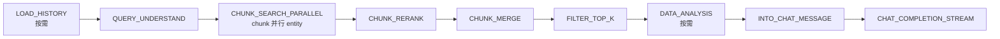

# 9. RAG 问答管线（事件 → 插件链）

## 9.1 执行语义：事件、闭包链与插件错误

`PipelineEventType` 是编译期注册表，共 **14 个**枚举值：`LOAD_HISTORY`、`MEMORY_RECALL`、`QUERY_UNDERSTAND`、`CHUNK_SEARCH`、`CHUNK_SEARCH_PARALLEL`、`ENTITY_SEARCH`、`CHUNK_RERANK`、`WEB_FETCH`、`CHUNK_MERGE`、`DATA_ANALYSIS`、`INTO_CHAT_MESSAGE`、`CHAT_COMPLETION`、`CHAT_COMPLETION_STREAM`、`FILTER_TOP_K`。

`EventManager`（`session/rag/` 包）是插件注册表与事件分发器，两条核心语义：

- **注册顺序即执行顺序**：`register(plugin)` 把插件挂到它 `activationEvents()` 声明的每个事件上，`buildHandler` 从最后一个插件往前包闭包——先注册的包在越外层、越先执行；每个插件拿到 `Chain.next()`，决定是否把控制权交给下一环。
- **错误即终止**：`Plugin.onEvent(eventType, state, next)` 返回 `null` 继续链；返回非空 `PluginError` 终止整条链（后续插件与事件都不再跑）。`PluginError` 的预定义错误是单例（`SEARCH_NOTHING`、`SEARCH`、`RERANK`、`GET_RERANK_MODEL`、`GET_CHAT_MODEL`、`TEMPLATE_PARSE`、`TEMPLATE_EXECUTE`、`MODEL_CALL`、`GET_HISTORY` 共 9 个），管线多处用引用比较；`withError(cause)` 返回新实例、不污染单例。

`SEARCH_NOTHING` 是哨兵语义：`SessionKnowledgeQaService.knowledgeQAByEvent` 对它不算失败，而是记 `stage_fallback` 后调 `SessionQaFallback.handleFallbackResponse(chatManage)`（按 `fallbackStrategy` 给兜底答复）并直接返回。其余错误抛出后由执行器发 `EVENT_ERROR` 并收尾。取消探针（`qaReq.cancellationProbe`）在每个阶段边界检查：STOP 置位后抛 `context canceled`。

> **反直觉**：`trigger` 返回非空 `PluginError` **不会**自动传播给调用方的调用栈——是 `knowledgeQAByEvent` 这个驱动循环把它翻译成 fallback / 异常；插件自身只返回错误对象。

## 9.2 阶段 × 插件表

`QaWiring.chatPipelineEventManager` 注册 **17 个**插件实例（`mgr.register` 调用 17 次），注册序即同阶段多插件的执行序：

| 阶段 | 插件（按注册序） | 作用 |
|---|---|---|
| `LOAD_HISTORY` | `PluginLoadHistory` | 载入最近 `maxRounds` 轮历史 |
| `MEMORY_RECALL` | `PluginMemoryRecall` | 长期记忆召回并写入 `usedMemories` |
| `QUERY_UNDERSTAND` | `PluginQueryUnderstand`、`PluginExtractEntity` | 查询改写/意图判定；实体抽取（Neo4j 未启用时直通） |
| `CHUNK_SEARCH` | `PluginSearch` | 单 KB 混合检索（向量 + 关键词 + FAQ 策略） |
| `CHUNK_SEARCH_PARALLEL` | `PluginSearchParallel` | 并发跑 chunk 检索与实体检索并合并去重 |
| `ENTITY_SEARCH` | `PluginSearchEntity` | 图谱实体检索 |
| `CHUNK_RERANK` | `PluginRerank`、`PluginWikiBoost`、`PluginMemoryAffinity` | 重排；Wiki 命中加权；记忆亲和度加权 |
| `WEB_FETCH` | `PluginWebFetch` | 抓取网页补充上下文 |
| `CHUNK_MERGE` | `PluginMerge` | 多路结果合并/去重/父子块展开 |
| `DATA_ANALYSIS` | `PluginDataAnalysis` | CSV/Excel 命中时的数据分析 |
| `INTO_CHAT_MESSAGE` | `PluginIntoChatMessage` | 检索结果拼装成用户消息上下文 |
| `CHAT_COMPLETION` | `PluginChatCompletion` | 非流式模型补全 |
| `CHAT_COMPLETION_STREAM` | `PluginChatCompletionStream` | 流式补全（增量写流） |
| `FILTER_TOP_K` | `PluginFilterTopK` | 按 `rerankTopK` 截断 |

## 9.3 预设管线与默认 `rag_stream`

`PipelineBuilder.presets()` 共 5 个预设（名字 → 阶段序列）：

| 预设 | 阶段序列 |
|---|---|
| `chat` | `CHAT_COMPLETION` |
| `chat_stream` | `CHAT_COMPLETION_STREAM` |
| `chat_history_stream` | `LOAD_HISTORY` → `CHAT_COMPLETION_STREAM` |
| `rag` | `CHUNK_SEARCH` → `CHUNK_RERANK` → `CHUNK_MERGE` → `INTO_CHAT_MESSAGE` → `CHAT_COMPLETION` |
| `rag_stream` | `LOAD_HISTORY` → `QUERY_UNDERSTAND` → `CHUNK_SEARCH_PARALLEL` → `CHUNK_RERANK` → `CHUNK_MERGE` → `FILTER_TOP_K` → `DATA_ANALYSIS` → `INTO_CHAT_MESSAGE` → `CHAT_COMPLETION_STREAM` |

`SessionKnowledgeQaService.knowledgeQA` 对每次请求**动态拼**管线（不是查 presets）：纯聊天走 `LOAD_HISTORY(按需) → MEMORY_RECALL → CHAT_COMPLETION_STREAM`；RAG 路径按 `hasHistory / webSearchEnabled / dataAnalysisEnabled` 条件增删阶段，形态与 `rag_stream` 等价：

## 9.4 共享实例与 `ChatManage` 可变状态

- **`PluginSearchParallel` 与 `PluginSearch` / `PluginSearchEntity` 共享同一实例**：装配层把 `CHUNK_SEARCH` / `ENTITY_SEARCH` 注册的那两个插件对象原样传给 `PluginSearchParallel` 构造器，两条路径复用。含义：这两个插件必须是**无状态**（只持有服务引用）；风险在于若有人往里加可变字段，并行路径与串行路径会互相踩——`fork()` 出的 `ChatManage` 副本隔离的是数据，不是插件自身状态。
- **`ChatManage` 可变状态**：一次管线执行的全部配置与状态。请求段（query、阈值、TopK、模型 id 等）在 `freeze()` 后冻结为 `TurnInputSnapshot`，之后请求段 setter 抛 `IllegalStateException`；状态段（`queryPlan`、`searchOutcome`、`rerank`、`merged`、`entityContext`、`answer`、`usedMemories`）由上游插件写、下游读；运行时段（事件总线 + 消息 id）不参与复制。`cloneChatManage()`（`fork()` 的实现）共享不可变请求段，只复制查询计划/实体上下文/usedMemories/renderedContexts——history、检索产出、合并结果都不复制。

## 9.5 检索参数从哪里来

两层叠加：先取全局默认（`application.yml` 的 `conversation:` 段，绑定进 `ConversationProperties`），再被 agent 配置 JSON 覆盖（`QaChatManageOverrides.applyAgentOverridesToChatManage`，仅非零/非空值生效）：

| 参数 | `conversation:` 默认 | agent 配置覆盖键 |
|---|---|---|
| 历史轮数 | `max-rounds: 5` | `historyTurns`（`multiTurnEnabled=false` 时强制 0） |
| 向量阈值 | `vector-threshold: 0.2` | `vectorThreshold` |
| 关键词阈值 | `keyword-threshold: 0.3` | `keywordThreshold` |
| 召回 TopK | `embedding-top-k: 30` | `embeddingTopK` |
| 重排 TopK | `rerank-top-k: 30` | `rerankTopK` |
| 重排阈值 | `rerank-threshold: 0.3` | `rerankThreshold`（含 `rerankModelId`） |
| 查询改写 | `enable-rewrite: true` | `enableRewrite` |
| 查询扩展 | `enable-query-expansion: true` | `enableQueryExpansion` |
| 兜底策略 | `fallback-strategy: model` | `fallbackStrategy` / `fallbackResponse` / `fallbackPrompt` |

会话表 `sessions` 也有同名阈值列（会话级），agent 配置是更上层的覆盖来源；最终全部落进 `ChatManage` 请求段。

## 9.6 加一个新阶段的步骤

1. 在 `PipelineEventType` 加一个枚举值（`key()` 用小写下划线）；
2. 写一个 `Plugin` 实现（声明 `activationEvents`，读写 `PipelineState` 字段）；
3. 在 `QaWiring.chatPipelineEventManager` 里按目标顺序 `mgr.register(...)`；
4. 跑 `python3 scripts/gen-pipeline-map.py` 重新生成 `docs/architecture/pipeline-map.md`（生成物是派生数据，不要手改）；
5. 跑测试：`PipelineRegistryCompletenessTest`（boot 模块，`@SpringBootTest`，断言每个枚举值都有至少一个插件，漏注册直接红）；插件逻辑测试在 domains 模块（如 `PipelineCoreRecordingTest`）。

---

[上一章：8. 知识生产：文档入库管线](08-知识生产-文档入库管线.md) ｜ [返回目录](详细技术文档.md) ｜ [下一章：10. Agent 引擎](10-Agent引擎.md)
