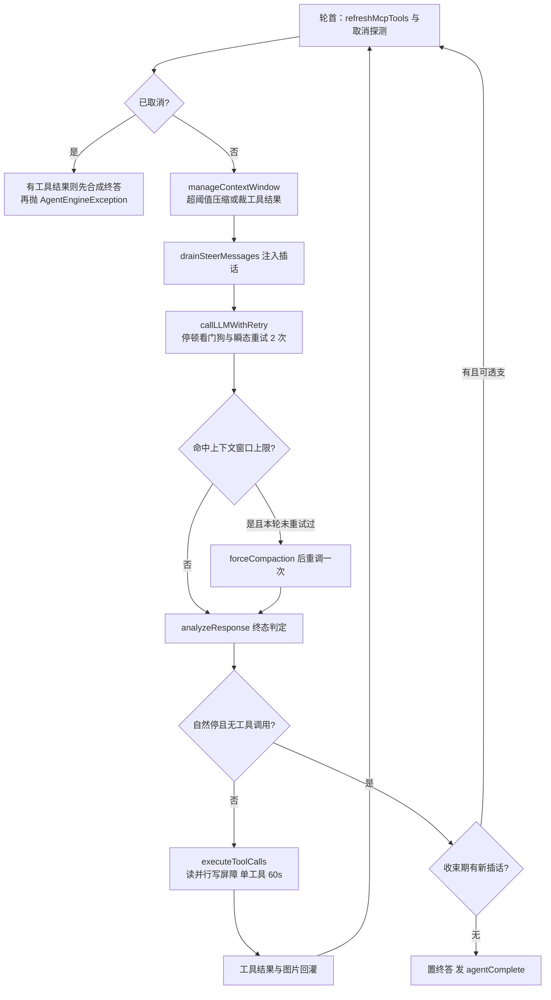

# 10. Agent 引擎

## 10.1 循环阶段与终止条件

一轮 = 一个 `ReActIteration`：`manageContextWindow`（裁剪/压缩）→ `drainSteerMessages`（注入插话）→ `callLLMWithRetry`（调模型）→ `analyzeResponse`（判定）→ `executeToolCalls`（执行工具）→ `appendToolResults/appendToolImages`（回灌）。循环由 `AgentEngine.executeLoop` 驱动，轮首刷新 MCP 工具定义并做取消探测。

终止条件全集（常量都在 `AgentConsts` / `AgentRunSpec`）：

| 出口 | 判定 | 缺省/阈值 |
|---|---|---|
| 自然终答 | finish reason 为 `stop`/`end_turn`/`stop_sequence` 且无工具调用 | — |
| 内容安全终态 | `content_filter` 且无工具调用 | 直接收束，不重试 |
| 轮次预算 | `withinIterationBudget`；负数 = 无上限（`UNLIMITED_MAX_ITERATIONS=-1`） | 未配置补 10（`AgentConfigJson.ensureDefaults`），装配时 `>100` 拒绝（`SessionAgentQaService.MAX_ITERATIONS`） |
| 轮次耗尽兜底 | `FinalizePhase.handleMaxIterations` 再合成一次终答 | — |
| 卡死循环 | 无工具调用且内容连续相同 ≥ `MAX_REPEATED_RESPONSE_ROUNDS`(2) 轮 | 提前收束 |
| 空回复 | 自然停但无内容 → nudge 重试 ≤ `MAX_EMPTY_RESPONSE_RETRIES`(2) | 重试后用兜底文案 |
| 取消 | `cancellationSource` 探针返回非 null（轮首与 LLM 返回后各查一次） | null = 存活 |
| LLM 停顿 | 流式无输出超过 `llmStallTimeout` | 默认 120s，`llmCallTimeout>0` 可覆盖 |
| 瞬态错误 | 错误串命中 `429/500/timeout/...` → 重试 `MAX_LLM_RETRIES`(2) 次 | sleep 1s/2s |

> **边界**：单次工具执行固定 60s（`AgentConsts.toolExecutionTimeout`）；流式调用的总上限在传输层，由环境变量 `RAGAGENT_LLM_STREAM_TIMEOUT_SECONDS` 控制（代码默认 600s，`LlmTransport`）。

## 10.2 上下文预算与压缩

**怎么算 token**：权威来源是模型 API 返回的 `TokenUsage`；`TokenEstimator` 只补两个缺口——LLM 调用之间新增消息的增量估算（`lastUsage` 基线 + delta）与首轮无 Usage 时的兜底。编码器用 jtokkit 的 `CL100K_BASE`（OpenAI 词表 + BPE），`reasoning_content` 与正文、工具调用一起计数（漏记会把思考类模型的 130k 上下文量成 26k）；图片按 1200 token/张假定，工具 schema 计数只用于诊断、不进压缩触发条件。

**阈值链**：`maxContextTokens` 取"agent 显式配置 > 模型声明的 `contextWindow` > `AgentBudgets.DEFAULT_MAX_CONTEXT_TOKENS`(200000)"；压缩阈值 = `maxContextTokens - reserveTokens`，其中 reserve = max(本轮补全预算 + `CONTEXT_SAFETY_TOKENS`(4096), `DEFAULT_RESERVE_TOKENS`(16384))；补全预算 quick-answer 2048 / smart-reasoning 4096（`AgentBudgets`）。

**压缩策略**（`compaction/`）：超过阈值时 `Compactor.compact` 把 keep-recent 预算之外的历史收成一份**检查点摘要**（低温度 0.3、关思考、最多 2 次重试；`length` 截断的摘要视为失败）。摘要失败降级为把原始档案追加进摘要文本（`degraded` 标记）。`DEFAULT_KEEP_RECENT_TOKENS=20000`，且被压到可用窗口的 1/4 以内——这让压缩必然收敛（压完约在阈值一半）。腾不出空间（`NothingToCompactException`）或释放不足 1/20 时记 `compactionExhaustedAt` 不再重试；每次成功压缩发 `contextCompacted` 事件并重置 usage 基线。响应命中窗口上限（finish reason 被窗口塑形）时绕过阈值**强制压缩**，每轮执行只回收一次。

**超长工具结果**：压缩后仍超预算才走这步（lossy 兜底）。`ContextBudget.trimToolResultsToBudget` 给全部工具结果预算 = `maxContextTokens/5`，钳制在 [8192, 32768]：先全部替换为 `[Tool result compacted: ...]` 标记，再把剩余预算从最新往最旧花——装得下的恢复全文，装不下的拿到最大头尾预览（二分求 keep 值）；MCP 目录结果因含结构化 schema 整体省略而非截断。

## 10.3 运行中转向（steer）与取消（引擎侧）

转向：`SteerSink`（`contract.agent`）是引擎的注入通道，null = 完全禁用。`SteerIntake.drainSteerMessages` 在**轮边界**（压缩后、下一次 LLM 调用前）与**收束边界**各 drain 一次：`persistSteerMessage` 先落库、成功才追加进消息列表（失败留待下次重试，避免模型看到没记录的文本），并发 `userMessageInjected` 事件。若终答收束时又排进新插话且轮次预算已用尽，允许"透支"最多 `MAX_STEER_OVERRUNS`(1) 轮继续跑——这就是 `allowSteerOverrun` 的用途。会话侧 `POST /api/v1/sessions/{sessionId}/steer` 与 `SteerSinkBridge` 的接入见 [§12](12-会话流式输出与SSE.md)。

取消：`setCancellationSource(Supplier<String>)` 接探针，null = 存活、非 null = 错误原文。轮首取消时若已有工具调用结果，先用它们合成一次终答再抛 `AgentEngineException`（答案不白算）；LLM 调用中途取消则保留半截 `AgentStep` 直接退出循环。探针同样贯穿工具执行（`executeTool` 的 `ToolCancellation`）与审批等待（取消即投递取消决策）。

## 10.4 Agent 配置（`agentmanagement` 域）

`AgentController` 提供 agent CRUD 与元数据；`SkillController` 提供技能目录管理（见 [§11.2](11-工具技能与MCP.md)）。Agent 与模型/工具/技能/知识库的绑定全部落在配置 jsonb（`AgentConfigJson.CONFIG_KEYS` 的 60 个已知键）：`modelId`、`rerankModelId`、`allowedTools`、`mcpSelectionMode`/`mcpServices`/`mcpAuthWaitTimeout`、`skillsSelectionMode`/`selectedSkills`、`kbSelectionMode`/`knowledgeBases`、`webSearchEnabled`/`webSearchProviderId`、`memoryEnabled`、`maxIterations` 等。

| 端点（`/api/v1` 前缀） | 方法 | 说明 |
|---|---|---|
| `/agents` | GET/POST | 列表（含共享解析）/ 新建 |
| `/agents/placeholders` | GET | 提示词占位符静态定义（10 个：`query`/`contexts`/`current_time`/`current_week`/`conversation`/`yesterday`/`answer`/`knowledge_bases`/`web_search_status`/`language`） |
| `/agents/type-presets` | GET | agent 类型预设（`agent/management/agent_type_presets.yaml`） |
| `/agents/{id}` | GET/PUT/DELETE | 详情 / 更新 / 删除 |
| `/agents/{id}/copy` | POST | 复制 |
| `/agents/{id}/suggested-questions` | GET | 建议问题（静态 curated + FAQ/文档分块池；limit 默认 6、上限 30，`AgentSuggestedQuestions`） |

内置 agent：`BuiltinAgentRegistry` 启动时装载 `domains/src/main/resources/agent/management/builtin_agents.yaml`——代码白名单 `isBuiltinAgentId` 收 8 个 id，随仓库 YAML 实际装载 5 个（`builtin-quick-answer`、`builtin-smart-reasoning`、`builtin-data-analyst`、`builtin-wiki-researcher`、`builtin-wiki-fixer`）；列表展示序固定 7 个（wiki-fixer 刻意不在列）。YAML 未知键静默丢弃，`system_prompt_id`/`context_template_id` 引用的模板 content 启动时解析填入；name/description 按 locale 解析（`RAGAGENT_LANGUAGE` 优先）。

## 10.5 用量统计与事件

每个 ReAct 轮把 `response.getUsage()` 累进 `AgentState.getTurnUsage()`（含 `cacheReadTokens`/`cacheWriteTokens` 与缓存命中率），终态 `agentComplete` 事件**恒输出** `usage` 键（无用量时为 `null`，消费侧按 `usage instanceof TokenUsage` 判别）；失败收尾的 complete 事件带 `extra={"outcome":"failed","error":...}`。过程事件：`toolCall`/`toolResult`/`finalAnswer`/`contextCompacted`/`userMessageInjected`/`error`（事件类型清单见 `EventType`）。追踪面：Langfuse 三层 span `agent.execute` → `agent.round.N` → `agent.tool.<name>`（工具输出 4000 字符预览，敏感参数只报键）。

---

[上一章：9. RAG 问答管线（事件 → 插件链）](09-RAG问答管线.md) ｜ [返回目录](详细技术文档.md) ｜ [下一章：11. 工具、技能与 MCP](11-工具技能与MCP.md)
