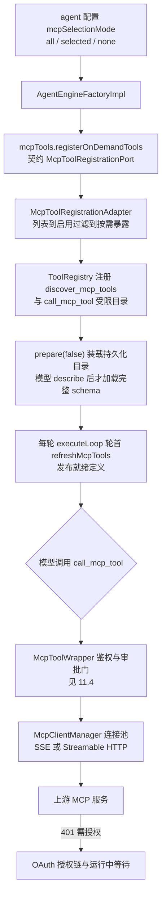
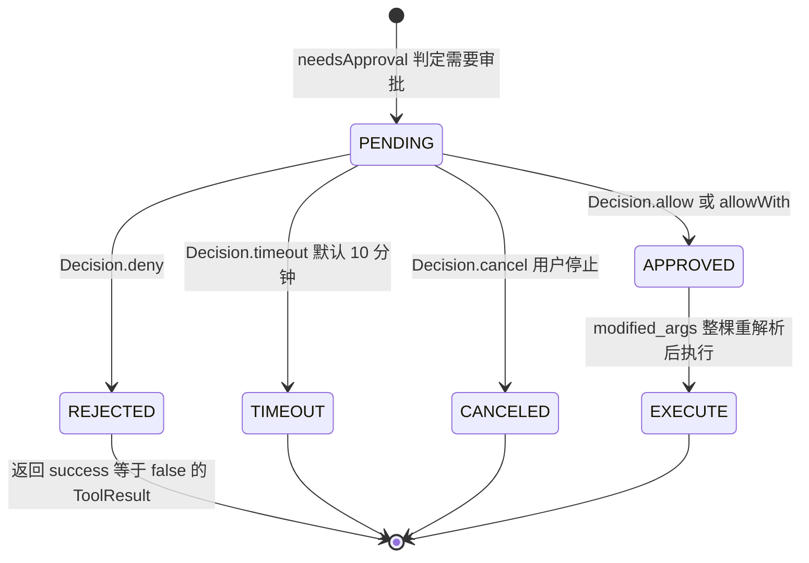

# 11. 工具、技能与 MCP

## 11.1 内置工具

**数量口径**：`ToolDefinitions` 的 `TOOL_*` 常量共 **33 个**（`grep -c` 实测；`scripts/check-tool-registry.py` 报告"33 个工具名常量 / 22 个 agenttools 实现 / 22 条分发 / 装配 switch 覆盖 29 个"）。当前真正会注册的 27 个 = `agenttools` 22 + 引擎内置 3（`thinking`/`todo_write`/`read_file`）+ MCP 动态 2（`discover_mcp_tools`/`call_mcp_tool`）；另有 6 个沙箱族常量（`list_sandbox_files`/`write_sandbox_file`/`edit_sandbox_file`/`shell_exec`/`write_skill_file`/`edit_skill_file`）保留名字与持久化清洗规则，但**随沙箱裁剪已无注册点**（`AgentEngineAssembler.buildTools` 对它们恒走跳过分支）。

| 类别 | 工具名 | 实现类（`agenttools` 子包 / `agent.tool`） |
|---|---|---|
| 知识检索（7） | `knowledge_search` `grep_chunks` `list_knowledge_chunks` `get_document_info` `query_knowledge_graph` `search_conversations` `search_memory` | `KnowledgeSearchTool` `GrepChunksTool` `ListKnowledgeChunksTool` `GetDocumentInfoTool` `QueryKnowledgeGraphTool` `SearchConversationsTool` `SearchMemoryTool`（`agenttools/knowledge/`） |
| SQL/数据表（3） | `database_query` `data_analysis` `data_schema` | `DatabaseQueryTool`（`agenttools/sql/`，`SqlGuard` 等守卫）；`DataAnalysisTool` `DataSchemaTool`（`agenttools/datasource/`，DuckDB JDBC） |
| Wiki（10） | `wiki_read_page` `wiki_search` `wiki_read_source_doc` `wiki_flag_issue` `wiki_write_page` `wiki_replace_text` `wiki_rename_page` `wiki_delete_page` `wiki_read_issue` `wiki_update_issue` | `agenttools/wiki/` 同名工具类 |
| 网页（2） | `web_search` `web_fetch` | `WebSearchTool` `WebFetchTool`（`agenttools/web/`，provider 经 `websearch` 域） |
| 思维链/待办（2） | `thinking` `todo_write` | `SequentialThinkingTool` `TodoWriteTool`（agent-engine 内置，按允许清单注册） |
| 技能读取（1） | `read_file` | `SkillReadFileTool`（`skill://<name>/SKILL.md` 与 `skill://<name>/<file>` 通道） |
| MCP 动态（2） | `discover_mcp_tools` `call_mcp_tool` | `McpDiscoverTool` `McpCallTool`（`mcp/tool/`，见 [§11.3](11-工具技能与MCP.md)） |

**注册链**：域侧 `AgentToolBackends` 按工具名分发构造实例（三个 switch：检索/会话/记忆/DB 族、wiki 族、web 族）→ `AgentEngineAssembler.buildTools` 按 `allowedTools` 裁剪（无 wiki KB 摘掉 wiki 族、无向量库摘掉检索族）→ `AgentEngineFactoryImpl.create` 把它们连同内置工具注册进每轮新建的 `ToolRegistry`；MCP 工具由 `McpToolRegistrationAdapter` 经 `ToolRegistryPort`（实现 `ToolRegistryPortImpl`）注册。注册表三条纪律：**first-wins**（同名重复注册保留先到者并告警，防借名劫持）、**按名排序输出**（发给 LLM 的工具块字节稳定，保住前缀缓存）、**deferred 注册**（保留执行能力但不把定义发给模型）。工具契约 `AgentTool` 四方法（name/description/parameters/execute），结果一律返回 `ToolResult`（`success`/`output`/`data`/`error`/`images`）——工具出错**不抛异常**而是 `success=false`；输出上限默认 `ToolOutput.DEFAULT_MAX_TOOL_OUTPUT`=24000 字符（agent 配置 `maxToolOutputChars` 可覆盖）。

> **工具并行**：`ToolBatchExecutor` 用**虚拟线程**并发执行一批工具调用，`Semaphore` 限并发 8、结果按调用序回填。只有 `ExecutionPolicy.canRunConcurrently` 白名单里的 14 个纯读工具可并行（`list_knowledge_chunks`、`query_knowledge_graph`、`get_document_info`、`search_conversations`、`search_memory`、`data_schema`、`web_search`、`web_fetch`、`read_file`、`list_sandbox_files`、`wiki_search`、`wiki_read_page`、`wiki_read_source_doc`、`wiki_read_issue`）；写工具、`shell_exec`、MCP/未知工具都是**执行屏障**——注意 `knowledge_search`/`grep_chunks` 虽是读但带会话级 `seenChunks` 状态，也被列为屏障。被截断的参数 JSON 经 `JsonRepair` 修复，修复后仍截断则拒执（`TRUNCATED_ARGUMENTS_ERROR`）。

## 11.2 技能（Skills）

技能 = **指令型（playbook）文档**，载体是 `SKILL.md`（frontmatter name/description + 正文），写入前用与运行期同一套 `Skill.parseSkillFile` 自校验；正文上限 256KB，`slug` 限 `[a-z0-9-]` 且 ≤64 字符。存储在 `skills` 表（`SkillCatalogService` + `DbSkillSource`，无宿主目录扫描）。

**两层目录**：平台内置层（`tenant_id IS NULL`，官方预置、全员可见只读）+ 租户自建层；可见范围 = "平台层 or 本空间"，由 `visibleScope` 单点表达，`tenantId` 缺失时只返回平台层（fail closed）。`name` 是运行期身份（agent 配置的 `selectedSkills` 存它），可见范围内唯一。

**三级注入时机**（`Manager`，每次装配一份实例、每轮重读 DB）：

| 级别 | 内容 | 注入时机 |
|---|---|---|
| Level 1 | 全部技能元数据目录 | 装配期 `initialize()` → `buildSystemPrompt` 拼进系统提示词 |
| Level 2 | 被点名的技能完整指令 | 装配期 `resolvePinnedSkillInstructions`（@ 提及的技能全文进提示词） |
| Level 3 | 技能附属文件 | 运行期模型自取：`read_file` 的 `skill://` scheme（`SkillReadFileTool` → `Manager.readSkillFile`） |

> **边界**：`skillsEnabled` 关闭或目录读取失败时 `skillsManager=null`，只降级不阻断本轮；`selectedSkills` 白名单在 `Manager.reload` 过滤，运行期越权读技能抛 `SkillValidationException`。

## 11.3 MCP 集成

`mcp` 域是 Model Context Protocol 的仓内实现（协议客户端、OAuth、服务与凭据管理、审批门），对外入口 `McpServiceController`（`/api/v1/mcp-services`）、`McpOAuthController`、`McpCredentialsController`、`AgentToolApprovalController`；对引擎的出口是契约端口 `McpToolRegistrationPort`（实现 `McpToolRegistrationAdapter`）与 `McpToolingGateway`。

| 能力 | 端点 / 类 | 说明 |
|---|---|---|
| 服务 CRUD | `POST/GET /mcp-services`、`GET/PUT/DELETE /mcp-services/{id}` | 租户自有 + 平台内置服务 |
| 连通性/目录 | `POST /{id}/test`、`GET /{id}/tools`、`GET /{id}/resources` | 连接测试、工具与资源列举 |
| 元数据 | `GET /{id}/metadata`、`POST /{id}/metadata/refresh` | 持久化工具目录（`mcp_metadata` 表） |
| 传输 | `McpTransportType`：`sse`、`http-streamable` | `stdio` 结构保留但传输层**硬禁用**（命令注入风险）；客户端族在 `mcp/protocol/`（`SseTransport`/`StreamableHttpTransport`，`McpClientManager` 连接池） |
| OAuth 授权链 | `POST /mcp-services/{id}/oauth/authorize-url` → `GET /mcp-oauth/callback` → `GET /{id}/oauth/status`、`DELETE /{id}/oauth/token` | 授权码 + PKCE（`oauth/model/Pkce`），发现走 `OAuthDiscovery`（授权服务器元数据）；state 默认内存、多副本开 `weknora.mcp-oauth.redis-state-store=true` 落 Redis（`McpOAuthWiring`）；令牌落 `mcp_oauth_clients`/`mcp_oauth_tokens` 表（`DbTokenStore`） |
| 运行中授权 | `POST /agent/mcp-oauth-resolutions/{pendingId}`（`/cancel`） | 传输层返回"需要授权"→ 发 `mcpOauthRequired` 事件 → `Gate.requestOAuthAndWait` 阻塞等回填 |
| 凭据托管 | `PUT /{id}/credentials`、`DELETE /{id}/credentials/{field}` | 字段白名单 `apiKey`/`token`（Admin+）；写入后回收连接使新凭据立即生效；读面只回"是否已配置" |

> **要点**：默认走**按需目录**模式——不预先连上游、不把几十个远端 schema 塞进上下文，模型用 `discover_mcp_tools(mode="describe")` 精确拉取单个工具的输入 schema 后经 `call_mcp_tool` 代理调用；`prepareMcpToolsDirect()`（完整暴露）保留为兼容路径但工厂不启用。MCP 工具的调用结果过同一执行管线（schema 校验 + 结果保留），注册失败只记警告不阻断引擎创建。

## 11.4 高危工具人工审批

**判定规则**：审批是**逐工具策略**而非全局开关——`mcp_tool_approvals` 表按 `(tenantId, serviceId, toolName)` 存 `requireApproval` 与 `enabled` 两个布尔位；经 `PUT /api/v1/mcp-services/{id}/tool-approvals/{toolName}` 设置、`GET /{id}/tool-approvals` 列举。只作用于 MCP 工具：`McpToolWrapper` 执行前问 `Gate.needsApproval`；策略查询失败默认 **fail-close**（仍要求审批），仅环境变量 `RAGAGENT_AGENT_TOOL_APPROVAL_FAIL_OPEN=true` 才放行。`enabled=false` 的工具直接返回"已禁用"结果。

**等待机制**：需要审批时**先发事件再阻塞**——`Gate.requestAndWait`（`mcp/approval/Gate`）发 `toolApprovalRequired` 事件（SSE 可见），然后在 `CompletableFuture` 上阻塞等待，**不受 60s 工具超时限制**；默认等 10 分钟，`weknora.agent.tool-approval-timeout-seconds>0` 可覆盖。等待者只存在于发起实例内存；配置 Redis 时，打到任意副本的 Resolve 经频道 `weknora:mcp_approval:resolve` 广播（3s ack 窗口、1s→30s 指数退避重连）实现跨副本决议。

**状态流转**（代码无独立状态枚举，pending 态在内存 `Waiter`，终态由 `Decision` 的标志位表达：`approved`/`timedOut`/`contextCanceled`）：

| 流转 | 入口 | 语义 |
|---|---|---|
| 人工决议 | `POST /api/v1/agent/tool-approvals/{pendingId}`，body `{decision: "approve"|"reject", modified_args?, reason?}` | `approve` 可带修改后的参数（整棵重解析、不保留旧键）；权限 Viewer+，租户/主体不匹配 fail-close |
| 幂等与冲突 | `ToolApprovalException.Kind` | 已决议 → 400 `ALREADY_RESOLVED`；不存在 → 404 `PENDING_NOT_FOUND`；租户/用户不匹配 → 拒绝 |
| 结果事件 | `toolApprovalResolved` | 广播决议结果（`approved`/`reason`/`timedOut`/`contextCanceled`），失败只吞掉 |

## 11.5 独立交付的 MCP 参考服务

`mcp-server/` 是一个**独立于 Java 构建之外**的 Python 包（`ragagent-mcp` 1.1.1，依赖 `mcp>=2,<3` + `starlette`/`uvicorn`；根 `pom.xml` 的 7 个 `<module>` 不含它），把 RagAgent 的 REST API 封装成一个标准 MCP 服务器，供任意 MCP 客户端（如 IDE Agent）操作本平台。

- **工具**：31 个 `@mcp.tool()`，覆盖租户（`create_tenant`/`list_tenants`）、知识库（建/列/查/删、共享库）、知识入库（文件/URL/文本三路 + 文本更新）、知识与分块（`list_knowledge`/`list_chunks`/`delete_chunk`）、模型注册、会话管理、`chat`/`agent_chat`（消费 `/api/v1/knowledge-chat`、`/api/v1/agent-chat` 的 SSE 流并拼装出完整答案）、agent 列表与 Wiki 三件（`wiki_search`/`wiki_read_page`/`wiki_index_view`）。
- **传输**：`--transport` 或 `MCP_TRANSPORT` 选 `stdio`（默认，本地 CLI 集成）/`sse`/`http`（Streamable HTTP）；网络传输必须设置共享令牌 `MCP_SERVER_AUTH_TOKEN`（ASGI 中间件校验）。
- **对接方式**：环境变量 `RAGAGENT_BASE_URL`（指向平台 `/api/v1`）+ `RAGAGENT_API_KEY`；服务端只是 HTTP 客户端，不直接访问数据库——平台的认证、租户隔离与审批闸门原样生效。

> **边界**：参考实现面向"单机自托管 + 个人 API Key"场景，`create_knowledge_from_file` 依赖本地文件路径解析（`upload_paths.py` 做路径安全校验）；它不在 Maven 反应堆里，版本与 Java 侧独立演进。

---

## 11.6 网页搜索提供商与抓取

`websearch` 域（集成适配）覆盖搜索 provider 目录/凭据、搜索执行与网页抓取。

**提供商注册表**：`WebSearchProviderRegistry` 按类型 ID → 工厂注册 **13 家**：`bing`、`brave`、`google`、
`duckduckgo`、`tavily`、`ollama`、`baidu`、`searxng`、`keenable`、`metaso`、`zhipu`、`exa`、`bocha`，
各自对应 `provider/` 下一个实现类（如 `BingProvider`、`ZhipuWebSearchProvider`）；按租户参数即时创建实例，
未注册类型报 `web search provider type %s not registered`。凭据与配置两张表：`web_search_providers`
（租户级行，`parameters` jsonb 经 `WebSearchParamsTypeHandler`）由 `WebSearchProviderController`
（`/api/v1/web-search-providers`：`/types`、`/test`、CRUD、`/{id}/test`）管理，敏感字段走
`WebSearchProviderCredentialsController` 子资源；租户列表排序 `created_at ASC`。

**抓取器**（`fetch/`）：`Fetcher` 提供两个工厂——`newFetcher()`（Agent 工具用：markdown 输出、2MB 上限、
60s、带 Chromium 渲染兜底接缝 `BrowserRenderer`，默认实现恒失败 → SPA 页面报 `empty_content`）与
`newPipelineFetcher()`（chat 管线用：纯 HTTP、纯文本抽取、100KB 上限、15s、无浏览器）。SSRF 防护：
发送前 + 每跳重定向前都过 `SsrfGuard`（含 DNS 解析 IP 检查）；Go 侧"解析后钉住首个校验通过的 IP"的 IP
pinning 在 JDK `HttpClient` 不可行，以此近似。

**临时知识库状态**：联网搜索会把抓回的页面建成临时 KB；状态存 Redis 键 `tempkb:<sessionID>`
（`{"kbID","knowledgeIDs","seenURLs"}`），由 `WebSearchTempKbStateService` 管理。跨域清理走契约端口
`WebSearchTempStatePort`：会话域删除会话时顺带清临时状态，Delete 语义逐层容忍（键不存在/JSON 损坏/kbID
空白只删键，删知识条目失败逐条 warn 继续，仅删 Redis 键失败才上抛）。

**两个使用点**：

- **问答管线**：`WEB_SEARCH` 命中后进入 `WEB_FETCH` 阶段，`PluginWebFetch`（`session/rag/plugin`）在
  rerank 之后对 web 结果抓全文替换摘要，topN 默认 3、单页超 8000 字节截断，抓取走 pipeline fetcher
  （15s/100KB + SSRF 守卫）。
- **Agent 工具**：`agenttools/web` 实现契约名 `web_search`（`WebSearchTool`，参数 `query`/`count`/`country`/
  `freshness`/`content`）与 `web_fetch`（`WebFetchTool`，支持 `wN page ID` 或绝对 URL、`offset`/`limit`
  分页续读、1–8000 字符），走 markdown fetcher。

---

[上一章：10. Agent 引擎](10-Agent引擎.md) ｜ [返回目录](详细技术文档.md) ｜ [下一章：12. 会话、流式输出与 SSE](12-会话流式输出与SSE.md)
