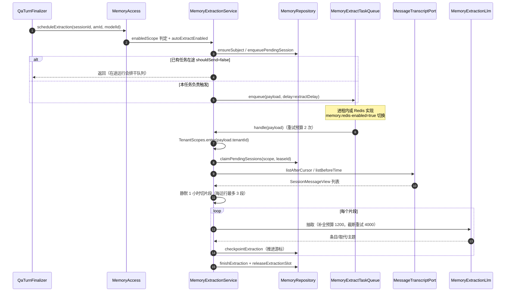

# 13. 记忆体系

记忆域（`domains/src/main/java/com/ragagent/memory/`）实现**用户长期记忆**：对话结束后异步蒸馏出一条条可检索的陈述，下一轮问答再按相关性与码点预算注入提示词。它是产品能力而非框架机制——一切读写都挂在「工作区 × 主体」的二元组上，且全程**只读请求上下文推导作用域**。

## 13.1 数据模型

记忆共 7 张表（`migrations/versioned/V1__baseline.sql`，实体在 `memory/domain/` 与子包 `item/`、`scope/`、`vector/`）：

| 表 | 实体 | 作用 |
|---|---|---|
| `memory_items` | `MemoryItem` | 一条被记住的陈述（HTTP 响应体就是它） |
| `memory_subjects` | `MemorySubject` | 一个工作区里的一个主体：开关、常驻块缓存、抽取进度 |
| `memory_item_embeddings` | `MemoryItemEmbedding` | 条目向量（pgvector `halfvec` + 小端 float32 `bytea`） |
| `memory_tombstones` | `MemoryTombstone` | 被用户拒绝/遗忘的话题指纹（防止反复抽出） |
| `memory_topic_stats` | `MemoryTopicStat` | 话题计数（跨会话复现达标即升格为「兴趣」） |
| `memory_doc_affinity` | `MemoryDocAffinity` | 文档亲和度（「这个人反复引用哪些文档」） |
| `memory_extraction_sessions` | `MemoryExtractionSession` | 每会话的抽取游标、失败与重试记账 |

条目关键字段（`MemoryItem`，`@TableName("memory_items")`）：

| 字段 | 含义 |
|---|---|
| `kind` | `profile` / `preference` / `fact` / `task` / `interest`（`MemoryKinds.ALL`，前三与 interest 是常驻种类） |
| `topic` / `normalizedKey` | 可读主题 / 归一化 key——同 key 的新条目**取代**旧条目，「我用 MySQL→迁到 Postgres」这类矛盾在读路径上不经 LLM 即被解决 |
| `origin` | `explicit`（用户明说）/ `extracted`（后台蒸馏）/ `manual`（管理器里建的） |
| `status` | `active` / `superseded`（被取代而非删除）/ `archived`（超容量归档）/ `pending`（系统推断，**永不注入提示词**，等用户确认或拒绝） |
| `replacesId` / `supersededBy` | 取代链；未取代时恒输出空串（不是 `null`） |
| `expiresAt` | 「只在一段时间内成立」的事的失效时间 |
| `useCount` / `lastUsedAt` | 召回用量，容量归档按它排名 |

> **原理要点（隔离模型）**：`MemoryScope(tenantId, subjectId)` 恒由 `MemoryScopes.resolve()` 从 `TenantContext` 推导——租户取上下文、主体取 principal 的 `Type:ID`（`storageId()`），**没有任何端点接受客户端传的 scope**。subjectId 同时覆盖 Web 用户、IM 用户、API 外部用户与 embed 访客；与工作区配对后，同一个人在多个工作区的记忆也不串。「改个 id 读到别人的记忆」这一整类缺陷从根上消掉，每个端点都不必单独审计这件事。

向量面（`memory/domain/vector/`）：`MemoryVectors` 负责小端 float32 编解码、pgvector 字面量渲染（定点记法、最短往返、绝不用指数——`Float.toString` 在次正规数上并不最短）与余弦相似度；`MemoryVectorQuery(modelId, vector, kinds, minScore, limit)` 的 `modelId` 钉死向量空间——**别的模型产生的向量会被跳过而不是拿来打分**（不同模型嵌入不可比，`cosineSimilarity` 对长度不一致直接打 0 分）。

## 13.2 写入路径：对话结束后的异步蒸馏

蒸馏的入口在问答收尾：`QaTurnFinalizer` 落库助手消息后调 `MemoryAccess.scheduleExtraction`，经 `MemoryExtractionService` 入队，由队列 worker（虚拟线程）异步执行——请求线程不做任何模型调用。

关键机制：

- **双实现队列**：`MemoryExtractTaskQueue` 缺省是 `InProcessMemoryExtractTaskQueue`（进程内延迟队列）；`memory: redis-enabled`（env `MEMORY_REDIS_ENABLED`）为 `true` 时 `MemoryTaskQueueWiring` 以 `@Primary` 装配 `RedisMemoryExtractTaskQueue`（复用 `RedisRetryingTaskQueue` 的租约/续期/重投）。打开但 Redis 连不上则**启动失败**，不静默退化。两实现的每任务重试预算都是 2 次。
- **一轮都不丢**：这一轮总是先记进主体的持久会话队列（`memory_extraction_sessions`），计时器只决定运行**何时**发生、不决定消息**是否**被考虑。最小间隔（默认 300s）只把任务**推迟**，不丢轮次。
- **租约串行化**：`claimPendingSessions` 保证同一时刻只有一个 worker 持有会话；一个死在认领与运行之间的 worker 最多把主体卡住 `EXTRACT_IN_FLIGHT_GRACE`（10 分钟）。
- **抽取用量**：一次运行最多读 40 条消息、做 3 次模型调用、产 8 条记忆；片段按静默 `EXTRACT_SEGMENT_GAP`（1 小时）切分；已存记忆只展示相关的 15 条候选（`EXTRACT_RELEVANT_CANDIDATES`），防止提示词无界增长。
- **容量与遗忘**：单主体活跃条目上限默认 200（`MemoryConfig.maxItems` 可配，上限 2000），超出按排名归档——这是系统里唯一的自动遗忘。`consolidatedAt` 驱动定期整体审阅（蒸馏只看得到最新对话），`POST /api/v1/memory/consolidate` 可手动触发。

## 13.3 召回路径：`MEMORY_RECALL` 与检索调节

知识问答管线（见 [§9](09-RAG问答管线.md)）在 `LOAD_HISTORY` 之后、检索段之前固定插入 `MEMORY_RECALL` 阶段（纯聊天的精简管线同样插入）；插件是 `PluginMemoryRecall`。它转调 `MemoryService.recall`（实现在包私有协作者 `MemoryRecallOps`），**永不调用模型、永不返回错误**——记忆是增强，任何失败都必须退化成一次普通回答：

1. **三层开关**（`MemoryScopeGate.evaluate()`，一次求值两个出口）：工作区开关（`tenants.memory_config` 的 `enabled`，**默认 false**，管理员必须显式打开）→ 请求级开关（`MemoryContext`，标记即禁用，缺席即允许）→ 主体级开关（`memory_subjects.enabled`，用户自己的退出开关，`PUT /api/v1/memory/settings`）。
2. **常驻块**：加载常驻条目（`listActiveResident`，上限 60 条），`MemoryRender.renderMemoryBlock` 按 `profile→preference→interest` 顺序渲染，码点预算 `BLOCK_RUNE_BUDGET=900`；interest 最多带 5 条（`RESIDENT_INTEREST_MAX_ITEMS`）且不按相关性过滤（「我在做什么」与兴趣文本不共享词，相关过滤会恰好丢掉能回答它的记忆）。
3. **情境召回**：`fact`/`task` 候选池经 `MemoryRecallSelector` 做字面匹配 + 可选向量召回（`MemoryConfig.embeddingModelId` 配了嵌入模型且 `vectorRecall` 开启时），融合排序后在 `RECALL_RUNE_BUDGET=600`、`RECALL_MAX_ITEMS=5` 内选出。
4. **注入与上报**：`MemoryRender.wrapMemoryForPrompt` 把块与命中拼成 `QueryPlan.memoryPrompt`，下游 `PipelineCommon` 拼进系统提示词；同时发 `EVENT_MEMORY_RECALLED` 事件（`MemoryUsedMemories.usedMemoriesFromItems` 投影，emit 失败只告警不断流）。注入的集合与上报的集合**刻意不同**——只因上限还有位置而搭车的兴趣是背景，不该每轮出现在聊天时间线上。

**检索调节**（开关 `retrievalConditioning`，三态：null = 有嵌入模型时开启）：

- `PluginQueryUnderstand`（`QUERY_UNDERSTAND` 阶段）经 `retrievalContextFor()` 把兴趣拼进查询改写提示（「长期关注：……」）——给检索加条件而不是引用给用户看。
- `PluginMemoryAffinity`（`CHUNK_RERANK` 附加插件）：查 `memory_doc_affinity`，对命中 ≥ 2 次（`MEMORY_DOC_AFFINITY_MIN_HITS`）的文档按 `log1p` 曲线加分——8 次命中饱和到 ×1.15 封顶，最多查 200 个知识 ID，加权后稳定重排。

Agent 侧另有按需查找工具 `SearchMemoryTool`（`agenttools/knowledge/`，`search_memory`），经 `MemoryAccess.search` 走 `MemoryService.searchMemory`（上限 20 条、码点预算 2000）。

## 13.4 管理面

`MemoryController`（16 个端点，全部无 subject 参数——作用域即请求上下文）：

| 端点 | 行为 |
|---|---|
| `GET` / `PUT /api/v1/memory/settings` | 读/改调用者开关；响应是合并生效值 `MemorySettings`（`effective = workspaceEnabled && userEnabled`） |
| `GET` / `POST /api/v1/memory/items` | 分页列表（limit ≤ 200，非法归 50）/ 手动创建（201） |
| `PUT` / `DELETE /api/v1/memory/items/{id}` | 编辑 / 永久删除（「忘记」是物理删，无软删列） |
| `POST /api/v1/memory/items/{id}/confirm` `/reject` | 接受/拒绝一条推断条目；拒绝即删除 |
| `DELETE /api/v1/memory/items` | 清空（注意是集合路由，与单条删除不同路由） |
| `GET` / `POST /api/v1/memory/topics`、`DELETE /api/v1/memory/topics/{id}` | 话题计数 / 提升为条目 / 停止跟踪 |
| `GET` / `DELETE /api/v1/memory/documents/{id}` | 文档亲和度列表 / 删除检索信号 |
| `GET /api/v1/memory/export` | 全量导出（分页走到底，硬上限 `EXPORT_MAX_ITEMS=20000`，`truncated` 刻意可见） |
| `POST /api/v1/memory/consolidate` | 立即整体审阅一次 |

前端对应两个页面：用户侧 `frontend/src/views/settings/MemorySettings.vue`（个人开关 + 条目管理器），管理员侧 `MemoryWorkspaceSettings.vue`（写工作区 `tenants.memory_config`：开关、写入模式 `explicit_only`/`auto`、抽取模型、容量、蒸馏节奏、额外抽取指引、`interestThreshold`、嵌入模型）。

> **反直觉：`MemoryTxTemplate` 为何独立成 bean**——Spring 的 `@Transactional` 自调用不走代理。若把 `withSubject` 放在 `MemoryRepository` 内部直接调用，事务注解根本不生效：所有写方法跑在各自的自动提交事务里，`FOR UPDATE` 行锁当场释放，「租约 CAS」随之失效，而**单线程测试全绿看不出差别**。提成为独立 bean 后调用穿过代理，行锁真正保持到回调结束；同一事务里的其他 mapper 操作靠 Spring 事务的线程绑定加入同一 SqlSession。

## 13.5 边界

> **边界**：① 记忆默认**关**（`MemoryConfig.enabled` 默认 false，`memory_subjects.enabled` 的 DDL 默认 true 但行未创建即视为启用）；② 抽取依赖对话模型——`extractModelId` 空串表示「用对话本身的模型」，因此不会因未配抽取模型而失败；③ 召回任何失败都退化成无记忆的普通回答，故障不会传染问答；④ 多实例部署需打开 `memory.redis-enabled`，否则蒸馏队列只在单 JVM 内（重复触发由主体侧租约兜底，不会重复蒸馏）；⑤ `pending` 状态的推断条目永不注入提示词——「把猜错的东西悄悄当成事实」是记忆失去信任的方式；⑥ 语言上下文未接入抽取链路（`MemoryExtractPayload.language` 恒空串），抽取提示词语言不受会话语言控制。

---

[上一章：12. 会话、流式输出与 SSE](12-会话流式输出与SSE.md) ｜ [返回目录](详细技术文档.md) ｜ [下一章：14. Wiki 与知识图谱](14-Wiki与知识图谱.md)
