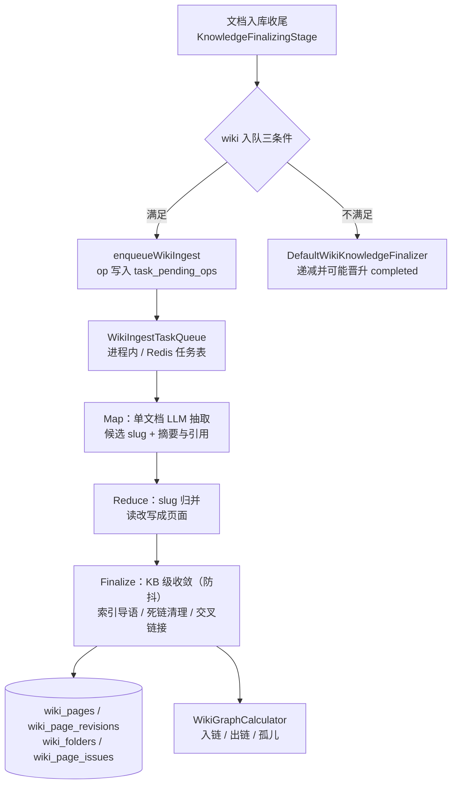

# 14. Wiki 与知识图谱

本章是两个**互不相同**的图结构：Wiki 的「页面链接图」与知识图谱的「实体-关系图（Neo4j）」。

## 14.1 Wiki

Wiki 域（`domains/src/main/java/com/ragagent/wiki/`）是**知识库内联百科**：文档入库后由 LLM 摄取成互相链接的百科页面，人在页面上继续编辑。

| 面包（`wiki/domain/*`） | 对象 | 说明 |
|---|---|---|
| `page/` | `WikiPage`（`wiki_pages`）、`WikiPageRevision`（`wiki_page_revisions`） | 页面含 `slug`/`title`/`content`/`parentSlug`/`folderId`/`categoryPath`/`inLinks`/`outLinks`/`sourceRefs`/`chunkRefs`/`version`；修订是全量快照（`version` + `editSource`） |
| `folder/` | `WikiFolder`（`wiki_folders`） | 文件夹树 |
| `graph/` | `WikiGraph` | 页面入链/出链视图，`overview` / `ego`（BFS 中心子图）两模式 |
| `index/` | `WikiIndex` / `WikiIndexEntry`（契约面 `contract/wiki`） | 目录树条目与分类路径规范化 |
| `issue/` | `WikiLintIssue` / `WikiLintReport`；实体 `WikiPageIssue`（`wiki_page_issues`） | 巡检问题与 lint 报告 |
| `ingest/` | `WikiIngestTask` / `WikiIngestPayload` | 任务载荷与 finalize 变更行、超时常量 |

**控制面**：`WikiPageController` 挂 `/api/v1/knowledgebase/{kbId}/wiki`，21 个端点——页面 CRUD（`pages`、`pages/{*slug}`）、修订（`revisions/{*slug}`、`revert`）、文件夹（`folders`）、移动（`move-page`）、索引（`index`）、链接图（`graph`）、统计（`stats`）、搜索（`search`）、链接重建（`rebuild-links`）、巡检（`lint`、`auto-fix`）、问题（`issues`、`issues/{issueId}/status`）。归属校验由 `WikiKbAccessGuard` 承担。

**摄取管线**：文档入库收尾（`KnowledgeFinalizingStage`）把 wiki 作为一个富化子任务交接，入队三条件：KB 索引策略 `isWikiEnabled()`、有分块、合成模型可解析（`wikiConfig.synthesisModelId` 优先，回落 KB 的 `summaryModelId`）——缺模型时绝不入队，否则批次反复重试而子任务槽被占住，文档永远停在 `finalizing`。

- 持久化状态在 `task_pending_ops`（`task_type="wiki:ingest"`）与 `task_dead_letters`（失败耗尽重试落死信）；`WikiPendingOpReplayer` 在启动时重放在途 op（换用 Redis 队列后自动关闭——持久队列自带重投）。
- **图片富化**：`WikiImageEnricher`（默认实现 `DefaultWikiImageEnricher`）把分块的 `<image>/<imageOcr>/<imageCaption>` 内联回正文——没有这一步，扫描件到 LLM 手里只剩裸图片链接，抽取/摘要产出空结果；Bean 缺席时管线退化为 `identity()`（等价于空图片信息分支）。
- **分布式锁（`WikiRedisWiring`）**：`wiki: redis-enabled`（env `WIKI_REDIS_ENABLED`）一次性把六个协调端口切成 Redis 版并 `@Primary` 覆盖进程内实现——`WikiSlugLock`（同 slug 读改写互斥，5 分钟 TTL、fail-open）、`WikiFinalizeLock`（KB 级 finalize 互斥，60 秒 TTL、20 秒续期、fail-closed）、`WikiIdentityClaimStore`（归一化身份的 slug 认领，2 小时 TTL）、`WikiInflightLimiter`（按 KB 在途批次上限）、`WikiIngestTaskQueue`（跨实例任务表 + TaskID 合并 + 崩溃回收）、`WikiDeletedTombstoneStore`（删除墓碑快路径）。启动时 ping，连不上**启动失败**。
- **问答侧**：`PluginWikiBoost`（`CHUNK_RERANK` 附加插件）对 `wiki_page` 类型分块 ×1.3 加成——快路径先看结果集里有没有 wiki 块，再确认至少一个检索目标确实是 wiki KB。**Agent 侧**的页面读写工具族（`agenttools/wiki/` 的十件工具：读/写/改名/替换/删除/搜索/索引概览/读源文档/标记与更新 issue）见 [§11](11-工具技能与MCP.md)。

## 14.2 知识图谱（Neo4j）

知识图谱是从文本**抽取的实体-关系图**，与 Wiki 页面链接图是两回事：前者按知识库/文档命名空间写入 Neo4j，后者只是 Wiki 页面间的 `[[slug]]` 引用关系。

**抽取（入库路径）**：分块图抽取任务 `ChunkExtractService`（`knowledge/service/chunk/`）对每个文本/OCR 分块调一次模型抽取，经契约端口 `EntityExtractionPort`（`contract/model/`，模型运行时侧实现 `EntityExtractionAdapter`）产出实体与关系。配置闸门是知识库的 `extractConfig`（jsonb 列）——`enabled=false` 直接 `skipped=extract_disabled`；上传/重解析弹窗可按文档覆盖（`ProcessOverridesResolver.extractConfig`），口径是**覆盖只减不增**：KB 未开图时单文档不能打开，KB 开图时允许单文档关闭。

**落库与隔离**：`Neo4jGraphRepository`（`retrieval-engine/src/main/java/com/ragagent/retrieval/graph/`）写 `AddGraph` / 删 `DelGraph` / 读 `SearchNode`。节点标签 = `ENTITY` 前缀 + 命名空间各段（`-` 换 `_`），形如 `ENTITYkbId:ENTITYknowledgeId`——同一知识库的图谱天然按租户/知识库隔离；节点键 `{name, kg: knowledge_id}`，同名实体在同知识内合并；写入走 APOC（`apoc.merge.node` / `apoc.merge.relationship` / chunks 并集），删除走 `apoc.periodic.iterate`（batchSize 1000）。

**检索（问答路径）**：与 [§7.5](07-检索引擎.md) 的图检索衔接——

- `PluginExtractEntity`（`QUERY_UNDERSTAND` 附加插件）：`NEO4J_ENABLE=true` 才生效；按本轮命中的知识库过滤出 `extractConfig` 开启者，用对话模型抽查询里的实体，实体名挂到管线状态供下一阶段消费。
- `PluginSearchEntity`（`ENTITY_SEARCH` 阶段）：逐知识文件或逐知识库并发查图（一跳子图 + 节点名 `CONTAINS` 任一关键词），新命中的 chunk 转成 `SearchResult`（分数恒 1.0、`MatchTypeGraph`）合入结果集，与向量/关键词召回一起走后续融合。

**启用门控**：

| 环境变量 | 行为 |
|---|---|
| `NEO4J_ENABLE` | 忽略大小写等于 `true` 才建驱动；否则 `Neo4jGraphConfig` 返回 null 驱动，三个操作告警 `NOT SUPPORT RETRIEVE GRAPH` 后静默返回（调用方无需判空） |
| `NEO4J_URI` / `NEO4J_USERNAME` / `NEO4J_PASSWORD` | 启用时以 30 次 × 2 秒重试建连（每次重建驱动并 `verifyConnectivity`） |

> **边界**：启用但连不上 = **启动失败**（`failed to connect to Neo4j after 30 attempts`），不会带着半个图库继续跑；未启用时系统信息页 `graphDatabaseEngine` 显示 `Not Enabled`（`SystemInfoService`），知识库设置里的图谱页显示未启用指引。抽取依赖对话模型，改了关系类型/额外要求后需**重新处理文档**才按新配置重建；查询侧的抽取（`PluginExtractEntity`）每轮多一次模型调用，`NEO4J_ENABLE` 关闭时该插件直接短路。

---

[上一章：13. 记忆体系](13-记忆体系.md) ｜ [返回目录](详细技术文档.md) ｜ [下一章：15. 渠道接入：IM 与网页嵌入（Embed）](15-渠道接入IM与网页嵌入.md)
