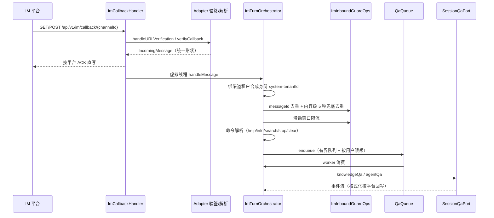
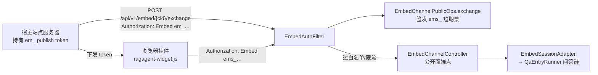

# 15. 渠道接入：IM 与网页嵌入（Embed）

两类对外渠道把问答能力送出控制台：IM 渠道让用户在聊天软件里提问，Embed 渠道让第三方网页挂一个访客聊天窗。两者最终都汇入同一条问答链（IM 走 `SessionQaPort`，Embed 走 `EmbedSessionPort`），但鉴权模型完全不同。

## 15.1 IM 渠道

IM 域（`domains/src/main/java/com/ragagent/im/`）按「一渠道一子包」组织 `im/channel/*` 九个子包，平台标识在 `ImTypes` 上：

| 渠道 | 平台标识 | 接入方式 | 客户端/适配器 |
|---|---|---|---|
| 企业微信 | `wecom` | webhook / 长连接 | `WecomWebhookAdapter` / `WecomWSAdapter` + `WecomLongConnClient` |
| 飞书（含国际版） | `feishu` / `lark` | webhook / 长连接 | `FeishuAdapter` + `FeishuLongConnClient`（同一实现两个平台名，`FeishuRegion` 区分） |
| 钉钉 | `dingtalk` | webhook / 长连接 | `DingtalkAdapter` + `DingtalkStreamClient` |
| Slack | `slack` | webhook / Socket Mode | `SlackAdapter` + `SlackSocketModeClient` |
| Telegram | `telegram` | 长轮询 / webhook 出站 | `TelegramAdapter` + `TelegramLongPollingClient` |
| Mattermost | `mattermost` | webhook | `MattermostAdapter` + `MattermostClient` |
| 微信（iLink 机器人） | `wechat` | 长轮询（扫码登录） | `WechatAdapter` + `WechatQRCodeService` |
| QQ 机器人 | `qqbot` | 长连接 | `QqBotAdapter` + `QqBotGatewayClient` |
| 云之家 | `yunzhijia` | webhook / 长连接 | `YunzhijiaAdapter` + `YunzhijiaLongConnClient` |

适配器工厂在 `ImAdapterWiringConfig`（`boot/src/main/java/com/ragagent/config/`）构造器里逐个注册进 `ImTurnOrchestrator`；未注册的平台启动渠道时打 WARN 并保持未启动，绝不静默假装成功。

**回调入口**：`ImCallbackController` 绑定 `GET|POST /api/v1/im/callback/{channelId}`，鉴权与响应形态由 `ImCallbackHandler` 承担。该路由**不套统一 `{code,message,data}` 外壳**——平台要求什么 ACK 就返回什么（云之家回 `{"success":true,"data":{"type":2,"content":""}}`，其余回 `{"success":true}`），错误文案 `channel not found`(404) / `channel is disabled`(503) / `verification failed`(403) / `parse failed`(400) 原样直写，避免第三方无限重试。渠道凭据（签名/Token/Encrypt Key）由各适配器 `verifyCallback` 校验，不依赖租户 JWT。

**消息处理时序**（`ImTurnOrchestrator.handleMessage` 为渠道无关编排核心）：

- **`im/runtime` 支撑件**：`Commands`/`ImCommandSet` 注册五个斜杠命令（`/help` `/info` `/search` `/stop` `/clear`，未注册的斜杠样式输入回复「未知指令」）；`ImFormat` 是纯出站文案助手（限长 `MAX_CONTENT_LENGTH=4096` 码点、引用清理、兜底话术）；`ToolDisplay`/`ThinkDisplay` 把工具步骤与思考态渲染成与 Web 端一致的 IM 文本；`ImSupervisor` 周期性（默认 6 小时）重建长连接，把「连接活着但再也收不到消息」的僵尸态最坏中断限定在一个周期内。
- **去重/重试**：同一 `messageId` 只处理一次（TTL 300 秒；Redis 接入时跨实例 SETNX、故障 **fail-closed** 丢消息，未接入回落进程内 map）；同平台重推换 id 的情形由内容级兜底拦住（`platform|channel|user|chat|content` 5 秒窗口）。`QaQueue` 是有界队列（默认 50）+ 按用户限额（默认 3）+ 虚拟线程 worker；满员回复「当前排队较多」。
- **会话映射与群聊**：`ChannelSessionRepository` 把 `(channelId, platform 用户/群, threadId)` 映射到平台内会话，`sessionMode` 为 `thread` 时按线程分会话（首条消息以自身 ID 起新会话）；群聊 @ 触发由各适配器在解析阶段处理（如飞书 `stripBotMention` 剥离 @ 片段）。文件/图片消息经 `ImAttachmentPreparer` 下载内联为问答内容（附件上限 32 MiB）。
- **出站 SSRF**：回复、拉用户信息、下载媒体等出站请求过 `SsrfGuard`（仅 http/https/ws/wss、禁直连 IP 与受限主机名/后缀、DNS 解析后校验，`SSRF_WHITELIST` 豁免）；自建/内网回调地址需进白名单。

管理端点在 `ImChannelController`（8 个）：按 Agent 建渠道（`POST /api/v1/agents/{id}/im-channels`）、列表/改/删（`/api/v1/im-channels`）、启停（`POST /api/v1/im-channels/{id}/toggle`）、微信扫码（`POST /api/v1/wechat/qrcode`、`/api/v1/wechat/qrcode/status`）。

## 15.2 网页嵌入（Embed）

`embedchannel` 域暴露**访客聊天渠道**：第三方网站嵌入一个挂件，访客无需注册即可与绑定 Agent 问答。票据模型分两层（`EmbedTokens`）：

| 票据 | 形态 | 生命周期 | 用途 |
|---|---|---|---|
| publish token | `em_` + 32 字节 base64url | 渠道行持有（`embed_channels.publish_token`，可轮换） | 站点服务器持有，**不出浏览器** |
| session token | `ems_` + 32 字节 base64url | Redis 键 `embed:session:<token>`，TTL 30 分钟 | 挂件请求携带（`Authorization: Embed <token>`） |

会话归属另有 HMAC-SHA256 签名（`signHandle`：以 publish token 为密钥签 `channelId|sessionId`，常量时间比较），防访客拿别人的会话 id 越权读写。

**鉴权过滤器**：`EmbedAuthFilter`（`EmbedWiring` 注册，order `HIGHEST_PRECEDENCE + 30`，只拦 `/api/v1/embed/` 前缀——全局 `AuthFilter` 对该前缀放行，它是这些请求的唯一认证层）按固定顺序判定：路径渠道 id 缺失 400 → token 缺失 401（只认 `Embed ` 前缀，Bearer/query 不算）→ `ems_` 前缀走 Redis 解析并校验与路径渠道一致，否则按 publish token 查渠道（禁用 → 403 `embed channel is disabled`）→ **Origin 白名单**（Origin 头优先回落 Referer；空清单全拒，支持 `*` 与 `*.` 后缀；不过 → 403 `origin not allowed`）→ 三段滑窗限流（per-IP 每分钟 / 渠道全局每分钟 / 渠道全局每日，DDL 默认 30 次/分钟、10000 次/天；超限 429）→ 租户存在性（500 `workspace unavailable`）。通过后写入合成身份 `embed_channel:tenant:channel`（role viewer）。

**安全模式换短期票**：`POST /api/v1/embed/{channelId}/exchange`——只有 publish token 能换（否则 403 `publish token required`），签发 `ems_` 会话票并返回 `{expiresIn, sessionToken}`；Redis 不可用时 503 `session tokens unavailable`。前端为站点生成接法示例（`buildSecureServerNodeExample` 等）：publish token 只存服务器环境变量，站点自建一个 mint 端点向 RagAgent 换短期票再下发给页面。

**委托问答**：`EmbedChannelController` 公开面覆盖建会话（`POST …/sessions`）、两条问答通道（`knowledge-chat`/`agent-chat`）、历史（`messages/{sid}/load`）、停止、追问建议、文件代理、webhook 中继与 MCP 审批等约 20 个端点；问答经契约端口 `EmbedSessionPort` 落到会话域的 `EmbedSessionAdapter`——它逐参数转发到与 HTTP 面同一套用例层（`QaEntryRunner`、`MessageHistoryService`、`SessionStopService`、`MessageSuggestionFacade`），**不新增校验、不改错误口径**，两个面的语义恒一致。

**前端挂件**：入口 `frontend/embed.html`（路由 `/embed/:channelId`）与 `frontend/src/embed-main.ts`——独立 Vue 应用，按需注册组件（整包引入会多拖 1 MB 首屏），`frontend/public/ragagent-widget.js` 是站点 `<script>` 引入的装载器（`data-channel`/`data-token-endpoint` 等属性配置），会话键存 localStorage 供首帧骨架判定。

**两种渠道的鉴权对照**：

| 渠道 | 身份来源 | 校验点 | 失败表现 |
|---|---|---|---|
| IM | 渠道配置里的平台凭据（签名/Token/Encrypt Key） | `ImCallbackHandler` → 适配器 `verifyCallback`；通过后绑渠道租户合成身份 `system-<tenantId>` | 403 `verification failed`（平台侧表现为回调被拒）；不套统一外壳 |
| Embed | publish token / session token（`Authorization: Embed …`） | `EmbedAuthFilter` 六步：路径 → token → 票据与渠道匹配 → Origin 白名单 → 三段限流 → 租户存在 | 401/403/429/500 纯字符串 `{"error":"…"}`，如 `origin not allowed` |

> **边界**：IM 的租户身份是**渠道级合成身份**（`system-<tenantId>`，viewer 最小权限）而非真实平台用户——检索范围以渠道绑定的 Agent 与租户为界；多实例部署需 `im.redis-enabled`（一次性打开去重/限流/全局并发/跨实例 stop/渠道配置广播/WS 选主六个面）。Embed 的限流键在多副本下需 `embed.redis-enabled`（Redis 滑窗共享预算，故障回落进程内）；publish token 若直接放进浏览器端页面（非安全模式），等于把渠道凭据公开，应始终走服务端换票。

---

[上一章：14. Wiki 与知识图谱](14-Wiki与知识图谱.md) ｜ [返回目录](详细技术文档.md) ｜ [下一章：16. 外部数据源连接器](16-外部数据源连接器.md)
