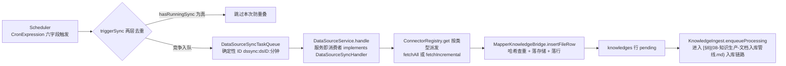

# 16. 外部数据源连接器

数据源域（`datasource/`）负责"**取回并转成仓内文档**"：不解析、不分块、不建索引，落行后交给 [§8](08-知识生产-文档入库管线.md) 入库链路。连接器只依赖 `contract` 与 `platform`，写入知识库走 `contract.knowledge` 端口（`KnowledgeBridge` 接口 + `MapperKnowledgeBridge` 实现），不反向 import knowledge 域实现。

## 16.1 连接器清单

注册表 `ConnectorRegistry`（普通类，由 `DataSourceWiring` 装配期显式填充，注册失败聚合后**启动失败**）里真实现 9 个连接器；`ConnectorCatalog` 目录另有 17 项——多出的 confluence / github / google_drive / onedrive / dingtalk / web_crawler / slack / imap 是"即将支持"的静态元数据（`GET /api/v1/datasource/types` 直出）。

| 标识 | 实现 | 同步内容 | 凭据形态（目录声明） |
|---|---|---|---|
| `feishu` / `lark` | `feishu/wiki/WikiConnector`（国际云只换 host 与 tenant） | wiki 空间与文档 | `oauth2` |
| `feishu_drive` / `lark_drive` | `feishu/drive/DriveConnector` | 云盘文件 | `oauth2` |
| `notion` | `notion/NotionConnector` | 页面与数据库 | `apiKey` |
| `yuque` | `yuque/YuqueConnector` | 知识库与文档 | `apiKey` |
| `ima` | `ima/ImaConnector` | 腾讯 ima 知识库 | `apiKey` |
| `rss` | `rss/RssConnector` | RSS/Atom 文章 | `custom` |
| `gitlab` | `gitlab/GitLabConnector` | 仓库文件 | `token` |

所有连接器实现 `domain/connector/Connector`：`type() / validate()（真实连一次） / listResources(parentId 惰性加载) / resolveResourceAncestors / fetchAll / fetchIncremental`；取消依赖线程中断（共享工具 `Connector.sleep` 被中断即抛 `ConnectorException`），`fetchIncremental` 允许"异常与结果同时有效"（`PartialFetch` 时 items/cursor 已填好，调用方先取结果再定性）。同步的最小单位是 `FetchedItem`（externalId/title/content/url/metadata——content 与 url 至少有一，灌入侧据此区分失败与跳过）。管理面端点（`DataSourceController`）：

| 端点 | 用途 |
|---|---|
| `GET /api/v1/datasource/types` | 连接器目录（含未实现项） |
| `POST /api/v1/datasource`、`GET /api/v1/datasource[/{id}]`、`PUT`、`DELETE /{id}` | 配置 CRUD（创建顺序有语义：查 KB → 查连接器 → 剥非密钥凭据 → 真实校验） |
| `POST /api/v1/datasource/{id}/validate`、`POST /api/v1/datasource/validate-credentials` | 试连 / 凭据校验 |
| `GET /{id}/resources`、`POST /{id}/resource-ancestors` | 资源树惰性加载与祖先解析 |
| `POST /{id}/sync`、`/{id}/pause`、`/{id}/resume` | 手动同步 / 暂停（暂停即摘掉 cron）/ 恢复 |
| `GET /{id}/logs`、`GET /api/v1/datasource/logs/{logId}` | 同步日志 |

## 16.2 同步流程

- **计划触发，全仓没有 `@Scheduled`**：`datasource/task/Scheduler` 自建 `ThreadPoolTaskScheduler`（池 4，线程前缀 `ds-scheduler-`），按每条数据源自己的 6 字段 cron（Spring `CronExpression`/`CronTrigger`）触发；`DataSourceWiring` 用 `SmartLifecycle` 在启动时加载全部 active 数据源注册 cron（尽力而为，失败只 WARN）。cron 按绝对墙钟触发，多实例会在同一分钟一起醒，去重靠两层：① `hasRunningSync` 防重叠；② `DataSourceSyncTaskQueue` 确定性 TaskID `dssync:<dsID>:<yyyyMMddHHmm>`，只有第一个入队者获胜，其余记 `TASK_ID_CONFLICT`（sync_log 置 `canceled` + "deduplicated"）。
- **队列双实现**：`DataSourceTaskQueueWiring` 按 `datasource.redis-enabled` 在 `InProcessDataSourceSyncTaskQueue`（进程内虚拟线程）与 `RedisDataSourceSyncTaskQueue`（全局 TaskID 去重 + 共享任务表，启动 ping 不静默退化）间切换。
- **服务即消费者**：队列端口只声明"投递"（`enqueue(payload, taskId, maxRetry, timeout)` 返回 `Outcome`），执行体 `DataSourceSyncHandler` 由 `DataSourceService` 自己实现——与 wiki/memory 同一处置，消费者不用在 bean 图上反向依赖队列实现。手动同步入口 `POST /api/v1/datasource/{id}/sync`（`manualSync`，active/error/paused 状态允许）走同一队列，与计划触发的差异只在载荷：`trigger="manual"`、TaskID 用随机 UUID（自带 `traceparent` 注入），而调度触发是 `trigger="schedule"` + 确定性 TaskID；手动路径对 `TASK_ID_CONFLICT` 亦按已受理继续。
- **逐条 best-effort**：单条灌入失败不拖垮整次同步——重复内容计 `skipped`、`embeddedImage` 增强条目灌不进计 `skipped`、其余计 `failed` 并记 `SyncItemError`（`code=ingest_failed`，样本上限 `MAX_SYNC_RESULT_ERRORS = 100`）；同步汇总落 `sync_logs`（created/updated/failed/skipped）。查旧行的基础设施异常短退避重试 2 次仍失败才记账，不当作"不存在"新建；删除分支处理"源端已删"的条目（按 `external_id` 找旧行软删回收）。
- **任务失败语义**：`handle` 里数据源已删、知识库已删 → sync_log 置 `canceled` 安静返回；KB 归属租户不符是确定性失败（上抛，队列不再重试）；连接器缺失置 `failed` 并把数据源标 `error`。启动恢复把陈旧 `running` 的 sync_log 判死（见 [§8.7](08-知识生产-文档入库管线.md) 同一 `StartupTaskRecovery`，分布式模式带 30 分钟陈旧窗）。
- **两行状态**：数据源行 `status ∈ {active, paused, error, deleted}`（`DataSourceConstants`），同步日志 `status ∈ {running, success, partial, failed, canceled}`——部分失败（`PartialFetch`）落 `partial` 而不是失败，这是"增量断点续跑"语义的一部分。

## 16.3 凭据托管、增量与工具澄清

- **凭据子资源**：`DataSourceCredentialsController` 提供 `PUT /api/v1/datasource/{id}/credentials`（整张替换）与 `DELETE .../credentials/{field}`（只认字段名 `credentials`）；创建/更新时 `DataSourceConfig.stripNonSecretCredentials` 把误存进 credentials 的非密钥键剥离。连接校验独立入口 `POST /api/v1/datasource/validate-credentials` 与 `POST /api/v1/datasource/{id}/validate`（真实连一次外部 API）。
- **连接器子包形态**：每个连接器一个子包，客户端/游标/格式化各自成类——feishu 最重（`core/` 下 `FeishuClient`、`SyncEngine`、`FeishuCursorCodec`、`DocxBlocks`/`DocxMarkdown` 等，drive 与 wiki 两种连接器共享）；notion 有 `NotionMarkdown`、rss 有 `JdkXmlFeedParser`/`ArticleExtractor`、yuque 有 `YuqueFormats`、ima/gitlab 各带 `ImaCursor`/`GitLabUrl`。游标（`SyncCursor`）持久化在数据源行上，队列重试从断点续读。
- **增量/全量**：`Connector.fetchAll`（全量，`resourceIds` 允许 null）与 `fetchIncremental`（基于 `SyncCursor` 游标）；载荷 `DataSourceSyncPayload` 带 `forceFull`（强制全量）与 `maxItems`；流式连接器（`StreamingConnector`）边抓边灌、进度落 `ds.lastSyncCursor` 检查点，中途失败不清游标，队列重试从断点续跑。
- **Agent 侧**：`agenttools/datasource` 包不是外部数据源工具——它是**数据分析**工具族（`data_analysis` / `data_schema` + DuckDB），与连接器无关；Agent 工具体系见 [§11](11-工具技能与MCP.md)。

---

[上一章：15. 渠道接入：IM 与网页嵌入（Embed）](15-渠道接入IM与网页嵌入.md) ｜ [返回目录](详细技术文档.md) ｜ [下一章：17. 多租户、认证与 RBAC](17-多租户认证与RBAC.md)
