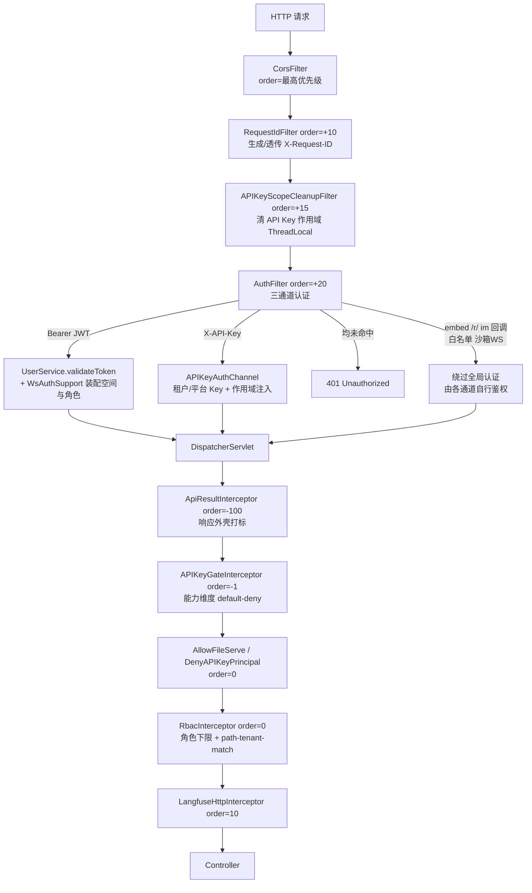
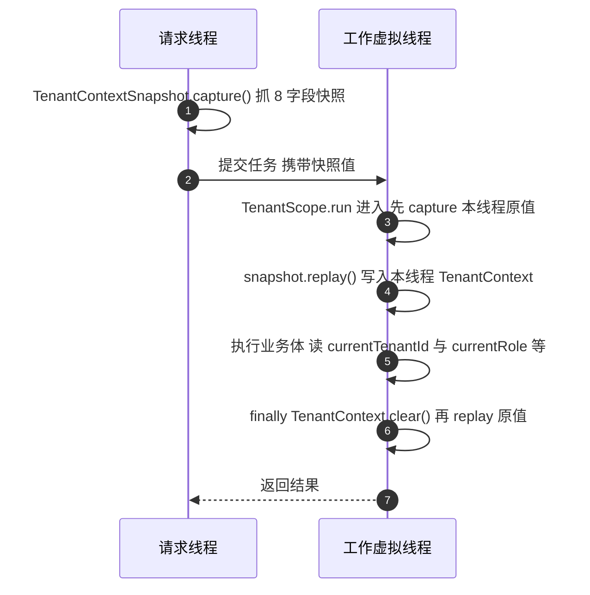

# 17. 多租户、认证与 RBAC

## 17.1 认证通道总表

全局认证入口是 `AuthFilter`（`domains/.../auth/controller/filter/`，非 Spring bean，由 `boot/.../config/WebConfig` 以 `FilterRegistrationBean` 注册，order=`HIGHEST_PRECEDENCE+20`，覆盖 `/*`）。通道顺序严格固定：OPTIONS 预检 → 路径穿越守卫（解码后出现 `..` 段一律 400）→ noAuthAPI 精确白名单 → API 文档（默认关）→ `/api/v1/embed/`（让路给 `EmbedAuthFilter`）→ `/api/v1/im/callback/`（平台签名在 handler 内做）→ `/r/` 能力 URL（短时令牌自证）→ 沙箱终端 WS（ticket 自鉴权）→ Bearer JWT → `X-API-Key` → 401。未匹配 controller 的放行请求由 DispatcherServlet 返回 404。

| 通道 | 机制 | 凭据来源 | 校验点（真实类名） | 失败表现 |
|---|---|---|---|---|
| 用户 JWT | `Authorization: Bearer`，HS256；access 24h、refresh 7d | env `JWT_SECRET`（未配置进程内随机 32 字节，重启后全部登录态失效） | `AuthFilter` 通道 2 → `UserService.validateToken`（含 DB 撤销检查）→ `WsAuthSupport.authenticateJwtUser`（空间解析 → 成员判定 → 角色装配） | 401 `Unauthorized: invalid or expired token`（未登录为 `missing authentication`）；无可用空间 409 `TENANT_REQUIRED`；无成员关系 403 |
| 注册 / 登录 | `POST /api/v1/auth/register`、`/login`（noAuth 白名单） | — | `AuthController`（`invite_only` 门 → 格式校验 → 消毒 → `PasswordPolicy`）→ `UserRegistrationService` | 400 参数/重复/密码策略；invite_only 模式注册 403 |
| OIDC | 授权码流程：`/api/v1/auth/oidc/config`、`/url`、`/start`、`/callback` | OIDC Provider（`OidcConfig`） | `AuthOidcOps` + `OidcService`；各端点 URL 逐一过 `SsrfGuard` | 403（details 携带原因） |
| 租户 API Key | `X-API-Key` | `tenant_api_keys` 表（明文 key 经 `CryptoService` AES-GCM 加密落库，认证按 hash 查找） | `AuthFilter` 通道 3 → `APIKeyAuthChannel.authenticate` → `TenantAPIKeyService` | 401 `Unauthorized: invalid API key`（不存在/撤销/过期刻意同一文案） |
| 平台 API Key | `X-API-Key` + `X-Tenant-ID` | 同上（`scope_type=platform`） | 同上；缺 `X-Tenant-ID` 时仅 `APIKeyAuthChannel.isPlatformTenantOptionalApi`（`/api/v1/system/admin` 前缀精确匹配 + `POST /api/v1/tenants`）放行 | 409 `TENANT_REQUIRED` + `Workspace required: platform API keys must send X-Tenant-ID`；Key 与头指向不同空间 403 |
| 外部用户 | `X-API-Key` + `X-External-User-ID`（direct_header 模式）或 `X-External-User-Token`（signed_token 模式） | 租户配置 `APIPrincipalConfig`（HMAC 密钥加密落库） | `APIKeyAuthChannel.resolveApiPrincipal`；外部 token 为手写 HMAC-SHA256 校验：alg=HS256、aud 含 `weknora`、exp 必需且 TTL ≤ 24h、`tenant_id` 匹配；ID ≤ 128 码点且无控制字符 | 401 `missing/invalid external user id/token`；主体为 `api_external_user:<tenantId>:` |
| Embed 发布票 / 换票 | `Authorization: Embed <token>`（query 与 `Bearer` 一律不算） | `em_` publish token（渠道表）；换 `ems_` session token（Redis 键 `embed:session:<token>`，TTL 30 分钟） | `EmbedAuthFilter`：渠道启用检查 → Origin 白名单（Origin 头优先回落 Referer，空清单全拒）→ 三段滑窗限流 → 租户存在性；换票 `POST /api/v1/embed/{channelId}/exchange` 只收 publish token | 400 `channel_id is required` / 401 `embed publish token is required` / 403 `origin not allowed` / 429 限流文案 |
| IM 平台回调 | 平台自身签名 | IM 渠道配置 | `/api/v1/im/callback/` 前缀在 `AuthFilter` 整体让路，签名在 handler 内校验 | 按各平台语义 |
| `/r/{token}` 能力 URL | HMAC 短时令牌自证 | 签发方生成的一次性/短时 token | `FileProxyController`（`/r/{token}` 路由，无鉴权直入） | 404 / 过期 |

> **反直觉**：注册不是"首位注册者成为租户 owner"——每个自助注册者（供应模式缺省 `create_personal`，服务端决定、不从请求读）都会创建自己的个人空间并成为**该空间的 owner**：`UserRegistrationService.register` 在同一事务里"建租户 → 建用户 → 写 Owner 成员行"三步，任一步失败整体回滚；`tenantless` 模式不建空间（`tenant_id` 落 SQL NULL）。

> **原理要点**：JWT 校验失败不立即拒绝，而是继续尝试 API Key 通道；全部未命中时按 `bearerPresented` 区分"未登录"与"登录态过期"两种 401 文案（契约被 golden 测试逐字符锁定）。

## 17.2 鉴权 / 租户解析 / RBAC 判定链

过滤器与拦截器的真实顺序（`WebConfig` 装配，数字为注册 order）：

拦截器语义：`APIKeyGateInterceptor` 必须先于 `RbacInterceptor`（能力判定先于角色判定；RBAC 对 API-Key 主体短路放行，`sysAdminOnly` 规则只放行平台 Key）。`RbacInterceptor` 的规则矩阵集中在 `boot/.../config/RbacRoutePolicies.java` 的 `registerAll`（登记顺序即语义：静态段规则先于 `/{id}` 通配，首个命中生效）。

## 17.3 租户上下文：TenantContext 与跨线程快照

`TenantContext`（`platform/.../access/`）是纯静态 `ThreadLocal` 容器，8 个字段：`tenantId`（null = tenantless 会话）、`principal`（type + id，8 种：`web_user` / `api_tenant` / `api_platform` / `api_external_user` / `im_user` / `embed_channel` / `embed_session` / `embed_visitor`）、`role`（null 时读取方 fail-closed 按 viewer）、`systemAdmin`、`canAccessAllTenants`、`userId`、`embedVisitorId`、`requestId`。

本仓库以虚拟线程承载请求（`application.yml`：`spring.threads.virtual.enabled: true`），而**虚拟线程不继承 ThreadLocal**——问答一轮要跨到新的虚拟线程/任务里跑管线、检索与工具调用，身份必须显式传递。这对操作的规范形态是：

1. 在发射线程 `TenantContextSnapshot.capture()`：把 8 个字段抓成不可变 record（纯取值，不持有 ThreadLocal）；
2. 快照随任务对象进入工作线程；
3. 在工作线程用 `TenantScope.run/supply/callable/runnable` 包住业务体：进入时 `replay()`，退出时**先 `clear()` 再恢复进入前的原值**（防止把本作用域写的值留给池化线程的下一个任务）；
4. `withTenantId(long)` 派生"只换执行租户"的快照——授权面（principal/role/userId）永远看调用方，不看执行租户。

漏传/漏 finally 的后果：异步 handler 里 `currentTenantId()` 返回 null → 查询落到 tenantless 面（空结果）或 fail-closed 拒绝；更糟的是手写 replay 后不恢复，会让**同一线程的下一个任务**带着上一个用户的身份运行（横向越权）。

数量核实：主码（不含测试）中 `TenantContextSnapshot.capture()` 调用点共 **22 处**、分布在 **15 个文件**（`session/qa`、`session/rag`、`im`、`EventBus`、`HybridSearchService`、`ActPhase` 等；grep 统计、剥离注释后计数）。守卫 `scripts/check-tenant-scope.py` 有两条硬规则：主码禁止出现裸 `.replay()`（唯一允许的实现是 `TenantScope`）；出现 `capture()` 的文件必须同时使用 `TenantScope.`，否则退出非零。

> **边界**：`TenantScope` 只搬运 `TenantContext`；`APIKeyScopeContext`、`StorageUrlContext` 等其它 ThreadLocal 各有自己的清理过滤器（`APIKeyScopeCleanupFilter`）或由设置方负责收口（如 `EmbedAuthFilter` finally 里同时清 `TenantContext` 与 `StorageUrlContext`）。

## 17.4 持久层租户隔离：探测而非改写

`boot/.../config/MybatisPlusConfig` 装配一条 `MybatisPlusInterceptor` 插件链，顺序按 MyBatis-Plus 官方建议——改造 SQL 的在前、只探测的放最后：

| 插件 | 作用 | 模式/配置键 |
|---|---|---|
| `PaginationInnerInterceptor` | 物理分页 + total 统计，`maxLimit=1000` | — |
| `FullTableWriteGuard` | 禁止无条件全局 UPDATE/DELETE | 机器强制 |
| `TenantFilterGuard` | **探测**：注册表的表在 SELECT 主 from-item 上缺 `tenant_id` 谓词即报 | `weknora.persistence.tenant-filter-guard`：`off/alert/enforce`，默认 `enforce` |
| `SoftDeleteFilterGuard` | **探测**：带 `deleted_at` 的表缺软删谓词即报 | `weknora.persistence.soft-delete-guard`，默认 `enforce` |

`TenantFilterGuard` 是**探测/拦截器，不是 SQL 自动改写**：它解析 SELECT 语句检查谓词存在性，缺失时按模式处置（`enforce` 抛 `MybatisPlusException`，执行期直接红）。它刻意不采用 `TenantLineInnerInterceptor` 那类 SQL 级自动改写，理由记录在其 javadoc：与"`tenant_id IS NULL` = 平台内置行"的语义冲突、方言 SQL 解析失败即炸、ignore 表清单难维护。表注册表由 `V1__baseline.sql` 推导（带 `tenant_id` 的 46 张表 + `skills`）。租户过滤的**执行**仍由各仓储手写条件；这层守卫保证"漏写一处"在默认配置下活不过一次执行。

## 17.5 RBAC：角色下限 + 第二层判定

四级角色（`contract/.../tenant/TenantRole.java`，level 间距 10 留扩展位）：

| 角色 | level | 语义 |
|---|---|---|
| `owner` | 40 | 空间所有者，成员/配置/删除等高危操作 |
| `admin` | 30 | 空间管理员 |
| `contributor` | 20 | 可创建/编辑业务内容 |
| `viewer` | 10 | 只读 |
| 未识别 | 0 | 严格低于所有角色 |

唯一判定式：`TenantRole.hasPermission(required)` ⇔ 当前角色 level ≥ 路由下限 level。

- **规则矩阵**：`RbacRoutePolicies` 登记 `addRule` 299 条、`addPublicRule` 55 条、`addSystemAdminRule` 18 条（grep 统计）。全量路由对照见 `docs/architecture/route-policy-map.md`（`scripts/check-route-policy.py --map` 生成，勿手改）：384 条路由，其中 VIEWER 197 / ADMIN 76 / PUBLIC 55 / CONTRIBUTOR 20 / SYSTEM_ADMIN 18 / OWNER 11 / OWNER（或 system_admin）4 / ADMIN（或 system_admin）3。守卫 `scripts/check-route-policy.py` 保证每条控制器路由命中规则或登记基线，并清理"幽灵规则"。
- **`RbacInterceptor` 判定顺序**（`preHandle`）：① `/api/v1/tenants/{id}/**` 的 URL 租户必须等于活动租户（空/非正整数 400、上下文无租户 401 fail-closed、不匹配 403；先于 API-Key 短路，防止换 URL id 跨空间读写）；② API-Key 主体短路（角色阶梯不适用于机器主体）；③ 命中规则按 level 判定，`orSystemAdmin` 规则系统管理员可绕过、`sysAdminOnly` 规则只认 `isSystemAdmin`；④ 真实控制器方法未命中任何规则 → 403 `Forbidden: no route policy`（默认拒绝只对 `/api/v1/**`）；⑤ `weknora.tenant.enable-rbac=false`（滚动窗口）只打 `[rbac]` WARN 放行；⑥ HEAD 未命中按 GET 规则兜底，防绕过。拒绝写一条 durable 审计 `rbac.access_denied`（服务内 1 分钟滑动窗口去重，审计失败不把 403 变 500）。
- **角色只是下限**——路由通过后控制器/服务里还有第二层：
  1. **所有权**：只能改自己创建的 Agent/知识库/会话，同空间 `owner`/`admin` 例外；
  2. **API Key 范围**：`APIKeyGateInterceptor`（default-deny，策略表 `APIKeyRoutePolicies.registerGin` 共 290 条）按路由查 `TenantAPIKeyScope` 的 `fullAccess` / `knowledgeBaseIds` 白名单（知识库控制器读 `APIKeyScopeContext` 二次校验）/ `capabilities`；
  3. **渠道签名**：IM 回调、Embed 访客按渠道凭据校验，不看租户角色。
- **系统管理员 `is_system_admin`**：`users` 表上的**平台级**布尔标记（默认 false），不是空间角色——在 `orSystemAdmin`/`sysAdminOnly` 规则上生效、可跨空间，但不自动获得空间内所有权语义；晋升/撤销由系统管理面写入并审计（`system.admin_promoted` / `system.admin_revoked`）。
- **成员邀请**：`TenantInvitationService` 签发 32 字节 token（base64url 43 字符），TTL 缺省 7 天；状态机 `pending/accepted/declined/revoked/expired`；被邀请人经 `POST /api/v1/auth/register-by-invite` 注册入空间；邀请与角色变更全程写审计（`rbac.invitation_*`、`rbac.member_*`）。

---

[上一章：16. 外部数据源连接器](16-外部数据源连接器.md) ｜ [返回目录](详细技术文档.md) ｜ [下一章：18. 安全与治理](18-安全与治理.md)
