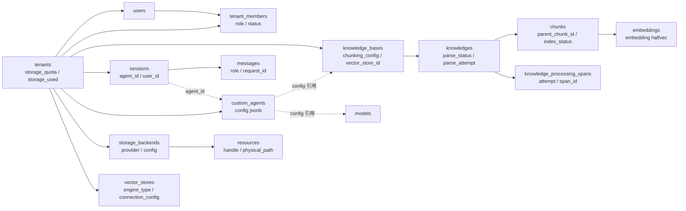
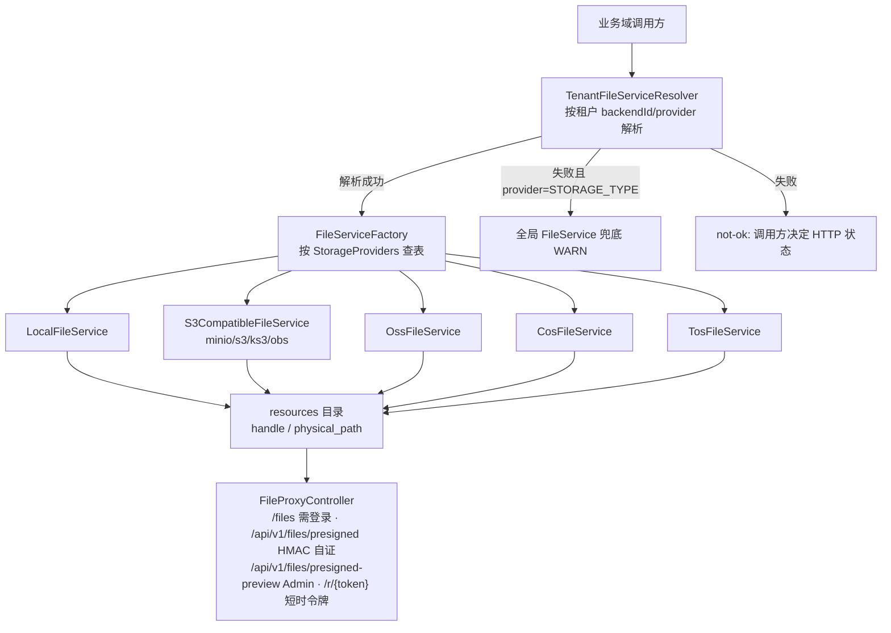

# 19. 持久化与数据模型

## 19.1 存储选型与迁移

主库是**唯一**的业务库：PostgreSQL（本地 dev 用 `docker-compose.yml` 里的 `paradedb/paradedb:v0.22.2-pg17`
镜像，即 PG17 + ParadeDB 的全文检索/向量扩展）。`boot/src/main/resources/application.yml` 里
`spring.datasource.driver-class-name` 固定 `org.postgresql.Driver`，连接串
`jdbc:postgresql://${DB_HOST:localhost}:${DB_PORT:15432}/${DB_NAME:RagAgent}`。`spring.flyway.*` 三项：
`locations: classpath:db/migration,filesystem:./build/generated-migrations`、`baseline-on-migrate: true`
（存量库自动 baseline）、`table: flyway_schema_history`。

迁移脚本只有 3 个，全在 `migrations/versioned/`：

| 脚本 | 用途 |
|---|---|
| `V1__baseline.sql` | 冻结基线：一次建齐 55 张表、索引与种子 |
| `V2__embed_visitor_id.sql` | `sessions` 加 `embed_visitor_id` 列 + 访客历史会话的部分索引（`WHERE embed_visitor_id IS NOT NULL AND deleted_at IS NULL`） |
| `V3__add_parse_attempt.sql` | `knowledges` 加 `parse_attempt bigint DEFAULT 0`（重解析代次，CAS 与失败清场按代次隔离新旧尝试） |

`filesystem:./build/generated-migrations` 是**相对工作目录**的路径，所以镜像有硬约束：`Dockerfile` 把
`migrations/versioned` 固定拷到 `/app/build/generated-migrations/`——漏拷的后果是全新容器启动即无 schema。

> **反直觉**：仓库里还能找到 SQLite / MySQL 驱动，但它们**都不是业务库方言**。`sqlite-jdbc` 服务于
> retrieval-engine 的 SQLite 检索引擎（`SqliteRetrieveRepository`），`mysql-connector-j` 服务于 Doris
> 检索引擎（Doris 走 MySQL 协议，`JdbcDorisSqlExecutor`），`duckdb_jdbc` 用于 Agent 的 SQL 数据分析工具
> （`AnalysisDuckDbJdbc`）。业务持久层没有任何多方言适配层。

## 19.2 核心表

总表数 55，全部由 `V1__baseline.sql` 一次建齐（`grep -c "CREATE TABLE" migrations/versioned/V1__baseline.sql`
→ 55；V2/V3 只加列不建表）。下表按域挑 32 张最核心的，字段名照抄 DDL：

| 表 | 归属域 | 用途 | 关键字段 |
|---|---|---|---|
| `knowledge_bases` | knowledge | 知识库 | `chunking_config`/`embedding_model_id`/`storage_backend_id`/`vector_store_id`/`wiki_config` 等 jsonb 配置族 |
| `knowledges` | knowledge | 文档 | `parse_status`、`enable_status`、`file_path`、`file_hash`、`storage_size`、`pending_subtasks_count`、`folder_path` |
| `chunks` | knowledge | 分块 | `content`、`chunk_index`、`parent_chunk_id`、`relation_chunks`、`index_status`、`seq_id`、`content_revision` |
| `chunk_revisions` | knowledge | 分块修订历史 | `chunk_id`、`revision`、`content`、`edit_source`、`editor_id` |
| `embeddings` | knowledge | 向量（PG 内向量面） | `source_id`、`source_type`、`chunk_id`、`dimension`、`embedding public.halfvec` |
| `knowledge_processing_spans` | knowledge | 处理跨度（管线观测） | `knowledge_id`、`attempt`、`span_id`、`parent_span_id`、`kind`、`status`、`error_code`、`duration_ms` |
| `knowledge_tags` / `knowledge_tag_relations` | knowledge | 标签及关联 | `name`、`color`、`sort_order`；关联表只有 `knowledge_id`+`tag_id` |
| `temporary_documents` | session | 会话临时文档 | `session_id`、`resource_ref`、`chunks`、`expires_at`、`token_count` |
| `sessions` | session | 会话 | `tenant_id`、`user_id`、`agent_id`、`agent_config`、`embedding_top_k`、`rerank_threshold`、`embed_visitor_id` |
| `messages` | session | 消息 | `request_id`、`role`、`knowledge_references`、`agent_steps`、`artifacts`、`used_memories`、`usage` |
| `message_suggestion_sets` | session | 建议问题集合 | `assistant_message_id`、`placement`、`status`、`questions`、`lease_until` |
| `custom_agents` | agentmanagement | 自定义智能体 | `is_builtin`、`config`（agent config jsonb）、`runnable_by_viewer` |
| `skills` | agentmanagement | 技能目录 | `slug`、`content`、`version`、`tenant_id`（NULL=平台内置全员可见） |
| `models` | model | 模型条目 | `type`、`source`、`parameters`、`is_default`、`is_builtin`、`managed_by` |
| `vector_stores` | vectorstore | 向量库配置 | `engine_type`、`connection_config`、`index_config` |
| `storage_backends` | storage | 存储后端配置 | `provider`、`config`、`source`、`legacy_alias` |
| `resources` | storage | 文件资源目录 | `handle`、`storage_backend_id`、`provider`、`physical_path`、`location_hash`、`lifecycle`、`state` |
| `tenants` | auth | 租户 | `storage_quota`/`storage_used`、各 `*_config` jsonb、`default_storage_backend_id` |
| `users` | auth | 用户 | `username`、`password_hash`、`tenant_id`、`is_system_admin`、`can_access_all_tenants` |
| `tenant_members` | auth | 成员关系 | `user_id`、`tenant_id`、`role`、`status` |
| `tenant_invitations` | auth | 邀请 | `invitee_user_id`、`role`、`status`、`token`、`expires_at`、`accepted_count` |
| `tenant_api_keys` | auth | API Key | `key_hash`、`full_access`、`knowledge_base_ids`、`capabilities`、`scope_type`（tenant/platform CHECK 约束） |
| `auth_tokens` | auth | 令牌 | `user_id`、`token`、`token_type`、`expires_at`、`is_revoked` |
| `mcp_services` | mcp | MCP 服务注册 | `transport_type`、`url`、`auth_config`、`stdio_config`、`is_builtin` |
| `mcp_tool_approvals` | mcp | 工具审批策略 | `service_id`、`tool_name`、`require_approval` |
| `im_channels` | im | IM 渠道配置 | `platform`、`mode`、`credentials`、`session_mode`（`user`/`thread` CHECK） |
| `im_channel_sessions` | im | 渠道-会话映射 | `platform`、`user_id`、`chat_id`、`session_id`、`agent_id` |
| `data_sources` | datasource | 数据源 | `type`、`sync_schedule`、`sync_mode`、`last_sync_cursor`、`conflict_strategy` |
| `sync_logs` | datasource | 同步日志 | `data_source_id`、`status`、`items_total/created/updated/deleted/skipped/failed` |
| `wiki_pages` | wiki | wiki 页面 | `slug`、`page_type`、`parent_slug`、`wiki_path`、`in_links`/`out_links`、`source_refs`、`version` |
| `memory_items` | memory | 长期记忆条目 | `subject_id`、`kind`、`normalized_key`、`importance`、`status`、`superseded_by`、`use_count` |
| `audit_logs` | audit | 审计（只追加） | `actor_user_id`、`action`、`target_type`、`outcome`、`scope_type`、`details` |

其余 23 张按同样套路归属：wiki 族（`wiki_folders`/`wiki_page_revisions`/`wiki_page_issues`）、记忆族
（`memory_subjects`/`memory_item_embeddings`/`memory_tombstones`/`memory_extraction_sessions`/`memory_topic_stats`/`memory_doc_affinity`）、
任务族（`task_pending_ops`/`task_dead_letters`）、MCP OAuth 族（`mcp_metadata`/`mcp_oauth_clients`/`mcp_oauth_tokens`）、
收藏/置顶（`user_kb_pins`/`user_resource_favorites`）、`web_search_providers`、`system_settings`、
`message_suggestion_events`。所有租户数据表都有 `tenant_id` 列；软删表统一用 `deleted_at timestamptz`
（NULL=存活），没有 `is_deleted` 布尔列。

核心实体关系（schema 视角）：

> 关系两点说明：`custom_agents` 与 `sessions` 对知识库/模型的引用存在 `agent_config`/`config` jsonb 里
> （虚线），不是外键；向量面在 PG 内表（`embeddings`）与外置向量库（`vector_stores` 配置，经
> `knowledge_bases.vector_store_id` 引用）之间按租户引擎选择，见 [§7](07-检索引擎.md)。

## 19.3 数据访问的两套写法

持久层有两套写法并存（`find domains -name "*Mapper.java"` → 48 个 mapper 包文件 + 2 个 DTO 转换器）：

- **MyBatis-Plus `Mapper`**：38 个 `extends BaseMapper<实体>`，简单 CRUD 走通用方法 + `LambdaQueryWrapper`；
- **手写 `Repository`**：45 个 `*Repository.java`，跨表、带业务谓词（软删/租户/排序）或需要事务模板的读写
  下沉到仓储。选择规则没有硬线，但守卫管住底线：控制器禁止 import `*.mapper.*Mapper`（`check-controller-purity.py`
  的「控制器纯度」规则——查询必须下沉 service/repository）。

三条硬规矩：

1. **软删显式写**：所有带 `deleted_at` 的表，查询必须显式写 `deleted_at IS NULL`，**禁用 MyBatis-Plus 的
   `@TableLogic`**（datetime 逻辑删除值在 MP 各版本行为敏感；全仓 grep `@TableLogic` 命中的 22 处全是
   "不用它"的注释）。确需读已删行（回收站/恢复/对账）的语句要登记白名单。
2. **控制器不碰 Mapper**：见上；守卫扫描 `import com.ragagent.*.mapper.*Mapper` 直接报红。
3. **机器探测兜底**：`platform/persistence` 下两个拦截器做**只探测不改写**的 fail-loud 防线：
   `TenantFilterGuard`（SELECT 主查询缺 `tenant_id` 谓词即拦）与 `SoftDeleteFilterGuard`（带软删列的表缺
   `deleted_at` 谓词即拦，软删表注册表 25 张——`knowledge_tags` 有列但从不写、已移出）。两者均三档
   `off | alert | enforce`，配置键 `weknora.persistence.tenant-filter-guard` / `weknora.persistence.soft-delete-guard`
   （env `RAGAGENT_TENANT_FILTER_GUARD` / `RAGAGENT_SOFT_DELETE_GUARD`），**默认 enforce**——未登记的
   无谓词查询在执行期直接抛 `MybatisPlusException`。

`MybatisPlusConfig` 注册的插件链顺序（改 SQL 的在前）：`PaginationInnerInterceptor`（物理分页，
`maxLimit=1000`）→ `FullTableWriteGuard`（禁无条件全表 UPDATE/DELETE，确需的具名 Mapper 方法登记
`FULL_TABLE_ALLOWED`）→ `TenantFilterGuard` → `SoftDeleteFilterGuard`。

## 19.4 事务边界

**整轮问答不开事务**：一轮 QA 跨越 SSE 流、模型调用、插件链与多次落库，动辄分钟级；包进数据库事务意味着
连接被长期占用、且"模型出错就回滚已流出的 token"语义不成立。落库按"轮次消息同事务、其余尽力而为"切分：

- **有事务的点**（grep 核实共 **28 处**注解声明：27 处短形式 `@Transactional` + 1 处全限定名注解）：
  - `MessageService.createTurnMessages`——一轮问答的 user + assistant 两条消息**同一本地事务**写入，
    避免孤儿 user 行（注解用全限定名书写，短形式统计容易漏掉它）；
  - knowledge 管理面：`KnowledgeService`（5 处）、`KnowledgeRecycleService`（4 处）、`KnowledgeFolderService`（2 处）、
    `KnowledgeFileService`、`KnowledgeTagBatchService`——目录/标签/回收站的多表写；
  - wiki 持久化任务：`TaskPendingOpsRepository`（7 处）、`TaskDeadLetterRepository`（2 处）、`WikiPageRepository`；
  - 注册回滚探针：`UserRegistrationService.register`（`rollbackFor = Exception.class`）；
  - 两个事务模板 bean 自身的注解：`TxTemplate.inTransaction(...)`（2 处）与
    `MemoryTxTemplate.withSubject(...)`（1 处，事务内先 `FOR UPDATE` 锁主体行，保住记忆"租约 CAS"的行锁语义）；
  - 直接注入 Spring `TransactionTemplate` 的两处：`StorageBackendService`、`VectorStoreConfigService`。
- **best-effort 清理的失败语义**：删消息/清会话时伴生的建议删除、聊天历史知识清理是"同步尽力而为"——
  失败只 `log.warn` 全吞，HTTP 响应不受影响；`StartupTaskRecovery` 启动时的三种复位 likewise：失败只 WARN
  不阻塞启动。
- **自调用事务失效的处理**：Spring 自调用不走代理，同类内部调 `@Transactional` 方法注解不生效且**测试全绿**
  （单线程看不出差别）。仓库把这类模板提成独立 bean（`TxTemplate`、`MemoryTxTemplate`），调用穿代理事务才真。

## 19.5 文件存储

`storage` 域把对象存储差异收进单一登记点 `StorageProviders`：每个 provider 一个 `Descriptor`（必填校验、
端点 SSRF 策略、连通性测试、旧 KV 段映射、运行时 `Creator`），调用方按 provider 查表。实现类归属：

| provider | 实现类 | 说明 |
|---|---|---|
| `local` | `LocalFileService` | 本地目录；基目录 `${weknora.storage.local-base-dir:${LOCAL_STORAGE_BASE_DIR:${user.home}/ragagent-data/files}}` |
| `minio` | `S3CompatibleFileService` | 支持 `docker` 模式（端点/凭据取 `MINIO_ENDPOINT` 等 env） |
| `s3` / `ks3` / `obs` | `S3CompatibleFileService` | S3 兼容族，默认 pathPrefix `weknora/` |
| `oss` | `OssFileService` | 阿里云 OSS，支持临时桶（`tempBucketName`） |
| `cos` | `CosFileService` | 腾讯云 COS，探测域名 `<bucket>.cos.<region>.myqcloud.com` |
| `tos` | `TosFileService` | 火山引擎 TOS |
| `dummy` | （抛异常） | 仅路径解析用，不暴露在 `/types` |

租户级选择与配额：`TenantFileServiceResolver` 先按租户配置解析（`backendId`/`provider` 指定，缺失用租户
默认）；失败时若请求的 provider 与进程级 `STORAGE_TYPE` 相同，用全局文件服务兜底（记 WARN），否则返回
not-ok 由调用方决定 HTTP 状态。配额走 `contract` 端口 `TenantStorageQuotaPort`（`tenants.storage_quota`/
`storage_used` 归 auth 域所有，`adjustUsed` 负数钳 0；knowledge 写入前"先查配额、后记账"）。

文件代理与 URL 签名：`StorageUrlWiringConfig` 把 `FileUrlPort` 接到"恒 local 基座 + resource catalog 装饰"
的生产实现——`APP_EXTERNAL_URL` 在位时 `resource://` 手柄能派生 `/r/<token>` 能力链接（短时令牌自证、
完全无鉴权）；`FileProxyController` 暴露四组鉴权分层不同的路由：`GET /files`（需登录）、
`GET+HEAD /api/v1/files/presigned`（免鉴权、HMAC 自证）、`GET /api/v1/files/presigned-preview`（Admin，
显式拒绝 API-Key 主体）、`GET+HEAD /r/{token}`（短时令牌）。

---

[上一章：18. 安全与治理](18-安全与治理.md) ｜ [返回目录](详细技术文档.md) ｜ [下一章：20. 异步任务、队列与多实例协调](20-异步任务队列与多实例协调.md)
