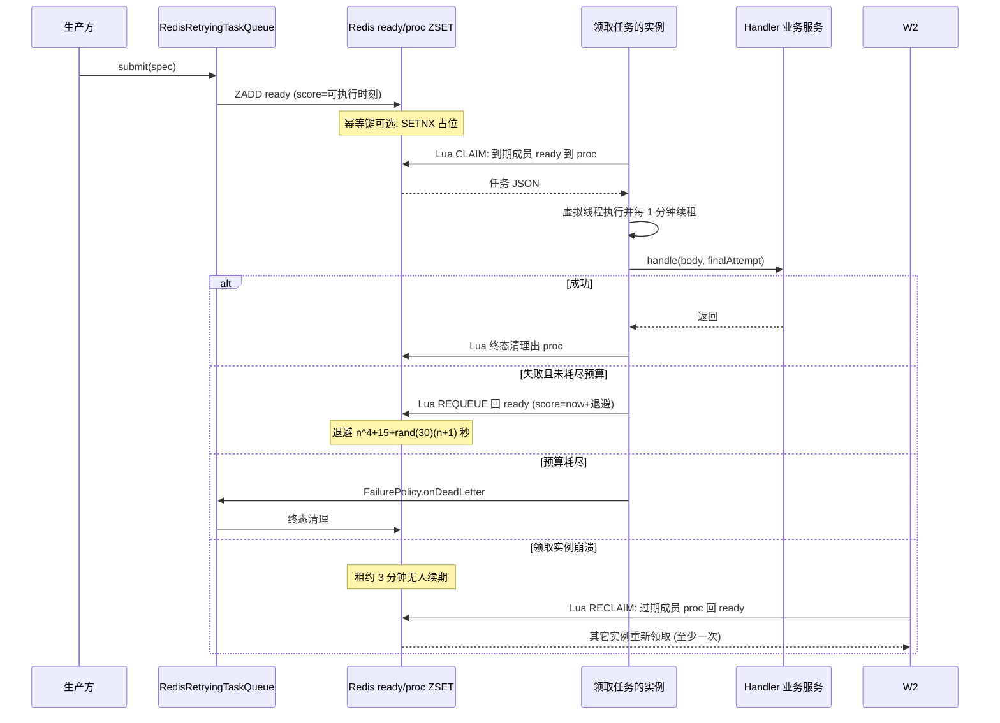

# 20. 异步任务、队列与多实例协调

## 20.1 五套双实现队列

全仓共 7 个任务队列接口，其中 5 套有"进程内 + Redis"双实现，1 个（知识主处理队列）实现即 worker 本身，
1 个（IM `QaQueue`）是进程内有界队列 + 可选 Redis 面。选择机制是 `@ConditionalOnProperty` + `@Primary`
而非 `@Profile`：InProcess 实现是无条件 `@Component`，Redis 版由 Wiring 类按 `*.redis-enabled=true`
条件装配并 `@Primary` 胜出——开关关闭时 Wiring 整体不生效，语义与单实例完全一致；**开关打开时启动即 ping
一次 Redis，连不上则启动失败**（不静默退化）。

| 队列接口 | 进程内实现 | Redis 实现 | 用途 | 开关 |
|---|---|---|---|---|
| `ChunkExtractTaskQueue` | `InProcessChunkExtractTaskQueue` | `RedisChunkExtractTaskQueue` | 分块抽取 | `KNOWLEDGE_REDIS_ENABLED` |
| `QuestionGenerationTaskQueue` | `InProcessQuestionGenerationTaskQueue` | `RedisQuestionGenerationTaskQueue` | 问题生成 | `KNOWLEDGE_REDIS_ENABLED` |
| `DataSourceSyncTaskQueue` | `InProcessDataSourceSyncTaskQueue` | `RedisDataSourceSyncTaskQueue` | 数据源同步 | `DATASOURCE_REDIS_ENABLED` |
| `MemoryExtractTaskQueue` | `InProcessMemoryExtractTaskQueue` | `RedisMemoryExtractTaskQueue` | 记忆蒸馏 | `MEMORY_REDIS_ENABLED` |
| `WikiIngestTaskQueue` | `InProcessWikiIngestTaskQueue` | `RedisWikiIngestTaskQueue` | wiki 摄取 | `WIKI_REDIS_ENABLED` |
| `KnowledgeProcessingQueue` | —（`KnowledgeProcessWorker` 即实现） | — | 知识主处理入队 | — |
| `QaQueue`（IM） | 进程内有界队列 | `RedisPort` 接缝 | IM 问答排队 | `IM_REDIS_ENABLED` |

`KnowledgeRedisWiring` 一次还装配 `FaqImportTaskStore`（FAQ 导入进度跨实例可见 + 同库互斥跨实例成立）与
`KnowledgeTaskProgressStore`（move/clone 进度跨实例可见）。

**服务即消费者**：队列接口不需要独立 worker bean——业务服务直接实现队列回调接口，入队端口与执行方解耦：
`KnowledgeProcessWorker implements KnowledgeProcessingQueue`（生产方只依赖接口，不反向依赖 worker 实现）、
`DataSourceService implements DataSourceSyncHandler`。Redis 队列构造时以 `ObjectProvider<Handler>` 取回调，
handler 缺席时的语义见 [§20.4](20-异步任务队列与多实例协调.md)。

## 20.2 重试、租约与崩溃回收

平台层三件套（`platform/task/`）：

- `InProcessTaskQueue`——一任务一虚拟线程，失败按 `RetryPolicy` 退避，支持延迟投递；关停时 `enqueue`
  抛 `RejectedExecutionException` 让调用方释放在途槽位。
- `RedisTaskQueueCore`——Redis 结构只有两个 ZSET：`{prefix}:ready`（score=可执行时刻）与 `{prefix}:proc`
  （score=租约到期时刻）。取任务/回收/重排/续租/终态清理全部走 **Lua 脚本**（多实例并发下不重不漏）。
  **租约默认 3 分钟、每 1 分钟续期**：取走任务的实例崩溃后，租约过期即被其它实例回收重投——至少一次语义。
- `RedisRetryingTaskQueue`——把 core 与重试预算拼成可复用执行循环；可选幂等键（提交前 `SETNX` 占位，
  TTL 覆盖重试总时长上界，重复提交返回 `DUPLICATE` 不抛异常）；可选 `FailurePolicy` 定制退避与死信回调。

`RetryPolicy`：`maxRetry` 次重试（共 `maxRetry+1` 次尝试），默认退避 `n^4 + 15 + rand(30)*(n+1)` 秒。
各队列预算：分块抽取/问题生成 `MAX_RETRY=3`，记忆蒸馏 `MAX_RETRY=2`，数据源同步与 wiki 摄取 `RetryPolicy(0)`
（一次性，失败走各自的死信/记录面）。

`StartupTaskRecovery`（`@EventListener(ApplicationReadyEvent.class)`）做启动回收：知识解析卡在
`pending/processing/finalizing/deleting` 的行复位 failed + 取消孤儿 span（仅未装配知识 Redis 面时）、
摘要 `pending/processing` 复位 failed（仅 Lite）、数据源 `status='running'` 的 `sync_logs` 复位 failed
（分布式模式加 30 分钟陈旧窗），外加重试失败的知识删除清理（上限 200 条）。跳过判据用
`knowledge.redis-enabled` / `datasource.redis-enabled` 本身，而非 `REDIS_ADDR` 非空——只把 Redis 用于
IM/embed 的部署不会被误判成分布式。

## 20.3 为什么全仓没有 `@Scheduled` 与自建调度

`grep -rn "@Scheduled" --include="*.java"` 全仓 **0 处**。周期任务全部自建：`datasource/task/Scheduler`
用 Spring `TaskScheduler` + `CronExpression`（6 字段）按数据源行动态注册 cron 触发。多实例下 cron 按绝对
墙钟触发、各副本同瞬间一起响，去重靠两层：① `hasRunningSync` 防重叠（进程内 `ReentrantLock` + 状态检查）；
② 队列的**确定性 TaskID**——每个 `(dataSourceID, 分钟)` 一个 ID，Redis 实现用
`SETNX datasource:sync:id:<taskId>` 全局去重，只有第一个入队者获胜，其余拿 `TASK_ID_CONFLICT`。进程内实现
则靠 InProcess `TASK_ID` 表在单实例内去重（多副本会各自触发一次——这正是 `DATASOURCE_REDIS_ENABLED` 注释
写明的单机边界）。IM 的 WS 长连接多实例协调（广播、跨实例 stop、选主）由 `ImRedisRuntime` 按
`im.redis-enabled` 装配。

## 20.4 单实例默认 → 多实例需要打开什么

| 能力 | 单实例默认 | 多实例开关 | 打开后语义 |
|---|---|---|---|
| SSE 流续传/断线重连 | `MemoryStreamManager`（进程内） | `STREAM_MANAGER_TYPE=redis` | `RedisStreamManager`，流状态跨实例共享（TTL 1h） |
| 分块抽取/问题生成队列 | 进程内队列 | `KNOWLEDGE_REDIS_ENABLED=true` | 跨实例执行 + 崩溃回收重投 + FAQ/move 进度共享 |
| 数据源同步队列 | 进程内（多副本各自触发一次） | `DATASOURCE_REDIS_ENABLED=true` | Redis 任务表 + 全局 TaskID 去重 |
| 记忆蒸馏队列 | 进程内 | `MEMORY_REDIS_ENABLED=true` | 跨实例执行，租约保证不重复蒸馏 |
| wiki 摄取 | 进程内六件 | `WIKI_REDIS_ENABLED=true` | slug 锁 / finalize 锁（60s TTL、20s 续期、fail-closed）/ 身份认领（2h TTL）/ 在途限流器（90s 租约）/ 任务队列 / 删除墓碑 全走 Redis |
| IM 排队/限流/广播 | 进程内 | `IM_REDIS_ENABLED=true` | 队列全局计数 / 消息去重 / 限流 / 跨实例 stop / 渠道配置广播 / WS 选主 六面；`IM_GLOBAL_MAX_WORKERS` 可选全局并发上限 |
| embed 公开面限流 | 进程内滑窗 | `EMBED_REDIS_ENABLED=true` | Redis ZSET 滑窗（Lua 原子），预算跨实例共享；Redis 故障回落进程内 |
| 模型并发闸门 | 进程内 `LocalLimiter` | `LLM_LIMITER_REDIS_ENABLED=true` | `RedisLimiter` 分布式信号量（`ModelConcurrencyGovernorWiring`，启动 ping） |

所有开关共同语义：启动时 ping 一次 Redis，连不上即启动失败，不静默退化。

## 20.5 可选 Bean 缺失时的行为

消费侧用 `ObjectProvider.getIfAvailable()` 探测可选协作者（主代码共 78 处）。典型的 8 处：

| 可选 Bean | 缺失后果 | 有无日志 |
|---|---|---|
| `WikiIngestTaskHandler`（Redis wiki 队列回调） | 任务直接丢弃并释放 TaskID（避免 finalize 合并被永久占住） | 有 WARN（"no WikiIngestTaskHandler bean registered"） |
| `TaskDeadLetterRepository`（wiki 死信归档） | 终态失败不归档死信，槽位照常释放 | 无（静默 return） |
| `WikiIngestSlotReleaser` | 跳过弃任务槽位释放（测试/裁剪装配） | 无 |
| `StorageBackendResolver`（URL 派生） | `resource://` 引用保留为 handle，不派生 `/r/<token>` 链接 | 无（构造期装配） |
| `Resolver`（IM 出站重写） | 出站消息不重写 `local://`，飞书里图片退化为文件名 | 无（javadoc 记录该历史行为） |
| `McpOAuthSupport`（`McpWiring`） | `McpClientManager` 无 OAuth 支持，MCP 走无 OAuth 传输 | 无 |
| `BuildProperties`（`SystemInfoService`） | 版本/构建时间返回空串 | 无 |
| `StringRedisTemplate`（各 Redis 面） | 配置了 redis 却无连接时**启动失败**（这是 fail-loud 而非降级） | 有（`IllegalStateException`） |

> **反直觉**：最后一行是"可选探测"的反面用法——`getIfAvailable()` 为 null 在某些路径是**故意炸**，
> 把配置错误从运行期提前到启动期。

## 20.6 任务生命周期时序

---

[上一章：19. 持久化与数据模型](19-持久化与数据模型.md) ｜ [返回目录](详细技术文档.md) ｜ [下一章：21. 可观测性与运维](21-可观测性与运维.md)
