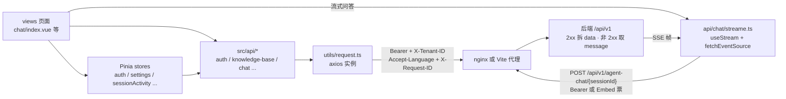

# 23. 前端控制台

前端是一个独立的 Vue 3 单页应用（`frontend/`），与后端同仓不同交付物：开发期经 Vite 代理连后端，生产期打成一个 nginx 静态镜像。同一份构建产出两个入口——`index.html`（主控台 SPA）与 `embed.html`（第三方页面嵌入挂件，见 [§15](15-渠道接入IM与网页嵌入.md)）。

## 23.1 技术栈与版本

均核实自 `frontend/package.json`（版本为 semver 约束）：

| 技术 | 版本 | 在本项目的角色 |
|---|---|---|
| Vue | `^3.5.34` | UI 框架（Composition API） |
| Vite | `^7.3.5` | 构建/开发服务器（双入口、手动分包） |
| TypeScript | `~6.0.3` + `vue-tsc ^3.2.8` | 类型检查（`npm run type-check` = `vue-tsc --build`） |
| Pinia | `^3.0.4` | 状态管理 |
| vue-router | `^4.5.0` | 路由（history 模式） |
| vue-i18n | `^11.4.2` | 国际化（7 locale） |
| TDesign | `tdesign-vue-next ^1.19.2`、`tdesign-icons-vue-next 0.4.4` | 组件库（图标经 alias 替换为按需 shim，避免整包图标进首屏） |
| axios | `^1.16.0` | HTTP 客户端（统一拆包） |
| `@microsoft/fetch-event-source` | `^2.0.1` | SSE 流式问答客户端 |
| marked + `marked-katex-extension` + katex | `^17.0.5` / `^5.1.8` / `^0.16.45` | Markdown 与公式渲染 |
| mermaid | `^11.15.0` | 回答内图表渲染（动态 import，不进首屏） |
| highlight.js | `^11.11.1` | 代码高亮（动态 import） |
| DOMPurify | `^3.4.11` | Markdown HTML 消毒 |
| `@xterm/xterm` | `^5.5.0` | 沙箱终端前端 |

> **注意**：渲染链是「marked → katex/mermaid/highlight → DOMPurify 消毒 → v-html」，消毒是最后一道闸（`src/utils/markdownDomPurify.ts`）。mermaid 与 highlight.js 走动态 import，是首屏体积控制的关键（`vite.config.ts` 的 `manualChunks` 注释里记录了被拖进首屏再拆出来的过程）。

## 23.2 目录结构与页面清单

`frontend/src/` 一级目录各管一层：

| 目录 | 职责 |
|---|---|
| `api/` | 按资源划分的 HTTP 客户端（`auth/`、`agent/`、`chat/`、`knowledge-base/`、`model/`、`wiki/`、`datasource/`、`embed/`、`memory.ts`、`mcp-service.ts`、`skills.ts`、`vector-store.ts`、`storage-backend.ts`、`web-search-provider.ts`、`system/`、`tenant/` 等），全部经 `utils/request.ts` 出手 |
| `components/` | 跨页面复用组件（聊天气泡、引用浮层、文档预览、上传、会话侧栏、命令面板等） |
| `composables/` | 组合式函数（`useChatStreamHandler`、`useEmbedBridge`、`useTheme`、`useTypewriter` 等） |
| `stores/` | Pinia：`auth`（登录态）、`knowledge`、`menu`、`settings`、`ui`、`sessionActivity`（流中活动状态）、`chatResources`、`commandPalette`、`uploadConfirm`、`editorResources`、`deploymentCapabilities` |
| `views/` | 页面（见下表） |
| `i18n/` | vue-i18n 装配、7 个 locale 模块、键审计/缺口扫描脚本 |
| `router/` | 单文件 `index.ts`：全部路由与守卫 |
| `utils/` | `request.ts`、SSE 错误帧判定、token 刷新、markdown 渲染与消毒等约百个工具模块（大量配套 `*.test.ts`） |
| `config/` | 部署能力、设置页路由/访问控制等静态配置表 |
| `directives/` `hooks/` `shims/` `types/` | 自定义指令、页面级 hook、类型补丁、全局类型 |

页面清单（`views/` 一级目录 → 功能，路由见 `router/index.ts`）：

| views 目录 | 功能 | 主要路由 |
|---|---|---|
| `auth/` | 登录/注册、空间初始化引导 | `/login`、`/register`、`/onboarding/workspace`、`/join` |
| `layout/` | 平台骨架（侧栏 + 顶栏），下挂全部业务页 | `/platform/...` |
| `knowledge/` | 知识库列表与工作台（文档/分块/FAQ/标签/Wiki） | `/platform/knowledge-bases`、`/platform/knowledge-bases/:kbId` |
| `agent/` | Agent 列表与编辑器 | `/platform/agents` |
| `chat/` | 问答主界面（SSE 消费方） | `/platform/chat/:chatid` |
| `creatChat/` | 发起问答的入口页 | `/platform/creatChat` |
| `settings/` | 设置中心（模型/检索/向量库/存储/网页搜索/MCP/记忆/解析引擎/Ollama/成员/审计/系统信息等面板） | `/platform/settings`（`section` 查询参数定位面板） |
| `integrations/` | API 集成（Key 管理与请求演练） | `/platform/integrations` |
| `embed/` | 嵌入挂件页面树（独立入口） | `/embed/:channelId` |
| `dev/` | 开发调试页（Markdown 渲染样张） | `/platform/dev/markdown` |

## 23.3 与后端的契约

全前端的 HTTP 契约收敛在 `frontend/src/utils/request.ts`：

- **请求拦截器**：注入 `Authorization: Bearer <JWT>`（来自 `localStorage`；嵌入面请求若已是 `Embed ` 前缀则不覆盖）、`Accept-Language`（当前 locale）、`X-Tenant-ID`（激活空间，只要设过就必附——注释里记录了"条件省略导致切换空间后静默跑在 home 空间"的坑）、每请求重新生成的 12 位 `X-Request-ID`。
- **响应拦截器 = 全前端唯一解包点**：2xx 且响应体恰好由 `code/message/data` 三键构成（`isApiEnvelope`，`code` 为数字）时——`code === 0` 就地拆出 `data` 返回（并附加不可枚举的 `$httpStatus`）；`code !== 0` 以 `message` reject。非 2xx 走错误分支：提取顶层 `message`（兼容 `{error:{code,message}}` 旧形态并摊平字段）后 reject。
- **401 处理**：普通请求刷新 JWT 后原请求重放一次；登录/注册/OIDC/嵌入等公开路径直接把错误交给页面；嵌入会话票（30 分钟 TTL）过期则先换票再重放。413 统一翻译为"文件超限"文案。
- **键名口径**：JSON 契约键一律 camelCase（= 后端 Java 字段名）。前端残留的 snake 契约键由守卫 `scripts/check-fe-contract-keys.py` 棘轮看管（只许减不许增），防止"反序列化忽略未知键 ⇒ 字段静默失效"。
- **绕过 axios 的裸 `fetch`**（FormData 上传、SSE、二进制下载）必须调用 `unwrapEnvelope` 自行拆包，`src/utils/rawFetchEnvelope.test.ts` 扫描新增裸 `fetch`，不拆包且无豁免标记即红。

**SSE 消费**在 `frontend/src/api/chat/streame.ts` 的 `useStream()`：用 `fetchEventSource` 发 `POST /api/v1/agent-chat/{sessionId}` 或 `/api/v1/knowledge-chat/{sessionId}`（GET + `messageId` 查询参数用于续流），`onmessage` 逐帧 `JSON.parse` 分发给注册的 `onChunk` 处理器；120 秒无帧判定连接卡死并收束；握手 401 经 `runStreamWithAuthRetry` 刷新凭据后重放（此刻尚无内容流出，用户无感）。`views/chat/index.vue` 经 `composables/useChatStreamHandler.ts` 消费该流。请求体键全部 camelCase，`channel` 字段区分 `web`/`embed`。

> **反直觉**：SSE 不走 axios，因此不经过响应拦截器——不会拆 `{code,message,data}` 外壳，前端按流帧内的终态字段判断完成；工具级失败帧（`done=false`）不能断流，否则智能体后续步骤与最终回答全部丢失。

## 23.4 开发代理与生产部署

- **开发**：`npm run dev` 起 Vite（端口 5173），`/api`（含 WebSocket 升级，`ws: true`）与 `/files` 代理到 `VITE_DEV_PROXY_TARGET`，其次 `FRONTEND_BACKEND_URL`，缺省 `http://localhost:8083`（`vite.config.ts`）。不设该变量且后端不在 8083 时，请求会静默打到空端口——"保存成功但重新打开是空的"即此症。`npm run preview`（4173）用生产产物配同一套代理，是最接近镜像的本地环境。dev 下 `/embed/:channelId` 由自定义插件回退到 `embed.html`，与 nginx 行为对齐。
- **生产镜像**（`frontend/Dockerfile`）：两阶段——`node:24-bookworm-slim`（按 digest 钉死，用 `$BUILDPLATFORM` 让多架构 CI 只编译一次 Vite）产出 `dist`；运行时是 `nginx:1.30.3-alpine`（同样按 digest 钉死，注释说明浮动 tag 曾在新 Alpine 上起不来）。无宿主侧 npm 依赖。
- **nginx 三份配置的分工**：
  - `frontend/nginx.conf`：server 模板（拷成 `templates/default.conf.template`，经 envsubst 注入 `MAX_FILE_SIZE`、`MAX_SKILL_BUNDLE_SIZE`、`APP_HOST`、`APP_PORT`、`APP_SCHEME`）。负责 SPA `try_files`、`/embed/` iframe 页（刻意不继承 `X-Frame-Options`）、`/ragagent-widget.js` 挂件加载器、`/assets/` 一年不可变缓存、`/files` 与 `/r/` 短链代理、沙箱终端与本地浏览器扩展两条 WebSocket 升级路由、技能 zip 两条集合路由单独放宽 body 上限、`/api/` 通用代理。
  - `frontend/nginx-api-proxy.conf`：两条 `/api` location 共用的 proxy 参数，SSE 友好是重点——HTTP/1.1、`proxy_buffering off`、`proxy_read_timeout 3600s`；逐字节拷贝进镜像而**不经 envsubst**（否则 `$host` 等 nginx 变量会被吃掉）。
  - `frontend/nginx-http.conf`：http 上下文的 `api_no_query` 日志格式——`$uri` 不含查询串，握手票据等敏感参数不落访问日志。
- **入口脚本**（`frontend/docker-entrypoint.sh`）：生成 `/usr/share/nginx/html/config.js`（`window.__RUNTIME_CONFIG__`：`MAX_FILE_SIZE_MB`、`MAX_SKILL_BUNDLE_SIZE_MB`、`DEFAULT_LOCALE`——只放行白名单 locale 标签，防环境值注入），envsubst 渲染模板后 `exec nginx`。上游默认 `http://app:8080`（compose 服务名）。

## 23.5 嵌入挂件的构建入口

`embed.html` + `src/embed-main.ts` 是 Vite 的第二个构建入口（`rollupOptions.input.embed`）：只注册挂件用到的 8 个 TDesign 组件、使用 `i18n/embed.ts` 精简语言包、路由仅 `/embed/:channelId`，首屏先渲染内联骨架再挂 Vue。第三方页面经 `/ragagent-widget.js` 静态加载器接入。协议与安全模型见 [§15](15-渠道接入IM与网页嵌入.md)。

## 23.6 国际化

`src/i18n/index.ts` 注册 **7 个 locale**：`zh-CN`、`zh-HK`、`en-US`、`ru-RU`、`es-ES`、`pt-BR`、`th-TH`（`SUPPORTED_LOCALES`，见 `src/i18n/resolveDefaultLocale.ts`；内置默认 `en-US`，运行时 `DEFAULT_LOCALE` 未命中白名单时回落）。`src/i18n/tdesign/` 另有 TDesign 组件库的 3 个补充语言包（`es-ES`、`pt-BR`、`th-TH`）。两个质量脚本：

- `npm run check-i18n`：跑 `src/i18n/localeKeyAudit.test.ts`，审计各 locale 键集与源码静态引用的一致性（`npm test` 也会跑到它）。
- `npm run scan-i18n-gaps`：跑 `src/i18n/localeGapScan.ts`，扫描**动态拼 key**（模板字符串、拼接、`tm()` 根）等静态审计看不到的用法，报告这些前缀下从未被引用的 locale 键缺口。

## 23.7 边界与注意

- 前端类型是手写的（无 codegen），后端改契约前端照样编译通过——由契约金片 + `scripts/check-contract-sync.py` 签字机制兜底（见 [§24.3](24-测试体系与质量门禁.md)）。
- `config.js` 是生产镜像唯一的运行时配置通道（上传上限、默认语言）；改环境变量须重建容器，不是构建期变量。
- embed 入口刻意轻装（不整包引入 TDesign、preload 过滤聊天重块），改动公共依赖时注意别把主控台的重量级模块拖进挂件首屏（`vite.config.ts` 的 `modulePreload.resolveDependencies` 有注释约束）。

---

[上一章：22. 配置体系（含配置项总表）](22-配置体系.md) ｜ [返回目录](详细技术文档.md) ｜ [下一章：24. 测试体系与质量门禁](24-测试体系与质量门禁.md)
