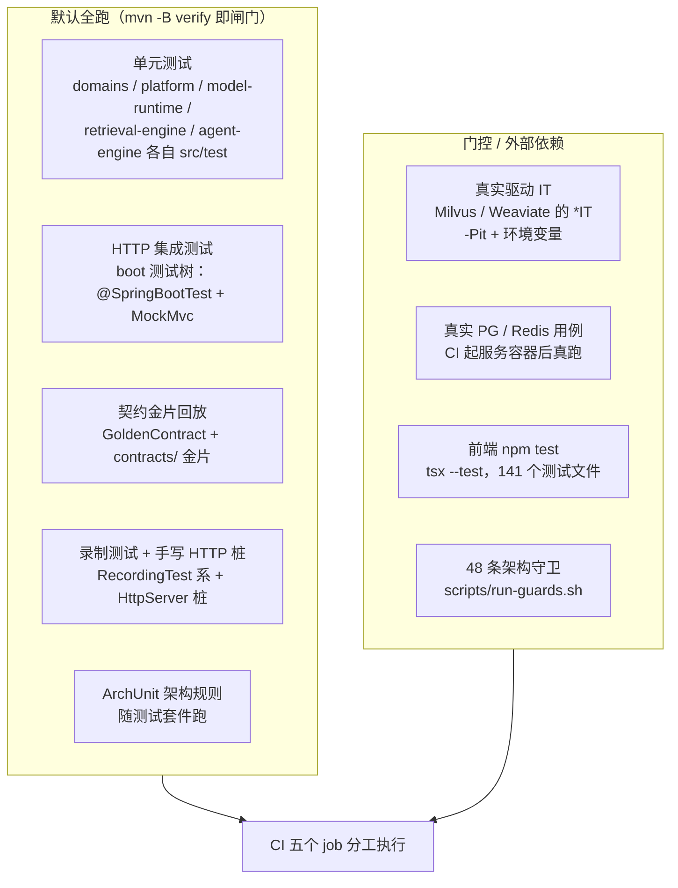

# 24. 测试体系与质量门禁

## 24.1 测试规模与技术栈

规模口径：`python3 scripts/test-summary.py`（只读各模块 `target` 下**最近一次构建**的 JUnit XML）：

| 模块 | 测试数 | 失败 | 跳过 |
|---|---|---|---|
| `domains` | 2859 | 0 | 0 |
| `platform` | 262 | 0 | 0 |
| `model-runtime` | 286 | 0 | 1 |
| `retrieval-engine` | 320 | 0 | 1 |
| `agent-engine` | 157 | 0 | 0 |
| `boot` | 1356 | 0 | 0 |
| `contract` | 12 | 0 | 0 |
| **合计** | **5252** | **0** | **2** |

两个跳过均有登记：`RemoteApiChatTest.liveRemoteApiChat`（需真实 provider API Key，联网计费，刻意不自动化）与 `JiebaTokenizerDiffTest.sdkTokenizeMatchesGo`（分词差分的对照产物不在本机，只跑裸切分差分）。

技术栈（核实各 `pom.xml`）：JUnit 5（`junit-jupiter`）、AssertJ、Spring Boot Test（`spring-boot-starter-test`）、MockMvc（boot 测试树 68 个测试类使用）、H2 内存库（`domains`/`boot` 测试依赖，共享 DDL 由 `domains/src/testFixtures/java/com/ragagent/TestSchema.java` 定义）、Mockito（随 starter 引入并大量使用）、ArchUnit 1.3.0（`boot` 与 `domains`）、嵌入式 Redis 夹具 `platform/src/testFixtures/java/com/ragagent/platform/stream/EmbeddedRedis.java`（依赖宿主 `redis-server` 在 PATH 上）。

## 24.2 测试分层

各层要点：

- **单元测试**住在各模块自己的 `src/test`，不跨模块拉依赖（错位测试被 `scripts/check-module-graph.py` 登记棘轮管住）。
- **HTTP 集成测试住在 `boot` 测试树**：集成测试必须从 HTTP 面进（`@SpringBootTest` + `@AutoConfigureMockMvc`），而只有组合根能装配全部 Bean——`boot` 主代码只有入口与 `config/`，测试树却有 24 个业务包根（见 `docs/architecture/module-package-map.md`）。
- **契约金片回放**：见 [§24.3](24-测试体系与质量门禁.md)。
- **录制测试与手写 HTTP 桩**：`*RecordingTest` 系（管线、工具、模型上下文等）对着**手写的 `com.sun.net.httpserver.HttpServer` 桩**跑真实 HTTP 线路——LLM 桩（OpenAI 兼容上游，按请求里的 `<<SCENARIO:...>>` 标记路由场景）、Ollama 桩（钉 11434 端口，`HEAD /` 探活、`GET /api/tags`、NDJSON `POST /api/pull`）、IM 平台适配器桩、数据源连接器桩、MCP 服务桩。boot 侧的 `boot/src/test/.../W5bStubServers.java` 把 Ollama + 上游两个桩收成一份剧本。
- **真实驱动集成**：`retrieval-engine/src/test/java/com/ragagent/retrieval/engine/milvus/MilvusDriverLocalIT.java` 与 `weaviate/WeaviateDriverLocalIT.java`，`@EnabledIfEnvironmentVariable(named = "RAGAGENT_MILVUS_IT"/"RAGAGENT_WEAVIATE_IT", matches = "true")` 门控，经 `-Pit` profile 的 failsafe 插件执行；CI 的 integration job 起 `milvusdb/milvus:v2.6.11` standalone 与 `semitechnologies/weaviate:1.28.4`（GSE 分词必开）真跑。
- **前端**：`npm test` = `tsx --test`，跑 `src/` 下 141 个 `*.test.ts`/`*.test.mjs`（Node 测试运行器）。

## 24.3 契约金片

- **数量**：`domains/src/testFixtures/resources/contracts/` 下 **1339 个 `*.json`**，另有 **5 个 `*.body`**（FAQ 导出、附件预览等下载/导出类样本）。
- **对比语义**：共享夹具 `domains/src/testFixtures/java/com/ragagent/fixtures/GoldenContract.java`——两侧同走 `ContractJson.deep` 归一（键排序、数字归一、时间归 UTC、字符串内嵌 JSON 递归归一）再 `strip` 比较；非 JSON 文本（CSV、错误体）退化为 strip 后文本断言。动态值（uuid/时间戳/耗时）由各域传入掩码函数，golden 与 actual 同函数。
- **重录**：`-Dcontract.refresh=true`（根 `pom.xml` 的 surefire 把它接线成 `contract.refresh` 系统属性），开启时测试把掩码后的实际响应**写回金片**而不是断言；孤儿夹具可用 `scripts/audit-contract-fixtures.sh` 做行为级审计（结论仅作人工复核线索）。改动响应形状必须显式重录，杜绝"接口悄悄变了"。
- **签字守卫**：`scripts/check-contract-sync.py` 对每份金片提取键名集合、算 SHA1 指纹，与基线 `scripts/contract-signature.baseline.json` 对账；金片键集变化而未跑 `--write` 签字即红——金片变了 = 契约变了，逼人确认前端是否已同步。

## 24.4 架构守卫

`bash scripts/run-guards.sh` 是守卫**单一入口**（CI guards job 与本地跑同一份），当前 **48 条**（脚本内 `run` 调用自计数，加守卫只加一行）。分类速览：

| 分类 | 守卫举例（`scripts/` 下） | 防什么 |
|---|---|---|
| 模块/包结构 | `check-package-cycles.py`、`check-module-graph.py`、`check-package-dirs.py`、`check-stray-dirs.py`、`check-duplicate-classes.py`、`check-package-size.py` | 包环、跨模块错位、改包不搬目录、死目录、跨模块同名类、包膨胀 |
| 契约纯度与端口 | `check-contract-purity.py`、`check-contract-shape.py`、`check-domain-contracts.py`、`check-port-budget.py`、`gen-contract-consumers.py` | contract 只许纯 JDK、端口方法数上限、跨域只经契约层、无消费者的端口 |
| 命名口径 | `check-fe-contract-keys.py`、`check-json-key-case.py --strict`、`check-event-face-case.py` | 前端 snake/后端 camel 分裂、JSON 键换锚失控、事件/路由面命名漂移 |
| 文件/方法长度棘轮 | `check-file-size.py`（不得新增 >600 行主源码）、`check-method-length.py`（>150 行只许减）、`check-hygiene-budget.py` | 巨型文件、超长方法、卫生预算反弹 |
| 统一外壳与控制器 | `check-api-envelope.py`、`check-exception-semantics.py`、`check-controller-purity.py`、`check-controller-entity-imports.py` | 新控制器不合响应外壳、检索层吞条件、控制器直连 Mapper/导入实体 |
| 租户作用域 | `check-tenant-scope.py` | 跨线程身份绕过 `TenantScope` 裸 capture/replay |
| 文档/索引同步 | `gen-arch-index.py --check`、`gen-pipeline-map.py --check`、`gen-port-map.py --check`、`gen-module-map.py --check`、`gen-domain-index.py --check`、`check-doc-truth.py`、`check-qa-flow.py`、`check-ingest-flow.py`、`check-reference-truth.py` | 生成的架构索引与代码脱节、文档断链、README 数字过期 |
| 路由权限覆盖 | `check-route-policy.py` | 未登记的公开路由、幽灵规则、对照表过期 |
| 版本与 schema | `check-version-consistency.py`、`check-schema-parity.py` | 版本漂移、`TestSchema` 建表与 `migrations/versioned/` 不一致 |
| 注释与日志卫生 | `check-internal-codes.py`、`check-comment-narrative.py`、`check-comment-decor.py`、`check-log-exceptions.py`、`check-log-level.py`、`check-tool-registry.py`、`check-wiring-points.py`、`check-known-gaps.py` | 注释里的历史代号、日志打印 `Throwable.toString()`、工具名三方不一致、装配点未登记 |

> **棘轮机制**：以上守卫大量采用"基线 + 只许减不许增"——存量违例逐条登记在 `scripts/*.baseline.json`（现 18 份，如 `package-cycles.baseline.json`、`file-size.baseline.json`、`fe-snake-contracts.baseline.json`），基线外**新增即红**（拦增量），基线条目清理后跑 `--write` 收紧基线（防规则空转、强制随清理下降）。跳过清单同理：`scripts/test-summary.py` 的 `ALLOWED_SKIPS` 只放行登记过的跳过，出现未登记跳过 → 退出码 1。

**ArchUnit 规则**（代码级，脚本表达不了的）：`boot/src/test/java/com/ragagent/arch/ArchitectureRulesTest.java`（22 个 `@Test` 规则）与同目录 `ContractBoundaryRulesTest.java`，`domains/src/test/java/com/ragagent/arch/` 另有三个边界测试。代表性规则：

1. 主代码不得裸调 `System.getenv`（只许四类登记落点：`@ConfigurationProperties`、域查找面、启动期值快照、全局查找面 + 启动钩子）；
2. `@ConfigurationProperties` 类必须被 `@ConfigurationPropertiesScan` 名单覆盖（漏了不报错、值永远是默认值）；
3. 禁 `@Lazy` 注入——循环依赖要拆，不许懒加载掩盖设计缺陷；
4. 分层方向：`service` 不得依赖 `controller`，`domain` 不得依赖 `service`/`controller`；
5. 顶层 `Mapper` 接口必须落在 `..mapper..` 包（`@MapperScan` 只扫这些包，放错包会静默不注册）。

## 24.5 格式与编译闸门

- **Spotless**：`ratchetFrom seed`——从基线 tag 起只检查触碰过的文件；规则为 import 排序（static 块置顶、其余单块 ASCII 序）、删未用 import、去尾随空格、文件末换行。CI 单独跑 `mvn -B spotless:check`。
- **Javadoc**：所有模块 `verify` 阶段跑 `maven-javadoc-plugin`，只开 `-Xdoclint:reference`（防 `{@link}` 断链），且加 `-Werror`——引用告警即构建失败；HTML 风格与 `@param` 完整性刻意不查。
- **编译 `-Werror`**：`contract/pom.xml` 与 `platform/pom.xml` 的主码编译开启 `-Xlint:all,-serial -Werror`（测试编译只告警）；其余模块按棘轮节奏跟进。
- **JaCoCo**：默认**不插桩**（agent 拖慢全量闸门约 25%），显式 `-Pcoverage` 才采集与出报告。
- **Surefire**：`forkCount=2` 按测试类分派两个 JVM。

## 24.6 CI（`.github/workflows/ci.yml`，五个 job）

| Job | 做什么 |
|---|---|
| `guards` | 跑 `bash scripts/run-guards.sh`（48 条，与本地同口径） |
| `backend` | 起 ParadeDB（`paradedb/paradedb:v0.22.2-pg17`）服务容器 + 安装 `redis-server`；**灌迁移自检**（`migrations/versioned/` 全部 SQL 按序灌进全新库）；`mvn -B spotless:check`；`mvn -B verify`（真实 PG/Redis 让相应录测试真跑）；启动冒烟 `scripts/ci-smoke.sh`（真实 jar：`/health` 200、API 文档默认 404）；失败时 `scripts/ci-log-annotate.py` 把关键日志行变成 PR 注解；`scripts/test-summary.py` 汇总失败与跳过 |
| `docker` | `docker build` 服务端镜像（防 Dockerfile 路径腐化）+ 自检迁移目录随镜像落地（Flyway filesystem 相对路径漏拷会静默无 schema） |
| `frontend` | `npm ci` → `npm run type-check` → `npm test` → `npm run build-only` |
| `integration` | 起 Milvus standalone 与 Weaviate 容器、等端口就绪（超时即失败，不许伪装成 skip）、发现 IT 类数量 ≥2（改名导致 0 发现必须红）、`mvn -B -DskipTests install` 后 `mvn -B -Pit -pl retrieval-engine verify`（env 门控开闸） |

## 24.7 本地命令速查

| 命令 | 用途 |
|---|---|
| `mvn -B verify` | 全量闸门：格式 + javadoc + 全量测试 + 守卫（守卫挂在 `boot` 模块的 verify——它是 reactor 最后一个模块，见 `boot/pom.xml` 的 exec-maven-plugin 绑定） |
| `mvn -B -DskipTests install` 后 `mvn -B -pl domains test -Dtest='com.ragagent.session.*'` | 定向测试；**单模块构建前必须先 install**，否则跨模块测试夹具解析不到（见 `README.md` 开发与测试一节） |
| `bash scripts/run-guards.sh` | 仅跑 48 条架构守卫（与 CI 同一份） |
| `mvn test -Dcontract.refresh=true` | 重录契约金片（确认契约变更是有意的之后） |
| `python3 scripts/test-summary.py` | 汇总最近一次构建的失败/跳过清单 |
| `cd frontend && npm run type-check && npm test` | 前端类型检查 + 单测 |
| `mvn -B -Pit -pl retrieval-engine verify`（env：`RAGAGENT_MILVUS_IT` / `RAGAGENT_WEAVIATE_IT`） | 真实驱动集成（本地需自备 Milvus/Weaviate 容器） |

## 24.8 设计原则

- **"任何环境默认可跑绿，但覆盖的消失必须被看见"**：外部依赖（真实 provider、Go 分词对照产物）允许跳过，但跳过必须在 `ALLOWED_SKIPS` 登记理由，未登记的跳过直接让 CI 变红——跳过和失败一样摆上台面，而不是沉进日志。
- **环境相关能力在 CI 真跑而非跳过**：CI 安装 `redis-server` 让嵌入式 Redis 测试真跑（曾实测过 4 个 Redis 测试被静默跳过而无从察觉）；起真 ParadeDB 支撑灌库守卫与两条连真 PG 的录测试；integration job 起 Milvus/Weaviate 且"端口未就绪即失败，不允许伪装成 skip"。
- **本地与 CI 同一份口径**：守卫只有 `scripts/run-guards.sh` 一个入口（本地手敲容易漏 `--strict` 之类开关，出现"本地绿 CI 红"）；`mvn -B verify` 即 CI 后端 job 的主闸门。
- **契约变更必须显式签字**：金片只在有意变更时重录，键集指纹对账把"后端改契约前端不知情"变成必红项。

---

[上一章：23. 前端控制台](23-前端控制台.md) ｜ [返回目录](详细技术文档.md) ｜ [下一章：25. HTTP 接口速查](25-HTTP接口速查.md)
