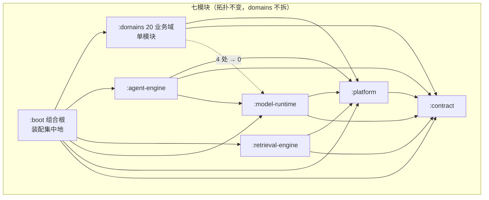

# RagAgent 架构评估与优化方案 v1.0

> - **评估日期**：2026-10-20
> - **评估团队**：MVP 开发专家团——项目总监（大湾区靓仔）统筹，架构师（高见远）/ 产品经理（许清楚）/ 后端工程师（贝洛奇）/ 前端工程师（贾思敏）/ 测试工程师（严过关）五专家并行只读深潜，总监对 8 项关键论断独立复核
> - **评估基线**：HEAD（953815f29「回退 :knowledge 合回 domains」之后）
> - **评估性质**：全只读。未修改/删除任何现有代码、配置、文档；未执行 Gradle/npm 构建；所有统计来自文件读取与 `scripts/` 守卫脚本实跑
> - **配套报告**（同目录 5 份，所有结论均带文件路径/行号/计数证据）：
>   `01-architecture-assessment.md`（模块与架构）｜ `02-business-link-assessment.md`（业务链路）｜ `03-backend-code-quality.md`（后端代码）｜ `04-frontend-architecture.md`（前端）｜ `05-quality-guard-assessment.md`（测试与守卫）

---

## 一、执行摘要

### 1.1 总体判定：conditional-pass —— 骨架商业级，末端失修

这个代码库不是"AI 生成烂摊子"，也不是"文档吹出来的架构"。三条核心架构承诺——**七模块单向依赖、契约层纯 JDK、域间只经契约**——经实跑守卫全部证实为真，且有基线棘轮防回退。问题不在拓扑正确性，而在四类结构性摩擦（扩展注册、装配权、跨域实体渗漏、文档计数）与两类纪律失败（文件/方法级规模、前端契约与门禁）。

### 1.2 九维评分卡

| 维度 | 判定 | 关键证据 |
|---|---|---|
| 模块划分 | 优（有条件） | 7 模块拓扑实测全达标；domains 单模块形态有 git 拆合实证支持；域间边 64→6 条收敛 |
| 核心业务链路 | 优 | 7 条链路均为单入口+单编排+单落点；跨域 import 仅占跨包 import 的 2.6% |
| 管理后台配置 | 良（有错配） | 配置功能落点基本清晰；RBAC 双表、引擎常量双写、"评测"功能被文档承诺但不存在 |
| 能力抽象 | 中 | SPI 契约七族统一干净；但注册/装配机制五套并存，新增成本差 3 倍以上 |
| 平台基础设施 | 良 | 事件总线/SSE/租户上下文/审计/审批端口化到位；跨域实体渗漏 8 处 + 装配权分散 |
| 代码可读性 | 中 | 注释密度与分层纪律优秀；但 47.3% 生产 LOC 沉在 >300 行文件，上帝服务+委托样板+注释腐烂 |
| 代码可维护性 | 中 | ArchUnit 强制分层（51 控制器 0 个碰 mapper）；事务跛脚、N+1、软删手写、测试覆盖失衡 |
| 前端架构 | 中（B 级） | 请求层/SSE/嵌入隔离/i18n 高于平均水准；上帝组件（最大 6,593 行）+ 契约全手工 + 无 ESLint |
| 质量体系 | 良（Silver） | 42 脚本守卫 + 28 ArchUnit + 1,349 金片 + 4,689 测试；三处结构性缺口（见 3.8） |

### 1.3 五个最重要的结论

**结论 1：「domains 巨型单模块是资产不是债务」——有 git 实证，不是挽尊。**
评估前 2 天（2026-10-18，commit `953815f29`），团队刚把拆出去的 `:knowledge` 模块合回 domains，回退理由原文：「拆分只带来独立编译，知识库代码仍分散在 knowledge/retrieval/contract/platform 四处；11 个知识相关 Port 本就在跨域，收益小于认知成本」。域间边从立规时 64 条收敛到 6 条（80 处 import，全部族内豁免且冻结，clearable 档为 0）。本次独立判断与团队用代价换来的结论一致：**不拆**。

**结论 2：真正贵的不是模块边界，是「扩展一个能力要改多少地方」。**
七族能力 SPI 契约全部干净统一（均在 `:contract`），但注册/装配机制有五套并存：websearch 一行注册（最优，~2 处）vs 向量库 6-7 处且要碰 boot 装配与 SSRF 安全策略分支（最差）——成本差 3 倍以上，且向量库路径漏改 SSRF 分支等于安全口径不一致。**这是"能力抽象"维度的核心欠账。**

**结论 3：可读性的主要矛盾是规模纪律，不是命名与分层。**
分层由 ArchUnit 测试强制（51 个控制器 0 个 import 域 mapper；265 个 service 文件 0 个跨域碰 mapper），package-info 覆盖 95.4%，注释密度异常高。但 301 个生产文件超 300 行、承载全部生产 LOC 的 47.3%，13 个文件超 700 行，22 个方法超 150 行（最大 275 行）——「上帝服务 + 委托样板 + 注释腐烂」是三位一体的可读性杀手（详见 3.6）。

**结论 4：前端是「骨架健康、末端失控」。**
请求层（唯一解包点 + 401 重放）、SSE 客户端（代际守卫 + embed 票双通道 + TTFB 插桩）、嵌入隔离（独立入口/独立 Pinia/零 store 依赖）、i18n 工程化（5 语言 + key 审计工具链）都明显高于平均水准；但 82 个 .vue 超 400 行（最大 6,593 行）、276 个契约类型全手工维护（`Tag` 抄 4 遍）、无 ESLint、上帝组件恰恰无测试保护。**问题不是能力，是纪律。**

**结论 5：质量体系是高强度基础设施，但有三处结构性缺口。**
42 条脚本守卫（单一入口，CI/本地同口径）+ 28 条 ArchUnit + 1,349 份契约金片 + 4,689 个测试方法（测试/主码 LOC 比 0.45）。缺口在：金片「值」无机械防伪（~100 个孤儿夹具虚增计数 7.4%）、覆盖结构失衡（initialization 2,291 行主码只有 1 条测试）、棘轮签收社会化（`--write` 无机械约束，file-size 允许 +30 行/PR 松弛可变相逃逸）。

### 1.4 路线图一图流

```
Wave 0 止血对齐（本周，零业务风险）
  文档计数守卫化 | 金片 sha256 边车+孤儿审计复活 | 前端 ESLint+orphan 扫描 | 评测功能处置决策
      ↓
Wave 1 安全与机械修复（1-2 周）
  软删过滤收口 | 钉钉流表租户键 | SHA-256 下沉 | N+1 批量化 | 死代码删除 | 方法级守卫+测试棘轮
      ↓
Wave 2 结构手术（2-6 周）
  注册机制统一(T1) | 实体渗漏清零(T3) | embedding 单路径 | RBAC 单表 | agent 工具端口化
  auth 事务补齐 | 大文件拆分门禁先行 | 前端目录正名+api 归域 | 装配权登记(T2)
      ↓
Wave 3 契约与拆分（持续 4 周+）
  springdoc+OpenAPI 生成 | DTO 收敛 | 上帝组件拆分(先补测试网) | 大文件批量拆分 | LLM 双目录合并(T5)
```

总闸门（每一波共用）：**42 守卫全绿 + 契约金片 0 意外重录 + 5,022 测试 0 失败 + spotlessCheck 通过 + 前端 type-check/test 通过**。任何一波回滚 = 单次提交 `git revert`。

---

## 二、评估方法与可信度

### 2.1 团队与纪律

- **五专家并行 + 总监交叉验证**：每专家独立产出、只读分析、报告落盘；总监对成员结论抽查复验，不采信未经证据支撑的判断。
- **证据标准**：所有结论必须带文件路径 + 行号/计数；禁止「感觉/可能/一般」式空泛判断。
- **总监独立复核的 8 项关键论断**（全部属实）：
  1. `:contract` 构建文件生产依赖为空（纯 JDK 由编译期硬保证）；
  2. 域间边 6 条 / 80 处 import（`check-domain-contracts.py` 实跑）；
  3. 跨域实体渗漏精确命中 8 个 session 文件（`import com.ragagent.agentmanagement.domain` 逐一验证）；
  4. `DingtalkAdapter.java:94` 存在 `static STREAMS` 进程级全局流表；
  5. domains `@Transactional` 22-25 处、仅覆盖 wiki/knowledge/memory 三域；
  6. 手写 `deleted_at IS NULL` 约 160 处 SQL 用法（含注释引用 216 处命中）；
  7. git `953815f29`「拆 :knowledge → 回退」完整往返实证存在；
  8. README L48/L227 两处承诺「评测」功能，但全仓无 evaluation 域/控制器/前端页面（domains 主码仅 1 处注释级提及）。

### 2.2 失败披露（透明性）

按团队规程如实披露：产品经理前两次 spawn 被框架 429 队列限流秒拒（第 3 次成功）；测试工程师与产品经理（第 3 次）均在**交付报告之后**、最终完成握手时被 429 打断。五份报告文件均已落盘并经总监打开验证，内容完整、证据可复现，全部采信。代理进程的失败是框架队列容量问题，不影响产物有效性。

### 2.3 数据底座（本次实测）

| 指标 | 数值 |
|---|---|
| 后端模块 / 主码 Java 文件 / LOC | 7 个 / 2,436 / 300,535 |
| domains | 20 域 / 249 包 / 51 业务控制器（全仓 `@RestController` 52 个，含 platform 健康探针） |
| 契约金片 | contracts 目录 1,349 个 JSON（~100 个孤儿，7.4%）；全量金片文件 1,433；Go 逐字节金片 8 个 |
| 测试 | 488 个 src/test 文件 / 4,689 个测试方法 / 134,719 行（测试/主码 0.45） |
| 守卫 | 42 条脚本守卫（39 本机实跑全绿）+ 28 条 ArchUnit |
| 前端 | src 约 205,000 行；views 11 目录 153 文件 95,327 行；82 个 .vue >400 行 |
| 域间耦合 | 6 条边 / 80 处 import / 33 个类（基线冻结，族内豁免） |

---

## 三、现状评估：基于业务的四大维度反向审视

### 3.1 核心业务链路：链路健康，病灶在「多点登记」

| 链路 | 入口 | 编排 | 跨域情况 | 判定 |
|---|---|---|---|---|
| 文档摄取 ingest | KnowledgeProcessWorker | 208 行 4 阶段类 | 走契约端口 | 最健康样板 |
| 问答 chat | QaEntryRunner | QaTurnExecutor + 17 插件 | session→agenttools/agentmanagement/memory（族内登记） | 健康 |
| Agent 执行 | 复用 chat 入口 | AgentEngine ReAct | 同 chat | 健康 |
| Wiki | 域内有域 | WikiIngestCitePipeline 等 | knowledge↔wiki 双向（族内登记） | 健康 |
| IM 渠道 | 各渠道 Adapter | ImTurnOrchestrator | **0 条域间直连** | 隔离最彻底 |
| 数据源同步 | ConnectorRegistry | 域内 DataSourceWiring | 注册表形态 | 扩展机制最佳样板 |
| 嵌入渠道 embedchannel | 29 端点三分面 | 拆 4 个控制器文件 | 0 直连 | 健康 |

**硬数据**：域间直连仅 6 条边 / 80 处 import / 33 个类，全部 intra-family 豁免且冻结在 `scripts/domain-contracts.baseline.json`；跨域 import 仅占总跨包 import 的 2.6%；domains 对三个 runtime 模块直连仅 4 处（session→modelcontext，登记为终态边）。

**错配点（业务视角）**：
1. **agent 工具装配寄生在 session 域**：`session/service/AgentToolBackends.java`（552 行）直接 import 26 个 agenttools 具体类做「工具名→实例」分发——全仓最重直连边（42 处 import）。加一个工具必须跨域改 session；agent 能力实际散落 agent-engine + agenttools + agentmanagement + session 四处。
2. **embedding 双路径**：`ChunkVectorIndexer` 同持两条路——KB 绑引擎走 model-runtime 的 `EmbedderFactory`（9 家），未绑走 `knowledge/client/EmbedderClient`（最小 OpenAI 兼容客户端，且住在业务域内）。厂商兼容性只覆盖一半。
3. **「评测」功能不存在**：README L48/L227 两处承诺，全仓无域/表/控制器/页面（见 3.2）。**文档承诺了不存在的交付物。**

### 3.2 管理后台业务功能管理/配置

| 功能 | 后端落点 | 前端落点 | 判定 |
|---|---|---|---|
| 模型管理 | domains/model（3 控制器）+ model-runtime | views/settings/ModelSettings + api/model | 清晰；但 provider 双目录双清单 |
| 向量库配置 | domains/vectorstore + retrieval-engine | settings/VectorStoreSettings + api/vector-store | 散：引擎常量双写（EngineTypes 9 vs VectorStoreEngines 7） |
| websearch 提供商 | domains/websearch | settings/WebSearchSettings | 清晰（注册表最优形态） |
| 存储后端 | domains/storage（3 控制器） | settings/StorageBackendSettings + api 三处 | 散 |
| 系统设置 | domains/system | api/system/index.ts（1,252 行/62 类型）+ views/system | 巨型混合文件 |
| 审批 / 审计 | domains/approval / audit | api/mcp-service + api/tenant/audit-log | 审计 API 放错域（塞进 tenant） |
| RBAC | boot/RbacRoutePolicies（593 行）+ auth/APIKeyRoutePolicies（705 行） | — | **双表：新端点要同步两张 600+ 行表** |
| 初始化向导 | domains/initialization | api/initialization（613 行） | 清晰但测试仅 1 条 |
| 评测 | **不存在** | **不存在** | **README 承诺（L48/L227）但零实现** |
| 连接器目录 | ConnectorCatalog 登记 17 类型 | 前端下拉 | 9 实现 / 8 空挂（known-gaps 如实登记） |

**判定**：配置类功能的代码落点整体可寻（20 域中 14 个前后端映射清晰），但「一个功能散落多处」的错配集中在：RBAC 双表、引擎常量双写、system 巨型 api 文件、审计 API 错域、评测功能缺口。另有 `SkillCatalogController`/`SkillsCatalogController` 命名仅差一个 s 的隐患。

### 3.3 能力抽象：契约七族统一，注册五套并存

**SPI 契约面（优）**：七族能力 SPI 全部沉在 `:contract`——LLM/Embedding/Rerank（26 家 provider）、向量/检索引擎（9 种）、Agent 工具（22 域侧 + 3 内置 + MCP）、存储后端（8 种）、网页搜索（13 家）、IM 渠道（9 渠道）、数据源连接器（9 实现）、技能（三级注入）。`BaseTool` 四方法设计与「工具出错返回 ToolResult(success=false) 不抛异常」的错误通道约定是经过思考的契约。

**注册/装配机制（核心问题）**：

| 能力族 | 注册机制 | 新增改动点 | 碰 boot | 碰金片 |
|---|---|---|---|---|
| 数据源连接器 | 注册表（域内自装配） | ~5 | 否 | 否 |
| websearch | 构造器 Map | ~2 | 否 | 否 |
| IM 渠道 | boot 装配一行 + ImTypes | ~4-7 | **是** | 否 |
| 向量引擎 | **switch 工厂**（EngineFactory）+ SSRF 策略分支同文件 | ~6-7 | **是** | 否 |
| 存储后端 | **switch 工厂**（FileServiceFactory）+ IMPLEMENTED 集合 | ~4 | 否 | 否 |
| LLM provider | 静态块双处 + ModelProviderCatalog 手写第二清单 | ~4-7 | 否 | **是** |

**试金石**：新增一个向量库（如 chroma）要走查 7 处——新 Repository（~600 行量级）+ EngineFactory switch 分支 + 同文件 SSRF 地址策略分支（漏改 = 安全口径不一致）+ EngineTypes 常量 + domains 校验 + 前端映射 + boot env 注册。对比新增一个 websearch 提供商的 2 处。**成本差 3 倍以上，且唯一触碰安全策略文件的路径没有注册表保护。**

### 3.4 平台基础设施：端口化到位，三类隐藏耦合

**到位项**：事件总线（消费方经契约接口持有，`GlobalEventBus` 静态门面主码 0 调用）；SSE 流管理（Memory/Redis 双后端经端口消费）；租户上下文（TenantContext + TenantScope 显式快照，`check-tenant-scope.py` 硬零两条判据）；审计（三条独立游标流只追加）；审批（高危工具人工闸门经契约面接入）；外部调用超时全覆盖（24 个 HttpClient 站点 100% 设 connectTimeout）。

**三类隐藏耦合**：
1. **跨域实体渗漏 8 处（最实质）**：session 8 个文件直接 import `agentmanagement.domain.CustomAgentEntity`（AgentResolver/SessionKnowledgeQaService/QaSupport 等），他域 ORM 实体进入本域公开返回形状（`AgentResolver.ResolvedAgent`），且带 `sharedAgentReadOnly` 恒 false 的裁撤残留。好消息：跨域 repository/mapper/controller import 为 0——持久层后门不存在，只有实体形状泄漏。
2. **装配权分散**：domains 内落 19 个 `@Configuration`（约 10 个真装配，`QaWiring` 装配 12 个契约端口却住在 `domains/session/assembly`），「组合根在 :boot」名不副实；同时 boot→agent-engine 主码 0 边，agent-engine 靠根包组件扫描隐式装配——编译图看不见运行图。
3. **域间环被族内豁免放行**：knowledge↔wiki 双向边同时存在（包级 SCC 守卫 5 组基线包含此类）——意味着「knowledge 与 wiki 实际是一个域」，拆模块必须一起拆。

### 3.5 模块划分终审：七模块维持，domains 不拆

**三判据**：
1. **棘轮实证**：域间边从立规时 64 条收敛到 6 条（33 类），clearable/owner 档均为 0，剩余全部族内豁免+冻结——「单模块内 20 域」的边界是被守卫承认的事实。
2. **git 实证**：`:knowledge` 拆模块后已回退（`cb3eb973d` → `953815f29`），团队用完整「拆—合」周期实践出了「能力族拆模块、业务域留单模块」的结论；`:common`/`:engine` 已完全解散史佐证同一演化方向。
3. **补偿机制齐全**：R10 三档棘轮 + capability-kinds（20 域 0 跨 kind 直连）+ package-size 棘轮 + controller-purity + package-cycles（环 0）+ 每域 package-info 四要素——实质是「用棘轮 + 元数据把单模块内的多域当准模块管理」。

**保留意见**：① boot→agent-engine 主码 0 边的隐式扫描面应作为已知机制登记；② 重审触发条件——域数或 domains 主码文件数增长 ×1.5（即 ~30 域或 ~2,300 文件）时重审拆分，届时按 family 边界（agent-runtime/identity/knowledge，已在 `domain-contracts.baseline.json` 定义）。

### 3.6 代码质量：分层优秀，规模失守

**优秀面（测试强制，非自觉）**：51 控制器 0 个 import 域 repository/mapper；265 service 文件 0 个跨域碰 mapper；`ArchitectureRulesTest`（22 个 ArchUnit 测试）把分层反向/mapper 归属/禁裸 getenv 钉成编译期可执行棘轮；注释密度与质量异常高（大量 javadoc 解释「为什么」）。

**失守面**：

| 问题 | 量化 | 证据 |
|---|---|---|
| 大文件治理失败 | 301 个生产文件 >300 行（12.4%），承载 47.3% 生产 LOC；>500 行 17 个、>700 行 13 个 | 全量 wc -l 统计 |
| 上帝服务 | 最重 7 文件已全文深读：StorageFileResolver 778（8 个内聚主题挤一类）/ MemoryService 770（175 行单行委托 + 双开关并行实现）/ FaqEntryCommandService 770（5 用例共居 + 同尾块抄 4 遍）/ UserService 738（90 行手写补偿事务）/ KnowledgeService 711（35 个单行委托 + 注释腐烂）/ McpCatalog 723（Go 单文件直译）/ DingtalkAdapter 754（三接口一文件 + static 全局表） | 03 报告 §3 |
| 事务跛脚 | domains 仅 22-25 处 `@Transactional`，只覆盖 wiki/knowledge/memory；auth `UserService.register`（432-521 行）手写补偿，补偿失败只能 log | 03 报告 §5.1 |
| 软删手写 | ~160 处 `deleted_at IS NULL`（WikiPageMapper 一个文件 32 处），刻意不用 `@TableLogic`——漏一处即跨租户泄露 | 总监复核属实 |
| N+1 查询 | 4 处实物定位：SessionService:352-371/394-404 循环内逐条查/删；ChunkAccessGuard 树遍历逐层查库；KnowledgeSearchService:65-66/84-85 逐 scope 查 KB | 03 报告 §5.4 |
| HTTP 层偏厚 | 862 处 BizException 中 534 处在 controller 层；AuthController 641 行内含 gin binding 协议仿真；响应信封双轨（DataSourceController 直写 `{"error"}`） | 03 报告 §4.1 |
| 重复未下沉 | 手工 SHA-256 18 处（5 模块）；TenantContext.currentTenantId() 146 处/87 文件；FAQ tag 装配尾块抄 4 遍 | 03 报告 §4.3 |
| 命名三方言 | Service(69)/Ops(20)/Support(9) 协作者后缀并存无书面判据；api/ 包仅 11/20 域有且无用途说明 | 03 报告 §4.2 |
| 巨型方法 | 22 个方法 >150 行（最大 SqlSelectDeepChecker.deepCheck 275 行；continueStream 177 行且无测试），`method-length-report.py` 存在但不在 42 条守卫里 | 05 报告 §5 实例 3 |

### 3.7 前端架构：骨架健康，末端失控

**健康面（应点名保护）**：`utils/request.ts`（328 行，唯一解包点 + 401 重放 + 注释全是踩坑史）；`api/chat/streame.ts`（267 行，代际守卫 + embed 票双通道 + TTFB 插桩）；嵌入隔离（独立入口/独立 Pinia/独立 i18n/零 store 依赖/构建层 chunk 过滤——全库最干净的部分）；i18n 工程化（5 语言 + localeKeyAudit + localeGapScan）；`views/chat/` 是组织样板（index.vue script 仅 150 行纯壳 + tool-results 18 个小文件）；团队已自发写 5 个「契约测试」补手工抄写的洞。

**失控面**：

| 问题 | 量化 | 证据 |
|---|---|---|
| 上帝组件 | 82 个 .vue >400 行、34 个 >1,000 行、15 个 >2,000 行；Top5：WikiBrowser 6,593 / AgentEditorModal 6,320 / FAQEntryManager 5,613 / KnowledgeBase 4,487 / AgentStreamDisplay 4,097 | 04 报告 §3.4 |
| 契约零代码生成 | ~276 个内联 interface/type（api/system/index.ts 一个文件 62 个）；`Tag` 抄 4 遍、`ModelConfig` 抄 3 处、`ParserEngineRule` 三种形态；`types/knowledgeProcess.ts` 整体 snake_case 与 camelCase 约定相悖 | 04 报告 §3.5 |
| views 三重错位 | views/system（12 文件/6,496 行）路由已全重定向进 settings，实为「寄生 section 库」；views/creatChat 拼写错误固化 10 处引用；views/dev 是 DEV-only 测试页混在产品树 | 04 报告 §3.1 |
| 组件伪共享 | 75 个组件中 41 个（55%）只有 1 个消费者；4 个零引用孤儿（SettingCard 的「引用」是一段声称它仍被使用的注释——实际没有） | 04 报告 §3.4 |
| 门禁缺位 | 无 ESLint、`npm run lint` 不存在；stores/versionedRequest.ts（90 行）零非测试引用已成死代码无人发现 | 04 报告 §3.3/3.7 |
| views 覆盖测试薄 | 130 个测试文件中 views 层仅 ~25 个——上帝组件恰恰无测试保护 | 04 报告 §3.7 |

### 3.8 质量体系：高强度基础设施，三处结构性缺口

**强度（Silver）**：42 条脚本守卫（单一入口 `run-guards.sh`，CI/本地同口径；39 条本机实跑全绿，1 条因本次评估产出目录未提交而红——提交后自愈）+ 28 条 ArchUnit（几乎每条挂在真实事故上，棘轮双断言防规则空转）+ 1,349 份契约金片 + 4,689 个测试方法（H2/EmbeddedRedis/手写 HTTP 桩自含，不依赖 Testcontainers）+ 跳过棘轮（未登记跳过即红）+ 测试命名行为句式。

**缺口 1——契约金片的「值」无机械防伪 + 计数失真**：`check-contract-sync.py` 只守键名签名不守值（把错误码从 1003 改成 1999，守卫全绿测试也绿）；~100 个孤儿夹具（7.4%）只存在于录制脚本、不被任何测试断言；真正逐字节的只有 8 个 Go 金片（sha256 边车），HTTP 金片是语义归一断言而非 README 声称的「逐字节钉死」；`audit-contract-fixtures.sh` 指向已改名的 `server/` 旧路径（腐烂、不进门禁）；`-Dcontract.refresh=true` 无 CI 侧禁用。

**缺口 2——覆盖结构失衡**：按测试/kLOC，最薄三域 = initialization（0.4，2,291 行主码 1 条测试）、vectorstore（1.9）、agentmanagement（4.2，README 头条能力的测试密度不到中位数 1/3）；contract 模块 20,241 行主码只有 11 条测试（体系里最刺眼的不对称）；Skills 管理面（`/api/v1/skills/catalog**`）与 continue-stream HTTP 面零测试；核心流式问答 SSE 的非 embed 渠道无 HTTP 级契约（靠手工 ab-*.sh）。

**缺口 3——棘轮签收社会化 + 豁免无上限**：所有 `--write` 无机械约束（file-size 的 `--write` 会重置基线，配合 +30 行/PR 松弛，每次 +25 行永远绿）；intra-family 族内新增边/类全放行（覆盖 7/20 域，33 类已在此豁免下）；R10 域清单手工维护，新域包可整体逃逸；绝对值永不归零（119 处控制器裸 catch、58 个 >600 行文件可合法永续）。

---

## 四、分级问题清单

> 完整证据链见配套报告 01-05；本表为整合视图。工作量量级：S ≤1 天 / M 2-5 天 / L 1-2 周 / XL >2 周。

### P0——安全 / 正确性 / 文档可信度（必须先办）

| # | 问题 | 证据 | 影响 | 修法 | 量级 |
|---|---|---|---|---|---|
| P0-1 | 软删过滤 ~160 处手写，漏一处即跨租户数据泄露 | WikiPageMapper 32 处等约 60 文件 | 数据安全事故 | 启用 `@TableLogic` 或加 ArchUnit 源码扫描规则强制过滤 | M-L |
| P0-2 | 契约金片值级无防伪 + ~100 孤儿虚增计数 7.4% | 改错误码全绿；doc-get.json 等只被录制脚本引用 | 「接口没悄悄变」的保护部分是假的 | sha256 边车 + audit 脚本修路径入门禁 + CI 禁 refresh | S-M |
| P0-3 | 钉钉流表进程级全局无租户维度，staffId 碰撞即跨租户串流 | DingtalkAdapter.java:94/649 | 跨租户数据串流 | key 加 tenantId 或改实例级；顺修 token 惊群与负 TTL | S |
| P0-4 | 大文件/大方法治理失败：47.3% 生产 LOC 在 >300 行文件；22 个方法 >150 行无守卫 | 03 报告 §2.2；05 报告 §5 | 可读性/回归风险系统性偏高 | 300 行 ratchet 门禁先行（复用 ArchitectureRulesTest.java:529 机制）+ 最重 7 文件拆分 + method-length 接入守卫 | L |
| P0-5 | README 承诺「评测」功能（L48/L227）但全仓零实现 | 无 evaluation 域/控制器/页面 | 文档可信度；新人按图索骥落空 | 产品决策：补做 evaluation 域（M-L）或从 README/API 口径删除（S） | S-L |

### P1——结构性摩擦（本迭代到 6 周）

| # | 问题 | 证据 | 修法 | 量级 |
|---|---|---|---|---|
| P1-1 | 扩展注册五套机制并存，新增成本差 3 倍+；向量库/存储 switch 工厂不可注入 | 01 报告 §2.3；02 报告 §6 | 统一「类型→工厂注册表」协议，SSRF 策略表独立按类型注册（ADR-002） | M-L |
| P1-2 | 跨域实体渗漏 8 处：session 直接持 agentmanagement ORM 实体 | 8 文件逐一验证 | contract 增 `AgentConfigView` 投影 + 守卫禁跨域 import `.domain.`（ADR-004） | M |
| P1-3 | agent 工具装配寄生 session：AgentToolBackends 552 行 import 26 个 agenttools 类 | 全仓最重直连边（42 import） | 工具注册端口化，session 经端口消费 | M |
| P1-4 | embedding 双路径；EmbedderClient 住在业务域内 | ChunkVectorIndexer 同持两路 | 单路径化，客户端归位 model-runtime | M |
| P1-5 | LLM provider 双目录双清单（ProviderRegistry + ModelProviderCatalog 199 行手写） | 加一家改 4-7 处含金片 | ModelProviderCatalog 改由 Registry 元数据生成（ADR-006） | M |
| P1-6 | 事务策略跛脚：22-25 处只覆盖 3 域；auth register 手写补偿 | UserService.java:432-521 | register 改 `@Transactional` + 补《事务边界约定》 | M |
| P1-7 | N+1 查询 4 处 | SessionService:352-371/394-404 等 | 批量化（deleteBySessionIds/listByIds/一次取树） | S-M |
| P1-8 | 前端契约零生成：276 内联类型、Tag×4、ModelConfig×3、snake_case 暗层 | 04 报告 §3.5 | springdoc 出口 + openapi-typescript + CI 新鲜度（ADR-007） | M |
| P1-9 | 前端上帝组件 82 个 >400 行且无测试保护 | WikiBrowser 6,593 行等 | 先补测试网再按「壳+面板」拆分（FAQEntryManager→AgentEditorModal→KnowledgeBase→WikiBrowser） | L |
| P1-10 | 测试覆盖结构失衡：initialization 0.4/kLOC、contract 模块 0.008、skills/continue-stream 零契约 | 05 报告 §2.2/§5 | 最低测试数棘轮 + 补金片面 + contract 模块补直接单测 | M |
| P1-11 | RBAC 策略双表（593 行 + 705 行） | RbacRoutePolicies + APIKeyRoutePolicies | 单表化或生成式同步（ADR-008） | M |
| P1-12 | 装配权分散：domains 内 10 个真 wiring；boot→agent-engine 0 边隐式扫描 | QaWiring 装 12 端口住 domains | overview 登记装配点清单 + 守卫；QaWiring 上移评估（ADR-003） | S-M |

### P2——卫生与一致性（持续收敛）

| # | 问题 | 修法 |
|---|---|---|
| P2-1 | 文档计数漂移 5+ 处（27 vs 26 LLM、1349 vs 1433 金片、51 vs 52 控制器、23 vs 24 子包、42 vs 32/40 守卫数） | 扩展 `check-doc-truth.py`（ADR-005） |
| P2-2 | intra-family 豁免无限新增 + R10 域清单手工 + `--write` 无机械约束 | 族内新增类需登记；域清单机械化；绝对值红线（catch 119→≤60、>600 行文件 58→≤40） |
| P2-3 | 协作者命名三方言（Service/Ops/Support）无判据；12 目录缺 package-info；api/ 包无用途说明 | code-organization 补命名判据 + 补全 |
| P2-4 | 注释腐烂：悬空 javadoc（KnowledgeService 57-71/80-81/365-366）、孤儿节注释（MemoryService 687-693） | 一轮专项清理（可脚本化检测 javadoc 后无声明） |
| P2-5 | 前端 views 命名错位：creatChat 拼写固化 10 处、system 寄生、dev 混入产品树 | 目录正名（零用户感知） |
| P2-6 | 前端组件伪共享：55% 单消费者、4 孤儿；stores 混住 helper、settings.ts 名不副实 | 收缩 components 为跨曲面层；stores 正名清散 |
| P2-7 | 引擎常量双写（EngineTypes 9 vs VectorStoreEngines 7） | 单源化 |
| P2-8 | 50 处 @Test 内固定 sleep；响应信封双轨；SkillCatalogController 命名差一个 s | Awaitility 收敛；信封统一需前端会签；控制器改名 |

---

## 五、目标架构方案

### 5.1 后端终态：七模块拓扑不变，五台定向手术



| # | 手术 | 终态判据（可验证） |
|---|---|---|
| T1 | **统一扩展注册协议**：所有能力族收敛为「类型→工厂注册表」（参照 websearch/ConnectorRegistry 现有形态）；switch 工厂（向量库/存储）改造；SSRF/地址策略拆为独立 AddressPolicy 表按类型注册 | 新增任一能力 = 1 个实现类 + 1 行注册；无 switch-on-type-string 工厂 |
| T2 | **装配权集中或登记**：domains 内 10 个真 wiring 上移 boot 或在 overview 登记为「域内装配点」并加守卫清单 | 「跨模块 Bean 去哪找」有单一权威答案 |
| T3 | **跨域实体渗漏清零**：`CustomAgentEntity` 以 contract 投影（AgentConfigView）替代，8 处 import 归零 | 守卫判据「禁跨域 import `.domain.` 实体」，基线 8→0 |
| T4 | **文档计数自动化**：金片数、LLM 数、契约测试数、控制器总数（含探针）、守卫数进 check-doc-truth | README 漂移数字全部有守卫 |
| T5 | **LLM 双目录单源化**：ModelProviderCatalog 由 ProviderRegistry 元数据生成；ProviderCatalogParityTest 退役；`Provider.validateConfig()` 接入生产校验或删除 | 新增 provider 只改一处 |

### 5.2 前端终态：8 个产品曲面 + 契约代码生成

```
frontend/src/
├── surfaces/              # 一级 = 产品曲面（回答"用户在哪操作"）
│   ├── platform/          # 外壳（菜单/上传/命令面板/邀请/引导）
│   ├── auth/              # 登录/注册/onboarding
│   ├── chat/              # 会话（吞并 creatChat 为 NewChatLanding）
│   ├── knowledge/         # 知识库列表/详情/文档/FAQ/标签
│   ├── wiki/              # wiki 升一级（原 knowledge/wiki）
│   ├── agents/            # Agent 管理
│   ├── settings/          # 设置中枢（吞并 system 12 文件 → sections/system/）
│   └── embed/             # 嵌入聊天（独立入口不变）
├── api/                   # 与后端 20 域 1:1，平铺文件清零
├── stores/                # 只放 Pinia store（settings.ts → chatComposer.ts 正名；删 versionedRequest/knowledge）
├── composables/           # 吞并 hooks/ 后删 hooks/
├── components/            # 收缩为真·跨曲面复用层（目标：≥3 消费者 + 设计原子）
├── types/
│   ├── generated/         # openapi-typescript 产物，CI 校验新鲜度
│   └── <domain>.ts        # 生成器的显式覆盖层
└── dev-pages/             # 原 views/dev 移出产品树
```

三条原则：① 一级目录 = 产品曲面，不与后端域 1:1（两者经 api 层对齐）；② 契约单一事实源 = OpenAPI 生成，手抄类型只允许在显式覆盖层；③ 壳薄面板厚——任何 view 的 script >300 行触发拆分评审（chat/index.vue 是标杆）。

### 5.3 契约治理终态

- 后端加 `springdoc-openapi`（1 依赖 + 1 配置）出口 `/v3/api-docs`（README 已有 `SPRINGDOC_ENABLED` 开关，成本极低）；
- 前端 `openapi-typescript` 生成 `types/generated/api.d.ts`，新代码必须用生成类型，CI 比对防漂移——替代现有 5 个手写契约测试的大部分职责；
- HTTP 金片加 sha256 边车（复用 Go 金片已验证模式），值级篡改即红；
- `KnowledgeProcessOverrides` 的 snake_case 后端出口统一 camelCase，前端删适配暗层（需前后端会签）。

---

## 六、ADR 汇总

> 完整 MADR 格式见 01 报告 §5；此处为整合视图（含本方案新增 2 条）。

| ADR | 决策 | 状态 |
|---|---|---|
| ADR-001 | 保持七模块拓扑，domains 维持单模块（git 实证：拆分收益为负） | Accepted |
| ADR-002 | 扩展注册统一为「类型→工厂注册表」协议，SSRF 策略独立注册 | Proposed |
| ADR-003 | 装配权集中或显式登记（overview 装配点清单 + 守卫） | Proposed |
| ADR-004 | 跨域实体渗漏清零（AgentConfigView 投影 + 守卫判据） | Proposed |
| ADR-005 | 文档计数守卫扩展（D4 金片/D5 LLM/D6 控制器口径/D7 守卫数） | Proposed |
| ADR-006 | LLM provider 目录单源化（Catalog 由 Registry 生成） | Proposed |
| ADR-007 | 前后端契约代码生成（springdoc + openapi-typescript + CI 新鲜度） | Proposed（本方案新增） |
| ADR-008 | RBAC 策略单表化或生成式同步；评测功能补做或从口径删除（需产品决策） | Proposed（本方案新增） |

---

## 七、实施路线图（四波次）

> 总闸门（每波共用）：42 守卫全绿 + 金片 0 意外重录 + 5,022 测试 0 失败 + spotless + 前端 type-check/test。回滚 = 单次提交 revert（提交粒度保持可回滚）。

### Wave 0：止血与对齐（本周，零业务风险）

| 动作 | 收益 | 风险/回滚 |
|---|---|---|
| 文档计数对齐（ADR-005：27→26、金片口径、52 控制器、24 子包、42 守卫数） | 文档可信度恢复 | 极低；单次提交 revert |
| 金片 sha256 边车 + audit 脚本修 `server/`→`boot/` 路径接入守卫 + CI 断言禁 refresh | 堵住值级篡改与孤儿虚增 | 低；边车为新增文件 |
| 前端加 ESLint（错误级：unused-imports/no-unused-vars/import/no-cycle）+ orphan 扫描 CI | 死代码与坏味首次有拦截 | 低；不加 stylistic 规则避免 diff 洪水 |
| **评测功能处置决策（需产品/总监拍板：补做 or 删除口径）** | 消除虚假承诺 | — |

### Wave 1：安全与机械修复（1-2 周）

| 动作 | 收益 | 风险/回滚 |
|---|---|---|
| 软删过滤收口（P0-1：@TableLogic 评估或源码扫描规则） | 跨租户泄露风险收敛 | 中；按 mapper 文件分批 |
| 钉钉流表租户键 + token 惊群 + 负 TTL（P0-3） | 并发正确性 | 低 |
| SHA-256/Codecs 下沉 platform（18 处，保字节级输出一致） | 重复收敛 | 低-中；逐个验证输出等价 |
| N+1 批量化 4 处（P1-7） | 性能 | 低 |
| 孤儿金片清理 + 前端死代码删除（versionedRequest + 4 孤儿组件） | 计数真实 + 卫生 | 低 |
| method-length 接入守卫做棘轮 + 最低测试数棘轮（initialization/vectorstore/agentmanagement/embedchannel/contract 首批） | 结构缺口有机械约束 | 低 |
| sleep 治理（引入 Awaitility，50 处分类收敛） | flake 风险下降 | 低 |

### Wave 2：结构手术（2-6 周）

| 动作 | 收益 | 风险/回滚 |
|---|---|---|
| T1 注册统一（存储+向量库先行；错误文案逐字保留，金片回归） | 新增能力成本对齐 1 类+1 行 | 中；每族一提交，新旧并存期 ≤1 迭代 |
| T3 实体渗漏清零（AgentConfigView 投影替换 8 处 + 守卫判据） | 域边界升到形状级 | 中；金片零变化为闸门 |
| embedding 单路径 + 引擎常量单源 + RBAC 单表 + agent 工具端口化 | 消灭最重直连边与双维护 | 中 |
| auth register 改 `@Transactional` + 《事务边界约定》 | 注册残留租户风险收敛 | 中；回归测试护航 |
| 300 行 ratchet 门禁先行 + 最重 7 文件拆分（公开签名不变） | 可读性系统性改善 | 中；纯内部重构 |
| 前端目录正名（system→settings、creatChat→chat/new 加 301、wiki 升一级、dev 移出、api 归域、hooks 合并） | 认知负载下降 | 低-中；路由不变用户零感知 |
| T2 装配权登记（overview 装配点清单 + 守卫） | 「Bean 从哪来」可静态回答 | 低 |

### Wave 3：契约与拆分（持续 4 周+）

| 动作 | 收益 | 风险/回滚 |
|---|---|---|
| springdoc 出口 + openapi-typescript + types/generated + CI 新鲜度（P1-8） | 276 个手工类型收敛到单一事实源 | 中；先生成用于新代码 |
| DTO 收敛示范（Tag×4→1、ModelConfig×3→1、ParserEngineRule 三形态归一） | 抄写漂移终止 | 低 |
| 上帝组件拆分（先补「渲染+关键交互」测试网；FAQEntryManager→AgentEditorModal→KnowledgeBase→WikiBrowser） | review 成本与回归风险下降 | 高（放最后）；每 PR <800 行 + props/emits 契约不变 |
| 大文件批量拆分（301 个按域推进，每文件 M 量级） | 47.3% LOC 逐步脱困 | 中 |
| T5 LLM 双目录合并 + Provider.validateConfig 死面清理 | 新增 provider 一处改动 | 低-中 |
| （远期）agent-runtime 族拆模块评估——触发条件：域数 ~30 或 domains 文件 ×1.5 | 单模块成本重审 | —；边界已在 baseline 定义 |

---

## 八、风险登记

| # | 风险 | 概率 | 影响 | 缓解 |
|---|---|---|---|---|
| R1 | Wave 2 引擎工厂改造漏迁 SSRF 分支 | 中 | 高（安全） | 策略表与引擎实现同条注册；金片错误文案逐字回归 |
| R2 | 投影替换改变 session 读 agent 配置时序/懒加载行为 | 中 | 中 | 影子读双跑再切换；金片零变化为闸门 |
| R3 | 前端上帝组件拆分无测试网保护 | 高（若跳过补测试） | 高 | 铁律：先补测试再动刀；每 PR diff <800 行 |
| R4 | 契约 codegen 引入后新旧类型并存期混乱 | 中 | 中 | 新代码强制用生成类型；CI 新鲜度检查 |
| R5 | 棘轮绝对值红线（catch 119→≤60 等）引发「为数字而数字」的重构 | 中 | 低 | 红线只设方向不设期限，随价值流动收敛 |
| R6 | 文档守卫扩展后合法变更被误红（如金片自然增长） | 中 | 低 | 判据用范围表述或脚本生成 |
| R7 | 评估结论被用作「架构已经很好，停止投入」的借口 | 中 | 高（流程） | conditional-pass 明确指向 P0×5 + P1×12；Wave 0-3 是投入清单不是免责声明 |
| R8 | 多副本部署下进程内任务队列语义（全局串行/至少一次）未验证 | 中 | 中 | 部署侧确认；ArchUnit 补任务队列拓扑规则 |

---

## 九、明确不做（Out-of-Scope）

| 不做 | 原因 | 何时重审 |
|---|---|---|
| 拆 domains 为多模块 | git 实证收益为负；域间边已收敛到 6 条 | 域数 ~30 或文件 ×1.5 |
| 引入微服务/远程模块边界 | MVP 后规模不需要，部署成本否决 | 出现多团队并行开发诉求 |
| 重构 contract 的 24 子包划分 | 现状健康（端口 ≤7 方法/字段 ≤20 预算达标） | 端口预算守卫报警 |
| 前端一次性重写目录 | 风险与收益不匹配；surfaces 改名与存量并行 | — |
| 在 components/ 建大设计系统 | ≥5 消费者的组件只有 4 个，DS 投资回报不成立 | 复用需求自己浮现后 |
| 重写 request.ts / streame.ts 核心逻辑 | 全库质量最高的两块，注释里全是踩坑史 | 出现不可绕过的缺陷 |
| 合并 20 个小域 | 域与业务同构，合并增加认知成本 | — |

---

## 附录 A：五份详细报告索引

| 报告 | 内容 | 规模 |
|---|---|---|
| `01-architecture-assessment.md` | 七模块拓扑/契约纯度/domains 去留/能力抽象/平台设施/文档一致性/目标架构/6 ADR/4 阶段迁移 | 427 行 |
| `02-business-link-assessment.md` | 7 条业务链路走查/管理后台盘点/演进成本量化/5 错配点/划分提案 | 469 行 |
| `03-backend-code-quality.md` | 301 大文件全景/7 个个案深读/分层命名重复健壮性/12 条重构 backlog | 419 行 |
| `04-frontend-architecture.md` | views/api/stores/组件/契约/嵌入隔离/目标 8 曲面/18 步迁移 | 421 行 |
| `05-quality-guard-assessment.md` | 测试分布/金片机制/42 守卫清单+强度/3 漏网实例/脆弱性/10 条改进 | 320 行 |

## 附录 B：关键数据速查表

| 类目 | 数字 |
|---|---|
| 后端规模 | 7 模块 / 2,436 主码文件 / 300,535 LOC / 52 控制器（51 业务+1 探针）/ 353 package-info |
| 域间耦合 | 6 边 / 80 import / 33 类（基线冻结；立规时 64 边） |
| 测试 | 4,689 方法 / 134,719 行 / 0.45 比率 / 48 契约测试 / 87 SpringBootTest |
| 金片 | 1,349 contracts JSON（~100 孤儿）/ 1,433 全量 / 8 Go 逐字节 |
| 守卫 | 42 脚本（39 实跑绿）+ 28 ArchUnit |
| 大文件 | 生产 >300 行 301 个（47.3% LOC）/ >500 行 17 / >700 行 13 / 最大 778；含测试 >600 行 58 个 |
| 大方法 | >150 行 22 个 / 最大 275 行 |
| 事务 | domains 22-25 处 @Transactional（wiki/knowledge/memory 三域） |
| 软删 | ~160 处手写 SQL 过滤（含注释 216 处命中） |
| 前端 | 205k src LOC / 82 .vue >400 行（最大 6,593）/ 276 内联类型 / 130 测试文件 / 0 ESLint |
| 覆盖最薄域 | initialization 0.4/kLOC、vectorstore 1.9、agentmanagement 4.2、embedchannel 4.0、contract 模块 0.008 |

---

*本方案为只读评估产物，未修改仓库任何现有文件。所有数据为 2026-10-20 实测；配套报告 01-05 含完整证据链。*
