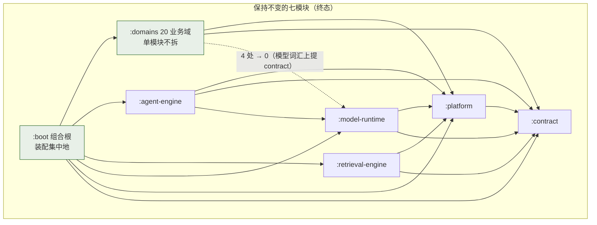

# 01 · 模块划分与整体架构评估报告（RagAgent）

- 评估人：高见远（首席架构师，MVP 开发专家团）
- 评估对象：/Users/billy/ragagent 七模块后端拓扑 + 前端目录形态 + docs/architecture 文档体系
- 评估性质：**只读存量评估**。未修改/删除任何现有代码、配置、文档；未执行任何 Gradle 构建；所有统计来自文件读取与 `scripts/` 下守卫脚本的实跑（纯 Python 静态分析）
- 评估日期：2026-10-20（所有计数为当日实测值）
- 配套报告：`03-backend-code-quality.md`（代码质量）、`04-frontend-architecture.md`（前端）

---

## 1. 结论摘要

### 整体 verdict：**conditional-pass（结构真实达标，扩展机制与文档计数有系统性欠账）**

一句话概括：**七模块单向依赖、契约层纯 JDK、域间只经契约这三条核心架构承诺不是文档口号，而是有守卫、有基线、有实测数据支撑的事实**——本次评估实跑 `check-module-graph.py` / `check-contract-purity.py` / `check-domain-contracts.py` 等守卫全部通过；真正的问题不在拓扑，而在**扩展注册机制四套并存**、**装配权分散**、**跨域实体渗漏**与**文档计数漂移**四类"结构性摩擦"。

### 量化总览（证据见 §2）

| 维度 | 判定 | 关键数据 |
|---|---|---|
| 七模块拓扑 / 依赖方向 | 合理 | 主码模块边 16 条全部在矩阵内；split package 0；跨模块重复 FQN 0 |
| 契约纯度 | 合理 | contract 353 文件，导入根/构建依赖/框架形状违例 0（C1/C2/C3 硬零） |
| domains 巨型单模块 | 合理（资产） | 1556 文件 / 20 域 / 51 控制器；域间边从基线 64 条收敛到 6 条（33 类），全部族内豁免且冻结 |
| 能力抽象（SPI/注册/装配） | **勉强** | 契约形状统一（7 族 SPI 均在 `:contract`），但注册机制 4 套并存；新增向量库要改 3+ 处硬编码 |
| 平台基础设施 | 合理（1 处后门） | 跨域实体渗漏 8 处（session → agentmanagement 实体）；装配类 19 个落在 domains 内 |
| 文档与代码一致性 | **勉强** | 结构文档（依赖图/包映射）准确；5 处计数漂移（27 vs 26、1349 vs 1433 等） |

### 最关键 5 个问题

1. **扩展注册机制四套并存，新增成本相差 3 倍以上**。LLM 用静态块双处注册 + 双目录；IM 用 boot 装配一行；websearch 用构造器 Map；**向量库与存储后端用 switch 工厂**（`EngineFactory.createFromStore` / `FileServiceFactory`）——新增一个向量库要改：新 Repository 类 + `EngineFactory` switch 分支 + `EngineTypes` 常量 + 同文件内的 SSRF 地址策略分支 + 前端映射（§2.3.3 走查共 7 处）。switch 工厂不可注入、不可测试替换，是七族中唯一没有"注册表"形态的。
2. **"组合根在 `:boot`"名不副实**：`domains` 内落着 19 个 `@Configuration`（其中约 10 个是真装配：`QaWiring`/`McpWiring`/`EmbedWiring`/`*RedisWiring` 等），RAG 管线的主装配 `QaWiring` 在 `domains/.../session/assembly/`。跨模块 Bean 的"去哪找"没有单一答案。
3. **跨域实体渗漏 8 处**：`session` 8 个文件直接 import `agentmanagement.domain.CustomAgentEntity`（含 `AgentResolver`、`SessionKnowledgeQaService`、`QaSupport` 等核心类）。域间契约棘轮（R10）允许族内直连，但**他域 ORM 实体进入本域公开 API 形状**属于持久层耦合，比服务依赖更难拆。
4. **文档计数漂移 5 处**：README/overview 称 "27 家 LLM"（实测 26）、"1,349 份金片"（实测 1,433）、`domains/build.gradle.kts` 注释称模型族 import "约 18 处"（实测 4）、overview 称 contract "23 个子包"（实测 24）、README "全部模块合计 51 个 HTTP 控制器"（实测 52 个 `@RestController`，含 platform 的 `/health` 探针）。`check-doc-truth.py` 只钉模块数/控制器数（业务口径）/package-info 覆盖三个数字，金片数、LLM 数、import 数无人看守。
5. **LLM provider 双目录**：运行时路由用 `model-runtime/.../ProviderRegistry`（静态块注册 26 家），HTTP 目录用 `domains/model/.../ModelProviderCatalog`（手写 26 条静态数据，由 golden 生成），两侧靠 `ProviderCatalogParityTest` 逐字段比对同步。一致性有测试兜底，但"新增一个 provider 要改两份手写清单"的成本真实存在，且 `Provider.validateConfig()` 目前**无生产调用点**（仅测试用）。

### 目标架构一句话概括

**保持七模块拓扑与 domains 单模块形态不变（有实证回退史支持），把"四套并行的扩展注册"收敛为统一的"类型→工厂注册表"协议、把 domains 内分散的装配回收或登记到组合根、清零跨域实体渗漏、给文档计数补自动化守卫。**

---

## 2. 现状评估（六问，每项带证据）

### 2.1 七模块拓扑评估 —— 合理（两处保留）

#### 2.1.1 依赖方向：文档声称与编译期事实一致

README（L80-97）与 `docs/architecture/overview.md`（L9-31）声称的依赖图，与 7 份 `build.gradle.kts` 逐条核对一致：

| 声称 | 构建文件实证 | 判定 |
|---|---|---|
| `:contract` 无依赖 | `contract/build.gradle.kts` 仅 testImplementation（JUnit/AssertJ），生产依赖块为空 | 一致 |
| `:platform → :contract` | `api(project(":contract"))` | 一致 |
| `:model-runtime → platform + contract` | `api(project(":platform"))` + `api(project(":contract"))` | 一致 |
| `:retrieval-engine → platform + contract`（对模型族出边 0） | 同左；注释记录"已把 VLM 客户端归位 model-runtime" | 一致 |
| `:agent-engine → platform + contract + model-runtime` | `implementation(project(":model-runtime"))`（注释：modelcontext 为合法终态边） | 一致 |
| `:domains → platform + contract + model-runtime` | `implementation(project(":model-runtime"))` 标注"过渡边" | 一致 |
| `:boot → 全部` | 6 个 `implementation(project(...))` | 一致 |

实跑 `scripts/check-module-graph.py`（判据 A~E，输出原文摘录）：

```
主码模块依赖（实测）：
  ✓ agent-engine     → contract           186 处
  ✓ agent-engine     → model-runtime        3 处
  ✓ agent-engine     → platform            52 处
  ✓ boot             → contract            10 处
  ✓ boot             → domains             37 处
  ✓ boot             → model-runtime        6 处
  ✓ boot             → platform            30 处
  ✓ boot             → retrieval-engine    19 处
  ✓ domains          → contract          1923 处
  ✓ domains          → model-runtime        4 处
  ✓ domains          → platform          1083 处
  ✓ model-runtime    → contract           182 处
  ✓ model-runtime    → platform            66 处
  ✓ platform         → contract           154 处
  ✓ retrieval-engine → contract            73 处
  ✓ retrieval-engine → platform            44 处
主码跨模块同名包：0 个（要求 0）
夹具包占用别模块主码包：0 个
跨模块重复 FQN：0 个
测试/夹具跨模块错位：10 个（登记 10 条，只许减）
✓ 模块图合规
```

注意 `domains → model-runtime 仅 4 处`（modelcontext 词汇），而 `domains/build.gradle.kts` 注释写"尚余约 18 处"——**注释已过期**（见 §2.5 反例 3）。域间能力消费已基本端口化（contract 1923 处 vs 模型实现 4 处）。

#### 2.1.2 契约纯度：实测成立，且是编译期+脚本双重保证

实跑 `scripts/check-contract-purity.py`：

```
✓ 契约层纯度：353 个文件，导入根 / 构建依赖 / 框架形状均为 0
```

判据 C1（只允许 `java.`/`javax.`/`com.ragagent.` 导入根）、C2（构建文件无生产依赖）、C3（无 Spring/MyBatis/JPA 注解形状）全部硬零。README"契约面纯 JDK……构建文件不声明任何依赖"的表述**基本准确但略过头**：`contract/build.gradle.kts` 实际有一个 `dependencies {}` 块，但只有 `testImplementation`/`testRuntimeOnly`（C2 明确豁免测试面）。contract 下辖 24 个子包（agent/apikey/audit/auth/doc/error/event/graph/json/knowledge/memory/model/pagination/pipeline/retrieval/session/settings/storage/tenant/text/tool/vectorstore/websearch/wiki），overview.md 写"23 个子包"（漂移 1 个，见 §2.5）。

#### 2.1.3 domains 巨型模块（1556 文件/20 域/51 控制器）：**是资产，不是债务**

判据一：**域间隔离有棘轮实证**。`check-domain-contracts.py --list` 实测：

```
域→域边 6 条（基线 6 条）· 三档进度：
  ① clearable      0 条 /    0 类   ← 目标 0（A③ 主线）
  ② owner          0 条 /    0 类
  ③ intra-family   6 条 /   33 类   ← 族内豁免+冻结
```

脚本 docstring 记录立规时是 **64 条边 / 约 500 处引用**（session→knowledge 53、agenttools→agent 114……），现收敛到 6 条边/33 类，且 clearable 档已清零、剩余全部是登记的族内边。这是"单模块内 20 个域"仍保持边界的最硬证据。

判据二：**拆分收益已被实证检验为负**。git 史（`git log -- settings.gradle.kts`）显示模块拓扑经历过完整的"拆—合"周期：

```
cb3eb973d refactor(module): 拆出 :knowledge 模块（L19）
953815f29 refactor(module): 回退 :knowledge 合回 domains
```

回退提交（953815f29，2026-10-18，即本次评估前 2 天）的理由原文：

> 拆分只带来「独立编译」，知识库代码仍分散在 knowledge/retrieval/contract/platform 四处；11 个知识相关 Port 本就在跨域，收益小于「知识库到底在哪」的认知成本

同时 git 史还记录了 `:common` 完全解散（4bed090c4，125→0）、`:engine` 解散（3ecf29af2）、`:model-runtime`/`:retrieval-engine`/`:agent-engine` 依次切出（c160b7498/8b0b37821/e69c99c90）——**这个团队已经用多轮模块拆合的代价实践出了"能力族拆模块、业务域留单模块"的结论**，本次评估的独立判断与之一致。

判据三：**单构建文件的成本真实但可管理**。20 域共用一个 `build.gradle.kts`：全量测试约 214s（domains 构建文件注释实测记录，4 fork 并行）、任何一域的改动都触发 domains 全模块测试。这是 domains 单模块的真实成本，但对比拆模块要付出的 20 份构建样板（build-logic 已收敛 toolchain/Spotless/BOM，仍剩依赖声明）、48 份契约测试（实测 `*ContractTest.java`；contract 构建注释称 49，又一处漂移）的归属迁移、10 处已登记错位测试的二次登记——成本明显更低。

**保留意见（两处）**：

1. **`boot → agent-engine` 主码引用为 0**（guard 输出："boot → agent-engine 0 处（矩阵已声明，当前无引用）"）。agent-engine 的 Bean 全靠 `RagAgentApplication` 的 `@SpringBootApplication` 根包组件扫描（`com.ragagent`）隐式发现——**编译期模块图看不见运行期装配图**。好处是 domains→agent-engine 主码零依赖（55 个消费文件全部走 `contract.agent` 端口，构建注释实录），坏处是"agent 引擎的 Bean 从哪来"在静态代码里没有答案，只能靠运行期扫描。这是有意的端口化代价，但应作为已知机制登记（overview.md L46 "实现由 :boot 注入"在此处不成立）。
2. **`@ConfigurationPropertiesScan` 显式枚举**（`RagAgentApplication` L18-27）12 个包，注释明确"别写 com.ragagent 根包扫描，那会把 session 等处未注册的配置类一并绑定"——说明团队对隐式扫描风险有认知并已局部收口，但组件扫描本身仍是宽口的。

### 2.2 domains 是否该拆 —— 不建议拆；当前形态是该仓库的最优解

**结论：不拆。** 除 §2.1.3 的实证外，补充判据：

1. **现成的有界上下文已经存在且被守卫承认**。`scripts/domain-contracts.baseline.json` 的族定义就是天然拆分边界：
   - `agent-runtime`：agentmanagement / agenttools / memory / session
   - `identity`：agentmanagement / auth / system
   - `knowledge`：knowledge / wiki
   若未来真要拆模块，按此三族（+ 剩余 14 个独立域）是最小惊讶边界——但注意 agentmanagement 横跨两族，说明**域与族不是正交划分**，拆模块必然产生新的跨模块边。
2. **剩余 6 条边全部是双向耦合对**：`knowledge ↔ wiki`（互相调用落页/再摄取）、`session → {agentmanagement, agenttools, memory}`。拆出任一域都会把边变成跨模块边，而跨模块边必须提高到 `:contract` 端口——wiki/knowledge 这对双向边需要两个端口，正是回退提交说的"11 个知识相关 Port 本就在跨域"的困境。
3. **不拆的补偿机制（现状已全部在位）**：
   - R10 三档棘轮（clearable 目标 0 / owner 登记允许 / intra-family 冻结），新增边即红；
   - `check-capability-kinds.py`：20 域 / 0 条跨 kind 直连（实测通过）；
   - `check-package-size.py`：无 >30 文件的包，最大包 `session/service` 26 个文件（警戒未红）；
   - `check-controller-purity.py`：HTTP 面只编排，禁直连 Mapper；
   - `check-package-cycles.py`：环 0、间接环 0、包级 SCC 5 组（基线 5，棘轮）；
   - 每域 `package-info.java` 四要素（种类/入口/契约面/依赖），由 `check-package-info-fields.py` 守卫。
   
   这套组合的实质是：**用棘轮 + 元数据把"单模块内的多域"当作准模块管理**。隔离缺失的代价（一处改动波及全模块的测试与扫描）由 CI 并行度（4 fork）和测试自含性（H2/桩，无 Testcontainers）对冲。

### 2.3 能力抽象评估 —— 勉强：契约形状统一，注册/装配机制四套并存

#### 2.3.1 SPI 形状（contract 面）：统一且干净

七族能力的 SPI 全部沉在 `:contract`，这是重大优点：

| 能力族 | SPI（contract） | 数量（实测） |
|---|---|---|
| LLM/Embedding/Rerank | `contract.model.LlmChatClient` / `Embedder` / `Reranker` | 26 家 provider |
| 向量/检索引擎 | `contract.vectorstore.*` + `RetrieveEngineService` | 9 种引擎 |
| Agent 工具 | `contract.tool.AgentTool` / `BaseTool` | 22 个域侧工具 + 3 内置 + MCP 外部 |
| 存储后端 | `contract.storage.*` + `FileService` | 8 种 provider |
| 网页搜索 | `contract.websearch.*` + `WebSearchProvider` | 13 家 |
| IM 渠道 | `ImTurnOrchestrator.AdapterFactory`（域内接口，经 runtime 包） | 9 渠道 / 10 平台注册 |
| 数据源连接器 | `Connector`（type() + 同步能力） | 9 个实现（目录 17 条，8 条规划中，known-gaps.md §5 如实登记） |
| 技能 | `contract.agent.SkillCatalogPort` | 三级注入（SKILL.md） |

`BaseTool` 的四方法设计（name/description/parameters/execute，参数 schema 为纯 JDK JSON 值）与"工具出错不抛异常、返回 `ToolResult(success=false)`"的错误通道约定，是经过思考的契约。

#### 2.3.2 注册与装配：四套机制并存（核心问题）

| 能力族 | 注册机制 | 新增要改的文件 | 一致性评价 |
|---|---|---|---|
| LLM provider | **静态块**双处手改（`ProviderRegistry` 静态块 + `allProviders()`）+ domains 侧第二目录 `ModelProviderCatalog` | 新 Provider 类 + ProviderRegistry 2 处 + ModelProviderCatalog 1 处 + 前端映射；parity test 强制同步 | 差：两份手写清单 |
| websearch | 构造器 Map（`WebSearchProviderRegistry` 构造函数 `factories.put`） | 新 Provider 类 + 注册表构造器 1 行 | 中：单点但硬编码 |
| IM 渠道 | **boot 装配**（`ImAdapterWiringConfig.registerAdapterFactory` 每平台一行）+ `ImTypes` 常量 | 新渠道包（Adapter+Factory+Client）+ boot 装配 1 行 + ImTypes 常量 | 好：注册表形态，集中可见 |
| 向量引擎 | **switch 工厂**（`EngineFactory.createFromStore` 按 engineType switch，同文件内还有 SSRF 地址策略 switch 分支） | 新 Repository 类 + EngineFactory switch 分支 + SSRF 策略分支 + EngineTypes 常量 + 前端映射 | **最差：无注册表、静态不可注入** |
| 存储后端 | **switch 工厂**（`FileServiceFactory`）+ `IMPLEMENTED` Set | 新 FileService 类 + switch 分支 + IMPLEMENTED 集合 | 差 |
| 数据源连接器 | 注册表（`ConnectorRegistry`，装配期填充，`DataSourceWiring` 逐个 register）+ 静态元数据目录（`ConnectorCatalog` 17 条） | 新 Connector 类 + DataSourceWiring 1 行 + ConnectorCatalog 元数据（若要对前端可见） | 中：注册表好，元数据双维护 |
| Agent 工具 | 请求级装配（`AgentEngineRequest.tools()`，由 `session/.../AgentToolBackends` 逐轮 `new` 22 个工具）+ 内置 3 个（`AgentEngineFactoryImpl`） | 新工具类 + AgentToolBackends 1 行 | 好：契约驱动，但装配类是显式 new 长清单 |

#### 2.3.3 试金石：新增一个向量库要动多少地方

以"新增一个 Qdrant 之外的向量库（如 `chroma`）"为例，走查 `EngineFactory`：

1. `retrieval-engine/.../engine/chroma/ChromaRetrieveRepository.java`（新，~600 行量级，参考 `TencentVectorDbRetrieveRepository` 649 行）；
2. `retrieval-engine/.../engine/EngineFactory.java`：`createFromStore` 的 switch 加 `case` 分支；
3. 同文件 `validateRuntimeVectorStoreAddresses`：SSRF 地址策略加该类型的校验分支（漏加则报 `vector store engine "chroma" has no SSRF address policy`——**这是安全相关分支，漏改即安全口径不一致**）；
4. `EngineTypes` 常量；
5. `domains/vectorstore` 的配置校验/连通性探测；
6. 前端引擎下拉映射；
7. `RetrievalEngineWiringConfig`（boot）env-store 注册（如支持 `RETRIEVE_DRIVER=chroma`）。

对比"新增一个 IM 渠道"：新渠道包 + `ImAdapterWiringConfig` 一行 + `ImTypes` 常量。**两者工作量差 3 倍以上，且向量库路径触碰安全策略文件**。结论：扩展成本不均的根因是注册机制没有统一协议，而非契约缺失。

#### 2.3.4 细节问题

- `Provider.validateConfig()` 无生产调用点（Provider.java 注释自述"当前 ValidateConfig 尚无生产调用点（仅测试）"）——SPI 上有死面。
- `ConnectorCatalog` 17 条目录 vs 9 个实现：前端展示"即将支持"是有意设计（known-gaps.md §5 登记），但"目录可见、创建失败"的体验依赖前端对 `implemented` 标记的处理，属可接受的产品取舍。

### 2.4 平台基础设施评估 —— 合理（一处后门、两处分散）

#### 2.4.1 事件总线 / SSE / 租户上下文：端口化到位

- **事件总线**：消费方经 `contract.event.EventBusInterface` 接口持有（`EventBusAdapter` 做 `EventBus→Interface` 适配），实测 `import com.ragagent.platform.event.EventBus` 的直接引用仅 agent-engine 1 处；`GlobalEventBus` 静态门面**主码 0 调用点**（遗留/测试路径，未构成隐藏边）。事件流在编译图可见——这是好的。
- **SSE 流管理**：`platform/stream` 包 Memory/Redis 双后端（`MemoryStreamManager`/`RedisStreamManager`），session 17 个文件经端口消费。
- **租户上下文**：`TenantContext`（ThreadLocal）+ `TenantScope` 显式快照/恢复，`check-tenant-scope.py` 硬零两条判据（禁裸 `.replay()`；capture 必须伴 `TenantScope.`）；21 个 domains 文件使用 TenantScope。虚拟线程不继承 ThreadLocal 的坑在 `mechanisms.md` §6 有如实记录。
- **审计/审批**：audit 经 `AuditWriteAdapter`（api 端口）写入、三条独立游标流只追加（README 声称）；approval 的 `Gate`/`ToolApprovalGateFactoryImpl` 实现 `contract.tool.ToolApprovalGateFactory`，高危工具人工闸门经契约面接入。

#### 2.4.2 隐藏耦合与绕行边界的证据（3 类）

1. **跨域实体渗漏（最实质）**：8 处 `session → agentmanagement.domain.CustomAgentEntity` 的实体层 import：
   ```
   session::AgentResolver.java            -> agentmanagement.domain.CustomAgentEntity
   session::SessionKnowledgeQaService.java -> agentmanagement.domain.CustomAgentEntity
   session::QaSupport.java                -> agentmanagement.domain.CustomAgentEntity
   session::QaRequestParser.java          -> agentmanagement.domain.CustomAgentEntity
   session::SessionQaResolution.java      -> agentmanagement.domain.CustomAgentEntity
   session::QaMentionTagScope.java        -> agentmanagement.domain.CustomAgentEntity
   session::QaKbScope.java                -> agentmanagement.domain.CustomAgentEntity
   session::QaChatManageOverrides.java    -> agentmanagement.domain.CustomAgentEntity
   ```
   `AgentResolver.ResolvedAgent` 记录把 `CustomAgentEntity`（他域 ORM 实体）放进了本域公开返回形状。R10 族内豁免允许服务依赖，但**实体泄漏是持久层耦合**，且 `ResolvedAgent` 还带着 `sharedAgentReadOnly` 恒 false 的裁撤残留字段（跨租户分享已移除，known-gaps.md §1）。
   好消息：**没有发现跨域 repository/mapper/controller import**（同一扫描下 0 处）——持久层后门不存在，只有实体形状泄漏。
2. **域间环被族内豁免放行**：`knowledge → wiki` 与 `wiki → knowledge` 双向边同时存在（知识处理完成触发 wiki 落页；wiki 摄取读 chunk）。包级 SCC 守卫的 5 组基线即包含此类；族内豁免是有意设计，但意味着"knowledge 与 wiki 实际是一个域"——拆模块时必须一起拆。
3. **装配权分散**：domains 内 19 个 `@Configuration`，其中约 10 个是真装配（`session/assembly/QaWiring`、`mcp/McpWiring`、`mcp/oauth/wiring/McpOAuthWiring`、`embedchannel/EmbedWiring`、`knowledge/task/KnowledgeRedisWiring`、`memory/runtime/MemoryTaskQueueWiring`、`datasource/config/DataSourceWiring`、`datasource/task/DataSourceTaskQueueWiring`、`wiki/WikiRedisWiring`、`storage/fileserve/StorageUrlWiringConfig`），其余为 `@ConfigurationProperties` 类（由 `RagAgentApplication` 的 `@ConfigurationPropertiesScan` 显式枚举覆盖）。overview.md 声称"跨模块 Bean / 端口实现 → `boot/.../config/`"（L60）与实际不符：`QaWiring` 装配了 12 个契约端口/客户端（22 处 contract import：ModelRuntime/LlmChatClient/HybridSearchPort/PipelinePorts/TenantConfigLookup/PipelinePageFetcher/EntityExtractionPort/KnowledgeCatalogPort/ModelCatalogPort/Reranker/RetrieveGraphRepository/KnowledgeProjectionAdapter）却住在 domains。
   未发现 `ApplicationContextAware` / 静态 ServiceLocator / 静态 SpringContext holder（扫描 7 模块主码 0 处）——没有"最坏形态"的隐藏全局态。

### 2.5 文档与代码一致性 —— 勉强：结构文档准，计数漂移

**正例（文档说得比代码保守，或与代码互相锚定）**：

1. **模块依赖图逐条属实**。README L80-87 与 overview.md L9-31 的七模块依赖图，与 7 份 build 文件、guard 实测矩阵完全一致（§2.1.1 表）。
2. **反直觉清单与代码相符**。`mechanisms.md` §4 声称"全仓 0 处 `@Scheduled`"——实测 domains/platform/agent-engine 主码 grep 为空，定时行为确由自建调度（`datasource/task/Scheduler.java`）+ 队列驱动承担；§3"embedding 两条路径"（`EmbedderClient` 直连 vs `EmbedderFactory` 引擎口）在代码中均属实。§5"session 域 0 事务"与 `QaTurnFinalizer` 手工补偿相符。
3. **生成式文档有守卫同步**。`packages.md`/`module-package-map.md`/`domain-index.md`/`port-map.md`/`pipeline-map.md` 全部由 `gen-*.py --check` 守卫与源码同步（run-guards.sh L46-61），本次实跑 `gen-arch-index --check`、`gen-module-map --check` 等通过。

**反例（5 处计数漂移）**：

| # | 文档声称 | 实测 | 位置 |
|---|---|---|---|
| 1 | "27 家 LLM 提供商" | 26（`ProviderRegistry` 静态块 26 个 register + `ModelProviderCatalog` 26 条 ENTRIES，两侧一致） | README L55、overview.md L37、model-runtime 构建注释 |
| 2 | "1,349 份逐字节钉死的 HTTP 响应样本" | 1,433 个金片文件（domains/testFixtures 1,432 + retrieval-engine/test 1）；contract 构建注释称 1,426 | README L270 |
| 3 | "domains 尚余约 18 处对模型族实现面的 import" | 4 处（guard 实测 domains→model-runtime 主码 4） | domains/build.gradle.kts 注释 |
| 4 | "contract.*（23 个子包）" | 24 个含 package-info 的子包 | overview.md L35 |
| 5 | "全部模块合计 51 个 HTTP 控制器" | 52 个 `@RestController`（domains 51 + platform HealthController 1） | README L99 |

其中 #5 有可辩护理由（`check-doc-truth.py` 注释明示"只数业务控制器：/health 是基础设施探针"），但 README 行文是"全部模块合计"，措辞与守卫口径不一致；#1/#2 属于**没有任何守卫看守的数字**；#3 属于重构推进后注释未同步（`check-comment-narrative.py` 只棘轮"注释不写迁移史"，不校验计数）。

---

## 3. 问题根因

1. **机制演化史决定注册风格**。仓库从 Go 工程（大量参考 Tencent/WeKnora）迁移而来，能力族按"当时顺手"定型：IM/websearch 后期建设的域用了注册表，向量库/存储沿用 Go 时代 switch 工厂，LLM 因"运行时路由 + HTTP golden 目录"两个关注点分裂成双清单。**契约层（形状）被系统性重构过（R 批次），注册层（机制）没有**。
2. **棘轮守卫保结构不保计数**。42 个守卫里 30+ 个是"只许减不许增"的结构棘轮，效果显著（域间边 64→6、包级 SCC 冻结）；但数字型事实只有 `check-doc-truth.py` 钉 3 个，且刻意收窄口径。计数漂移因此系统性发生。
3. **端口化把"依赖"推到了运行期，静态图盲区扩大**。domains→agent-engine 主码 0 边、boot→agent-engine 主码 0 边、agent-engine 靠根包扫描装配——这是端口化的成功，也是"编译图≠运行图"的来源。团队用 `@ConfigurationPropertiesScan` 显式枚举局部收口，但没有把"隐式扫描面"本身作为架构事实登记和守卫。

---

## 4. 目标架构方案

### 4.1 目标拓扑（mermaid）



### 4.2 终态要办成的五件事

| # | 事项 | 终态判据（可验证） |
|---|---|---|
| T1 | **统一扩展注册协议**：所有能力族收敛为"类型 → 工厂注册表"（IM/websearch 现有形态），switch 工厂（向量库/存储）改造为注册表 + 保留地址/SSRF 策略表 | 新增任一能力的改动点 = 1 个实现类 + 1 行注册；无 switch-on-type-string 的工厂 |
| T2 | **装配权集中或登记**：domains 内 10 个真 wiring 要么上移 boot，要么在 overview.md 登记为"域内装配点"并加守卫清单 | "跨模块 Bean 去哪找"有单一权威答案；`QaWiring` 归属有明确决策 |
| T3 | **跨域实体渗漏清零**：`CustomAgentEntity` 以 contract 投影（如 `AgentConfigView`）替代，8 处 import 归零 | `check-domain-contracts.py` 增加"禁跨域 import `.domain.` 实体"判据，基线 8 → 0 |
| T4 | **文档计数自动化**：金片数、LLM 数、契约测试数、控制器总数（含探针）进 `check-doc-truth.py` | README 五个漂移数字全部有守卫；注释计数由脚本生成或删除 |
| T5 | **LLM 双目录合并或单源化**：`ModelProviderCatalog` 静态数据由 `ProviderRegistry` 元数据生成（或反之），`ProviderCatalogParityTest` 退役 | 新增 provider 只改一处；parity test 转为"生成物新鲜度"检查 |

### 4.3 明确不做（out-of-scope）

- 不拆 domains（§2.2 实证）；
- 不引入微服务/远程模块边界（MVP 后规模不需要，部署成本否决）；
- 不重构 contract 的 24 子包划分（现状健康，`check-contract-shape.py` 端口预算已达标：端口 ≤7 方法、字段 ≤20）；
- 不动前端架构（归 04 号报告）。

---

## 5. ADR（架构决策记录）

每条按 MADR 格式，存入 `docs/decisions/`。

### ADR-001: 保持七模块拓扑，domains 维持单模块

- **Status**: Accepted（本次评估确认既有事实）
- **Background**: domains 1556 文件/20 域/51 控制器单模块，曾被质疑应拆。git 史显示 `:knowledge` 模块拆分后已回退（953815f29，理由：拆分只带来独立编译、知识代码分散在 4 处、收益小于认知成本）。
- **Decision**: 不拆。模块边界继续按"能力族"（contract/platform/model-runtime/retrieval-engine/agent-engine）而非"业务域"划分；域间隔离由 R10 三档棘轮 + capability-kinds + package-size 棘轮在单模块内维持。
- **Consequences**: 正面——避免 20 份构建样板与端口化成本，契约/装配/测试归属零迁移；负面——单模块全量测试（214s）与组件扫描面无法按域收窄，域增多到 ~30 个时需重审（触发条件：域数或 domains 主码文件数 ×1.5）。
- **Related ADRs**: ADR-002、ADR-003

### ADR-002: 扩展注册统一为"类型→工厂注册表"协议

- **Status**: Proposed
- **Background**: 七族能力四套注册机制并存（§2.3.2），向量库/存储的 switch 工厂新增成本最高且 SSRF 策略分支与工厂耦合在同一文件。
- **Decision**: 制定统一协议：`interface CapabilityFactory<T> { T create(Config); }` + `class CapabilityRegistry<T> { void register(String type, CapabilityFactory<T> f); T create(String type, Config); }`（形态参照现有 `WebSearchProviderRegistry` 与 `ConnectorRegistry`）。向量库/存储的 switch 工厂先行改造，SSRF/地址策略拆为独立的 `AddressPolicy` 表按类型注册。LLM provider 的静态块保留（26 家、无配置态创建需求），但 `allProviders()` 与静态块合并为单一数据源。
- **Consequences**: 正面——新增能力成本对齐（1 类 + 1 行）；注册表可注入、可测试替换；SSRF 策略漏改从"静默不一致"变为"注册即绑定"。负面——改造触及 9 个引擎 + 8 个存储的构造路径，需金片与集成测试护航；`EngineFactory` 的"postgres 明确指引式异常"等历史语义需逐条迁移。
- **Related ADRs**: ADR-001

### ADR-003: 装配权集中或显式登记

- **Status**: Proposed
- **Background**: domains 内 10 个真 wiring（`QaWiring` 等）与 boot/config 11 个并存，"组合根"事实分裂；同时 agent-engine 依赖根包组件扫描（boot→agent-engine 主码 0 边）。
- **Decision**: 分两步：(a) 在 overview.md 增设"装配点清单"节，把 domains 内 wiring 逐个登记（域内装配 vs 跨模块装配分类），并加守卫校验清单完整性；(b) 后续迭代将跨模块装配（`QaWiring` 装配 12 个契约端口）上移 boot/config，域内装配（Redis 双实现选择）留在域内。组件扫描面在 RagAgentApplication 注释中显式登记为已知机制。
- **Consequences**: 正面——"Bean 从哪来"可静态回答；负面——`QaWiring` 上移会产生 boot→domains 的更多实现面 import（boot 已依赖 domains，方向合法），需评估 boot 膨胀（现 19 文件）。
- **Related ADRs**: ADR-001

### ADR-004: 跨域实体渗漏清零（session → agentmanagement 实体）

- **Status**: Proposed
- **Background**: 8 处 session 文件 import `agentmanagement.domain.CustomAgentEntity`，他域 ORM 实体进入本域 API 形状（`AgentResolver.ResolvedAgent`），并带 `sharedAgentReadOnly` 恒 false 的裁撤残留字段。
- **Decision**: 在 `:contract` 增 `agent` 投影类型（如 `AgentConfigView`：id/名称/配置/允许工具名），`AgentResolver` 等 8 处改持投影；`check-domain-contracts.py` 增加判据"跨域 import 不得以 `.domain.` 结尾（实体层）"，基线 8 条、棘轮下降。
- **Consequences**: 正面——持久层耦合清零，域边界从"服务级"升到"形状级"；负面——投影字段与实体字段的映射维护成本；`CustomAgentEntity` 的懒加载/级联特性（如有）不可再跨域使用（实测确认无 repository 跨域引用，风险低）。
- **Related ADRs**: ADR-001

### ADR-005: 文档计数守卫扩展

- **Status**: Proposed
- **Background**: 5 处计数漂移（§2.5），根因是 `check-doc-truth.py` 只钉 3 个数字。
- **Decision**: 扩展判据：D4 金片文件数 ↔ README"契约金片"句；D5 LLM provider 数（ProviderRegistry 实测）↔ README/overview；D6 控制器总数含探针口径二选一（改 README 措辞为"51 个业务控制器 + 1 个健康探针"或改守卫计数口径）；构建文件注释中的计数改为引用 guard 输出或删除。
- **Consequences**: 正面——漂移即时红；负面——金片数随契约录制自然增长，README 句子要么改为范围表述（"1,400+ 份"），要么由守卫反向生成（选前者，低成本）。
- **Related ADRs**: 无

### ADR-006: LLM provider 目录单源化

- **Status**: Proposed（低优先级）
- **Background**: `ProviderRegistry`（运行时）与 `ModelProviderCatalog`（HTTP 目录）双清单，靠 `ProviderCatalogParityTest` 同步；26 vs 文档 27。
- **Decision**: `ModelProviderCatalog` 的 ENTRIES 改由构建期从 `ProviderRegistry` 元数据生成（或测试期生成后比对 golden），消灭手写第二份；`Provider.validateConfig()` 要么接入生产校验路径（模型保存时），要么从 SPI 删除。
- **Consequences**: 正面——新增 provider 一处改动；`validateConfig` 死面消除。负面——golden `contracts/model-providers.json` 与生成管的衔接需一次性重建；收益中等，排在 T1-T4 之后。
- **Related ADRs**: ADR-002、ADR-005

---

## 6. 分阶段迁移路径

总闸门（每个阶段共用）：**42 守卫全绿 + 契约金片 0 意外重录（改动响应形状必须显式重录并双人复核）+ 5022 条测试 0 失败 + spotlessCheck 通过**。51 控制器/1433 金片/5000 测试不受损的机制：所有重构阶段遵循"先加后移、金片只增不改、守卫棘轮只降不升"，任何阶段回滚 = `git revert` 单次提交（提交粒度保持可回滚，README 贡献指南第 1 条已要求）。

### Phase 0：文档计数对齐（零代码风险）

- **动作**：按 ADR-005 修正 README/overview 五处计数（27→26、金片改"1,400+ 份"、控制器措辞、contract 子包 24、domains 构建注释 18→4 或删除该计数）；扩展 `check-doc-truth.py` 增加 D4/D5/D6。
- **收益**：文档可信度恢复；新人不再被过期数字误导。
- **风险**：极低。D5 判据若 LLM 数再变会误红——措辞用"26 家（实测口径见 scripts）"。
- **回滚点**：文档单次提交 revert；守卫脚本单次提交 revert。
- **前置条件**：无。

### Phase 1：扩展注册统一（ADR-002，先存储+向量库两族）

- **动作**：(a) 在 `:platform` 或各能力模块新增 `CapabilityRegistry` 通用件；(b) `FileServiceFactory` 的 switch 改为注册表 + `IMPLEMENTED` 集合退役；(c) `EngineFactory.createFromStore` 的引擎 switch 与 SSRF 地址策略拆为两张注册表，`postgres` 的"明确指引异常"保留为注册表特殊条目；(d) IM/websearch/连接器三族保持现状（已是注册表），仅补 `package-info` 说明统一协议。
- **收益**：新增存储/向量库成本从 4-7 处降到 2 处；SSRF 策略与引擎实现绑定注册，消除漏改。
- **风险**：中。引擎构造路径被 1433 份金片中的连通性探测/错误文案钉住（如 `unsupported engine type: <t>`、`vector store engine "<t>" has no SSRF address policy`）——**错误文案必须逐字保留**，改造时以金片为回归。
- **回滚点**：每族一个提交；`EngineFactory` 旧实现保留至新注册表金片全绿后再删（两并存期不超过一个迭代）。
- **前置条件**：Phase 0 完成（避免新旧注释双重漂移）；`RetrieveEngineFactories` 的租户归属校验语义（纵深防御）在迁移中逐条对拍。

### Phase 2：装配权与实体渗漏（ADR-003 + ADR-004）

- **动作**：(a) overview.md 增设"装配点清单"，10 个 domains 内 wiring 逐个登记分类，加守卫校验；(b) contract 增 `AgentConfigView` 投影，8 处 session 实体 import 归零，`check-domain-contracts.py` 加"禁跨域实体 import"判据（基线 8 棘轮降）；(c) `QaWiring` 上移 boot 评估（可选，若 boot 文件数 <40 则移）。
- **收益**：跨域形状级隔离；"Bean 从哪来"可静态回答。
- **风险**：中。投影替换可能触碰 session 的 agent 配置读取路径（8 文件 + AgentToolBackends），需契约金片中 agent 相关响应零变化背书；`QaWiring` 上移涉及 12 个端口的装配顺序，回滚成本高——**建议本阶段只做 (a)(b)**，(c) 单独评估。
- **回滚点**：(a)(b) 按文件域分批 revert；(c) 独立提交。
- **前置条件**：Phase 1 金片全绿；`AgentResolver` 的 `sharedAgentReadOnly` 残留字段同批清理（行为已恒 false，无金片风险）。

### Phase 3：LLM 双目录合并与 SPI 死面清理（ADR-006）

- **动作**：`ModelProviderCatalog` 静态 ENTRIES 改为从 `ProviderRegistry` 元数据生成；`ProviderCatalogParityTest` 转为"生成物新鲜度"断言或退役；`Provider.validateConfig()` 接入模型保存校验或删除。
- **收益**：新增 LLM provider 一处改动；SPI 无死面。
- **风险**：低-中。`contracts/model-providers.json` golden 与生成管的衔接需一次性对拍；前端下拉顺序依赖目录声明序（`ConnectorCatalog` 同款确定性排序教训），生成必须保序。
- **回滚点**：单次提交 revert；golden 不动。
- **前置条件**：Phase 0 的 D5 判据在位（防止合并后再漂移）。

---

## 7. 风险登记

| # | 风险 | 概率 | 影响 | 缓解 |
|---|---|---|---|---|
| R1 | Phase 1 引擎工厂改造触碰 SSRF 分支，漏迁导致安全口径不一致 | 中 | 高（安全） | SSRF 策略表与引擎实现同条注册；`check-exception-semantics.py` 现有"边界失败即抛"判据护航；金片错误文案逐字回归 |
| R2 | Phase 2 投影替换改变 session 读 agent 配置的时序/懒加载行为 | 中 | 中 | 先加投影双跑（影子读）再切换；金片零变化为闸门 |
| R3 | 域数继续增长（20→30+）后单模块测试时长与扫描面恶化 | 低（1-2 年） | 中 | ADR-001 已设重审触发条件（域数或 domains 文件 ×1.5）；届时按 family 拆（边界已在 baseline 定义） |
| R4 | 组件扫描隐式装配在 Bean 名冲突时静默失败 | 低 | 中 | Phase 2 (a) 登记装配点；ArchUnit 已有"禁双装配"规则（CI 注释记录） |
| R5 | 文档守卫扩展后，合法变更被误红（如金片数增长） | 中 | 低 | 判据用范围表述或脚本生成，不用精确等式（金片数） |
| R6 | 评估结论被用作"架构已经很好，停止投入"的借口 | 中 | 高（流程） | 本报告的 conditional-pass 明确指向 5 项待办；Phase 0-3 是投入清单不是免责声明 |

---

## 附：证据索引（本次实跑/实测）

| 证据 | 来源 |
|---|---|
| 模块依赖实测矩阵 | `python3 scripts/check-module-graph.py`（2026-10-20，退出 0） |
| 契约纯度 | `python3 scripts/check-contract-purity.py`（353 文件 0 违例） |
| 域间边三档 | `python3 scripts/check-domain-contracts.py --list`（6 边/33 类，① ② 档为 0） |
| 包环/SCC | `python3 scripts/check-package-cycles.py`（环 0，SCC 5 组基线未变） |
| 端口预算/包规模/能力种类/文档事实 | `check-port-budget.py` / `check-package-size.py` / `check-capability-kinds.py` / `check-doc-truth.py`（均通过） |
| knowledge 模块拆分回退 | git commits cb3eb973d → 953815f29（2026-10-18） |
| 跨域实体渗漏 8 处 | 脚本扫描 domains 20 域 import（本报告 §2.4.2） |
| 注册机制形态 | `ProviderRegistry.java` / `WebSearchProviderRegistry.java` / `EngineFactory.java` / `FileServiceFactory.java` / `ImAdapterWiringConfig.java` / `ConnectorRegistry.java` / `AgentToolBackends.java` |
| 计数漂移 | README L55/L99/L270、overview.md L35/L37、domains/build.gradle.kts 注释 vs 实测 |

*本报告为只读评估产物，未修改仓库任何现有文件。*
